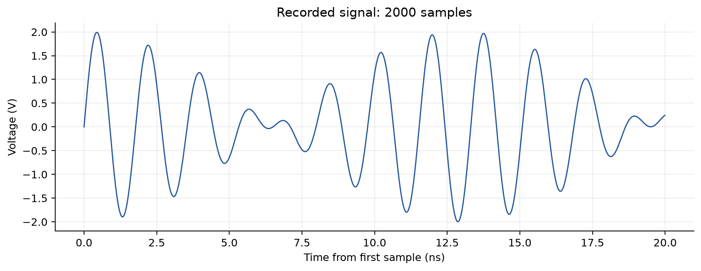
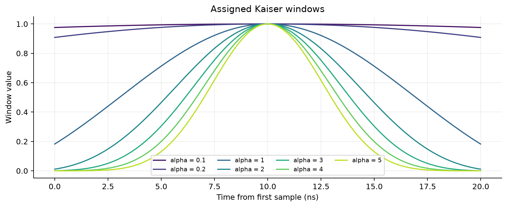
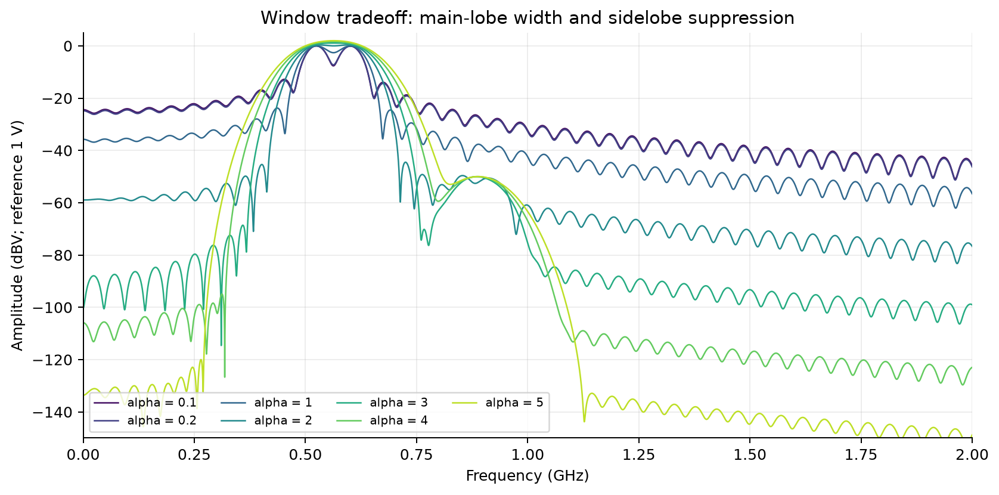
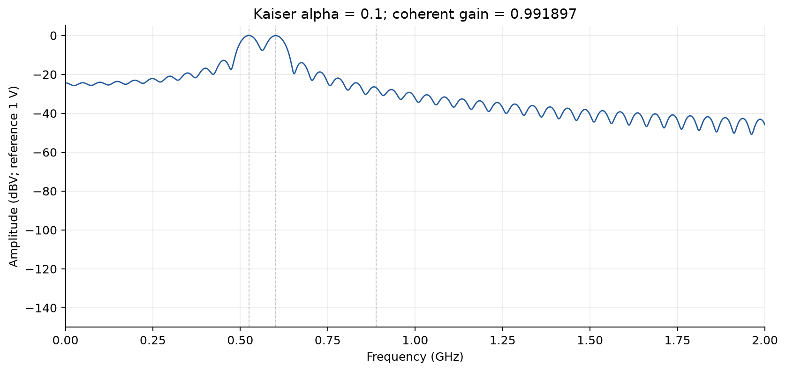
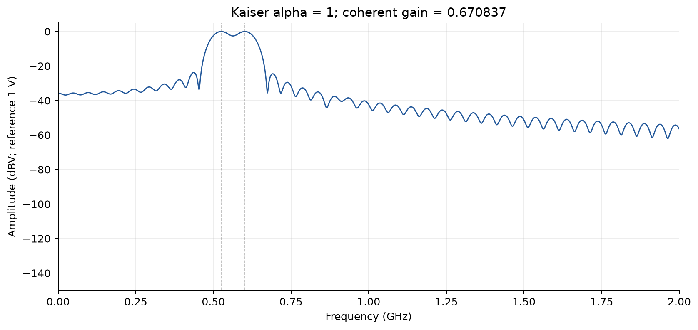
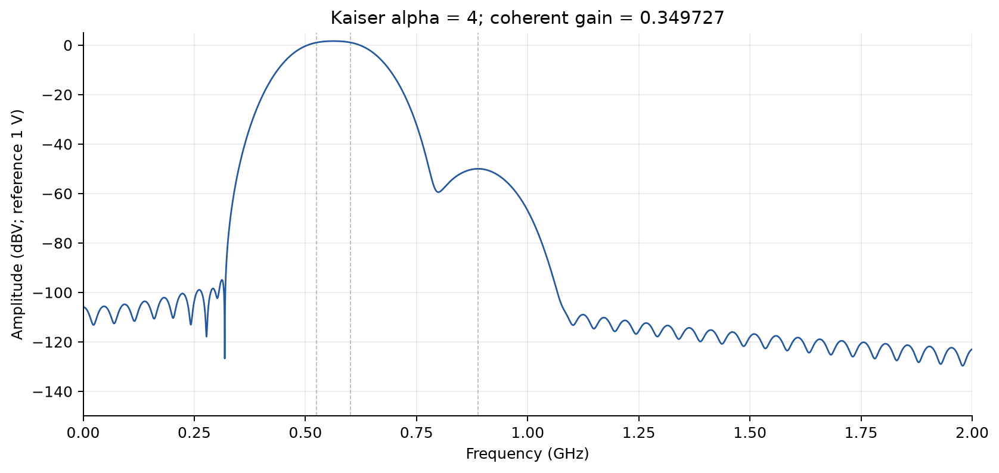
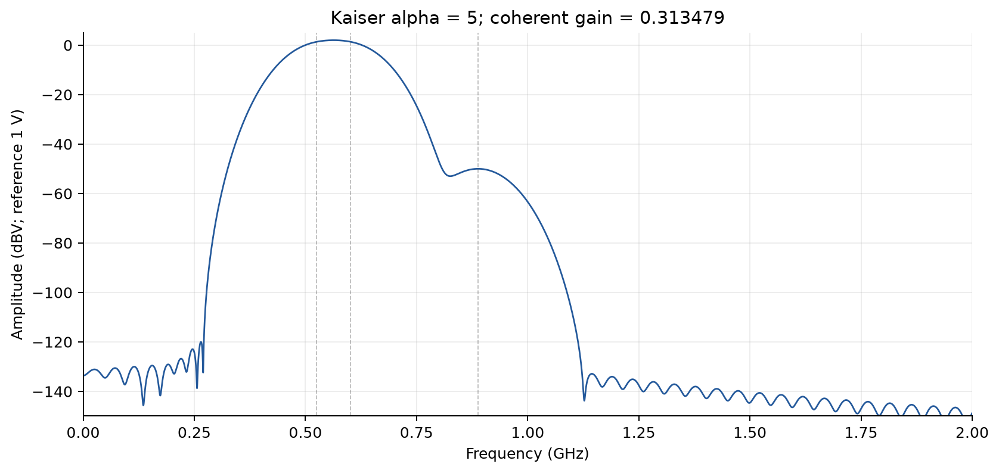
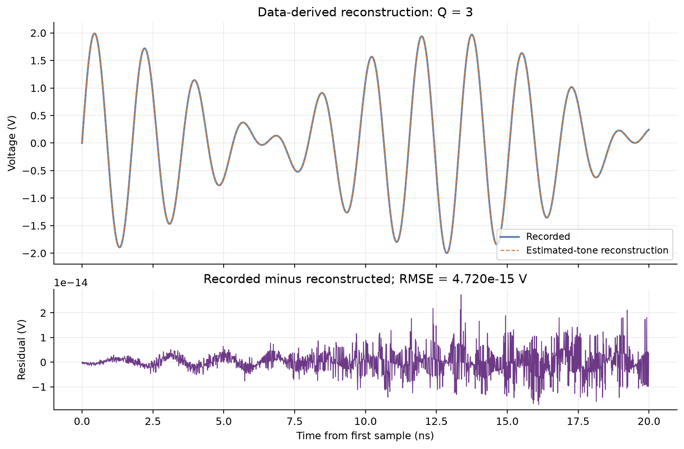

# HW01 - Spectrum analysis with a Kaiser window

EE8091. Anonymous reproducible numerical report.

## Problem and record

Estimate the number, amplitudes, and frequencies of the sinusoids in the supplied waveform. The record contains 2000 samples, with a 10 ps sample interval, 100 GHz sampling rate, 20 ns record duration, and 19.99 ns endpoint span. Its native DFT spacing is 50 MHz.



## Kaiser window and calibration

Evaluate the assignment equation directly using the modified Bessel function I0:

```text
w[n] = I0(pi*alpha*sqrt(1 - (2*n/(N-1) - 1)^2)) / I0(pi*alpha)
```

The course convention is beta = pi*alpha. No built-in Kaiser constructor is used. For the M-point real FFT Y of the windowed samples, divide abs(Y) by sum(w), then double the positive-frequency bins except Nyquist. DC is never doubled. An odd M has no Nyquist bin. The denominator refers to the original N samples rather than the zero-padded FFT length. Report 20*log10(A/1 V) in dBV.



## Window comparison







Small alpha helps separate the nearby strong tones through a narrow main lobe. Large alpha suppresses leakage and exposes the distant weak tone while broadening the main lobe. Coherent-gain compensation does not correct scalloping or overlapping lobes.





The weak feature persists for multiple tapers. A two-tone model leaves a structured residual. Combining window evidence with residual fitting supports Q = 3.

The FFT length is 1048575; its grid spacing is 0.0953675 MHz. Padding interpolates the spectrum and does not improve the acquired record's resolving power.

## Joint fit and reconstruction

Residual Kaiser spectral candidates; variable projection with bounded damped Gauss-Newton frequency refinement; BIC order selection

For fixed frequencies, solve sine coefficients, cosine coefficients, and the offset by linear least squares; refine the frequencies nonlinearly. Amplitude is sqrt(s^2+c^2); phase is atan2(c,s). Retain model-order evidence in summary.json.

| Component | Frequency (MHz) | Amplitude (V) | Amplitude (dBV) |
| --- | ---: | ---: | ---: |
| 1 | 525.000000 | 1.0000000000 | 0.0000 |
| 2 | 602.000000 | 1.0000000000 | 0.0000 |
| 3 | 888.500000 | 0.0031622777 | -50.0000 |

Selected Q: 3. Offset: -1.896e-16 V. RMSE: 4.720e-15 V. Maximum absolute residual: 2.737e-14 V. Relative RMSE: 4.781e-15.

Model-order selection compares BIC using unit-RMS-normalized samples, with normalized RSS floored at N*(1e-10)^2. The penalty counts 3*Q+1 parameters (frequency, sine coefficient, cosine coefficient, and one overall offset). Physical-voltage RMSE is unfloored. The algorithm stops on its declared relative numerical residual tolerance.



The displayed digits describe a deterministic numerical fit and do not establish experimental uncertainty. The complete Python source, input validation, plots, numerical outputs, and reproduction command accompany this report in the repository.

## Rebuild the report

First generate the analysis outputs using the command in the homework README. From the homework/hw01 directory:

```sh
python -m pip install -r report/requirements.txt
python report/build_report.py
```

The builder reads results/summary.json and the generated PNG figures, then rewrites report/report.pdf and report/report.md. It clears inherited author/date metadata and uses no personal information. ReportLab and pypdf are the report-building dependencies; Matplotlib is an optional font fallback on non-Windows systems.

## Reference

Course-provided assignment: *Time-frequency transform (1) - Using Kaiser window for spectral analysis*. Source waveform: HW1_Kaiser.txt. No personal identifiers are reproduced.
