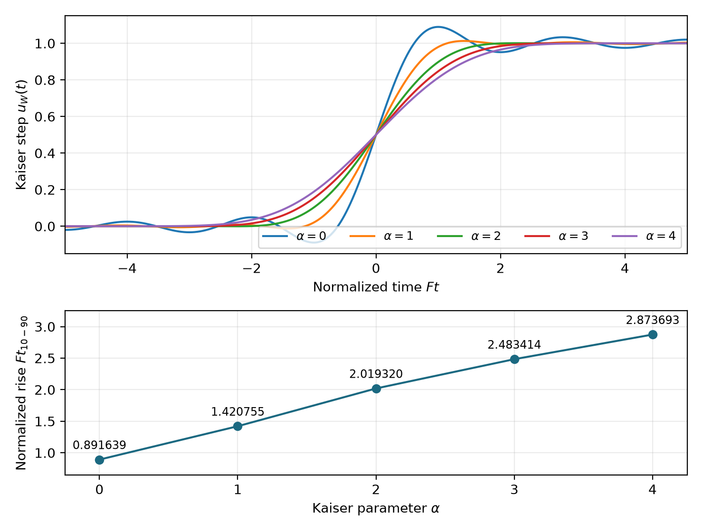
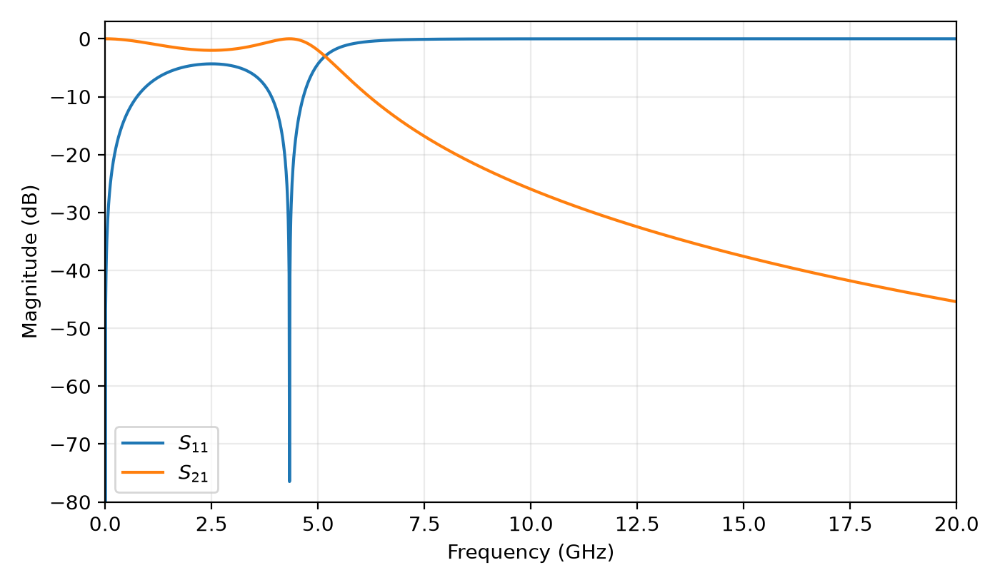
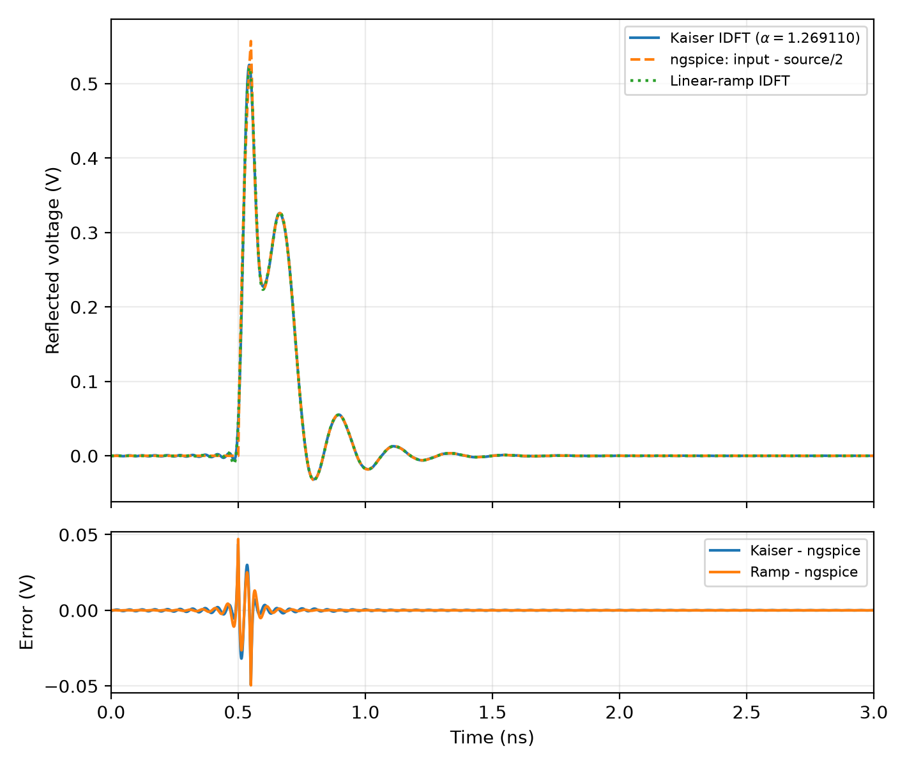
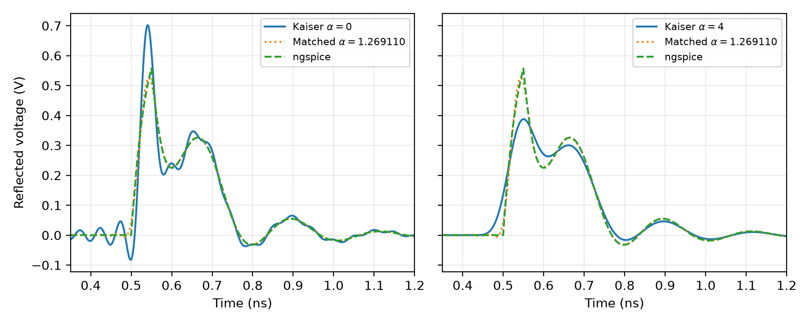

# HW2 | Step response from sampled frequency data

National Central University | EE8091

Introduction to Signal Integrity and Electromagnetic Compatibility

## Result and scope

The Kaiser parameter **alpha = 1.269110238** produces a **40.000 ps** central 10%-90% input rise at a two-sided bandwidth F = 40 GHz. The reflected waveform is reconstructed from the supplied S11 and compared against a fresh, independent ngspice circuit simulation. All 9 saved numerical checks pass. Residual differences between the Kaiser and SPICE waveforms are quantified over a stated comparison interval.

This report covers Part I (five Kaiser steps and normalized rise time) and Part II (S-parameters, the 40 ps reflection, circuit validation, and alpha = 0 / 4 comparisons). All plots and metrics are regenerated by the accompanying Python program.

## 1. Transform and window conventions

The inverse transform uses frequency f in hertz:

```equation
h(t) = integral H(f) exp(+j 2 pi f t) df
hW(t) = IFT[H(f) W(f)] = h(t) * w(t)
sW(t) = integral[-infinity,t] hW(tau) d tau = h(t) * uW(t)
```

Here * denotes convolution. Integrating the windowed impulse response produces the response to the finite-rise input uW, rather than an ideal zero-rise step. The DC-centered Kaiser window is zero outside |f| <= F/2, and inside that interval:

```equation
W(f) = I0(pi alpha sqrt(1 - (2 f/F)^2)) / I0(pi alpha)
W(0) = 1;   q = F t;   U(q) = uW(q/F)
```

I0 is the modified Bessel function of order zero. Since W(0) = 1, the total area of w(t) is one. Its even symmetry gives U(-q) = 1 - U(q), so the 50% crossing is at t = 0.

**Formula correction.** With the NumPy convention sinc(x) = sin(pi x)/(pi x), the consistent analytic pair is w(t) = F sinc(sqrt((F t)^2 - alpha^2)) / I0(pi alpha), using its real hyperbolic continuation inside |F t| < alpha. The printed assignment has (pi alpha)^2 under this square root; that expression does not match its stated W(f). The implementation verifies the corrected pair numerically and computes U directly from the frequency window to avoid this ambiguity.

<!-- pagebreak -->

# Part I | Kaiser input steps and rise time



The normalized step is evaluated without truncating its negative-time tail:

```equation
U(q) = 1/2 + integral[0,1] W(F x/2) sin(pi q x)/(pi x) dx
F t10-90 = q90 - q10 = 2 q90, where U(q90) = 0.9
```

Larger alpha suppresses the high-frequency edge of W and reduces ringing, while widening the time-domain transition. At F = 40 GHz, the five rise times are 22.2910, 35.5189, 50.4830, 62.0853 and 71.8423 ps, respectively. The full numerical table is saved in results/part1_rise_times.csv.

Solving F t10-90 = 40 GHz x 40 ps = 1.6 gives alpha = 1.269110238; rounding alpha to 1.25 instead gives about 39.6934 ps. The curves use the corrected transform pair, and their rise times are solved from crossings rather than estimated from image pixels.

<!-- pagebreak -->

# Part II | Circuit and reconstruction

## 2. Frequency response and reference planes

The assigned circuit is a 50 ohm line followed by an L-C-L ladder: L1 = L3 = 4.314 nH and C2 = 0.5301 pF, terminated in 50 ohm. It is the stated third-order Chebyshev low-pass example with nominal 5 GHz cutoff and 2 dB ripple. The Touchstone input is read using its declared units, complex representation, and two-port ordering S11, S21, S12, S22.



**Delay convention.** The line parameter TD = 250 ps is one way. An input reflection traverses the line twice, so its physical propagation delay is 500 ps. This follows the circuit and S11 phase; the assignment prose calling 250 ps the reflected-wave delay is ambiguous. A separate 25 ps shift aligns the Kaiser 50% point with the center of the SPICE source ramp.

## 3. Frequency samples to a real step

The available samples run from DC to 20 GHz with spacing 10 MHz, so F = 2 fmax = 40 GHz and the periodic reconstruction interval is 1/df = 100 ns. The 524,288-point transform gives dt = 0.190735 ps. Zero padding refines time sampling; it does not add bandwidth or extend the period.

1. Form S11(f) W(f) exp(-j 2 pi f x 25 ps).
2. Retain DC once and create the negative-frequency conjugate samples. Apply half weight at the measured band edge for trapezoidal frequency integration.
3. Evaluate IFFT x N x df, center the periodic time axis, and retain the real impulse response.
4. Integrate with the cumulative trapezoidal rule from the negative-time boundary. Compare all methods on the same 0.5 ps grid over 0-3 ns.

This construction preserves the DC area, avoids duplicating DC, and uses the actual FFT time spacing instead of an unrelated display grid.

<!-- pagebreak -->

# Part II | Independent circuit comparison

## 4. Match the excitation and extract the reflected wave

The standalone ngspice netlist uses a 2 V source, a 50 ohm source resistor, and a 50 ohm load. The launched incident wave is therefore vin/2, or 1 V after the edge. A 50 ps linear 0%-100% source ramp has a 40 ps 10%-90% rise. The reflected voltage at the source-side input reference plane is:

```equation
sNg(t) = v(input_port, t) - vin(t)/2
```



| Comparison on 0-3 ns / 6,001 samples | RMS error (mV) | Max absolute error (mV) |
| :--- | ---: | ---: |
| Kaiser IDFT vs ngspice | 3.5362 | 49.2544 |
| Linear-ramp IDFT vs ngspice | 3.3966 | 49.5646 |
| State space vs ngspice | 0.0003 | 0.0197 |
| Same-Kaiser state space vs IDFT | 0.0004 | 0.0047 |

**Equal rise time does not imply equal wave shape.** The Kaiser input has smooth tails and a different derivative from the piecewise-linear SPICE ramp. Both reach 10%-90% in 40 ps, but their reflected peaks need not coincide exactly. For a closer excitation match, the diagnostic linear-ramp IDFT substitutes sinc(f x 50 ps) for W(f), keeping the same 25 ps center delay. Remaining error includes the 20 GHz bandwidth cutoff, sampled-data precision, and numerical integration. The 25 ps alignment is specified from source timing rather than tuned to minimize the reported residual.

<!-- pagebreak -->

# Part II | Window tradeoff and verification

## 5. Repeat with alpha = 0 and alpha = 4



At alpha = 0, the rectangular frequency window retains the fastest central transition but creates visible pre-response and ringing around the reflected edge. At alpha = 4, stronger tapering reduces truncation oscillation and spreads the edge in time. Their actual rises are 22.2910 and 71.8423 ps at this bandwidth, so neither satisfies the requested 40 ps rise. The matched alpha provides the requested intermediate edge speed.

## 6. Independent evidence and limits

The circuit frequency response is independently computed with ABCD matrices. The supplied S11 agrees with the stated L-C-L circuit and line to about 8.73e-7 in maximum complex absolute error. Its use for reflection reconstruction is consistent with the assigned circuit.

The supplied S21 contains isolated 180-degree phase-sign anomalies at 2, 6, 10, 14 and 18 GHz. Its magnitude plot remains valid, and these samples do not affect this S11-only reflection calculation. The raw Touchstone data are retained unchanged; agreement of all complex S-parameters is not claimed.

A separate state-space model uses physical inductor currents and capacitor voltage and agrees with the linear-ramp ngspice run within 0.0197 mV. Driving that differential circuit with the same analytic Kaiser input, independently of S-parameters and FFT, matches the IDFT within 4.705 microvolts (RMS 0.371 microvolts). This supports the transform normalization and explains why the larger SPICE residual should not be interpreted as a reconstruction failure.

Doubling the FFT size changes the Kaiser response by at most 0.0250 mV over 0-3 ns. This tests time-sampling convergence; the finite bandwidth and input-shape differences remain physical limits of the linear-ramp comparison.

<!-- pagebreak -->

# Reproducibility and submitted source

## 7. Rebuild the analysis and this report

From the homework/hw02 directory, install the declared Python dependencies and run:

```text
python -m pip install -r report/requirements.txt
python src/hw2.py --ngspice /path/to/ngspice
python -m unittest discover -s tests -v
python report/build_report.py
```

Omit --ngspice to use an installed ngspice found on PATH, or the saved independent circuit reference if ngspice is unavailable. Recomputing a fresh reference is recommended when checking the circuit on a new platform. The program records whether the reference was recomputed or reused in results/verification.json. The archived simulation uses a fixed 2 V / 50 ps source rather than a waveform exported from the reconstructed response.

| File or directory | Purpose |
| :--- | :--- |
| src/hw2.py | Complete rewritten analysis and figure generation |
| data/chebyshev_lpf.s2p | Supplied raw frequency-domain circuit data |
| simulation/chebyshev_reflection.cir | Independent transient circuit definition |
| simulation/spice_reference.csv | Saved circuit waveform for portable reruns |
| results/verification.json | Numeric metrics, FFT diagnostics and assertions |
| results/part1_rise_times.csv | Tabulated Kaiser rise times |
| results/part2_reflection.csv | Aligned reconstructed and reference waveforms |
| results/figures/ | New raster and vector plots |
| report/report.md | Readable source of the main report |
| report/build_report.py | Portable report generator and source appendix |

**Saved verification outcome:** 9/9 assertions pass. The checks cover window symmetry, the target rise time, real inverse transformation, DC area, FFT convergence, circuit agreement, and other explicit checks listed in verification.json. Unit tests provide additional checks of the rewritten computation; their exact test count is recorded by the test runner rather than inferred from this report.

## 8. Interpretation

Frequency-window multiplication specifies the finite-rise excitation used in a step reconstruction. At F = 40 GHz, alpha = 1.269110238 meets the requested 40 ps rise. A stronger taper trades edge speed for reduced truncation ringing. Independent circuit and state-space calculations validate the reflection mechanism and reference-plane timing, while the reported residuals expose the difference between a Kaiser step and a linear source ramp.

## Reference material

The scope and circuit follow the supplied HW2 assignment, "Time-frequency transform (2) - Obtain step response using Kaiser window in IFT", especially its Parts I and II and source-code requirement. The accompanying course handout "Time-freq transform" supplies the LTI convolution and frequency/time-domain framework. Relative files in instructions/ preserve the provided homework reference material; the executable analysis above is newly written.

The following appendix includes the **complete analysis source and standalone SPICE netlist** in legible text. Line numbers refer to the accompanying editable files.
