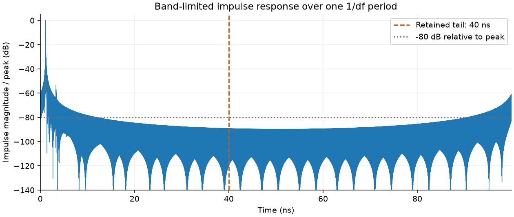
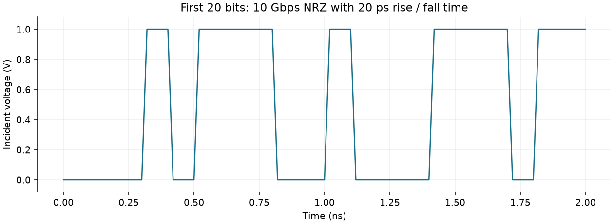
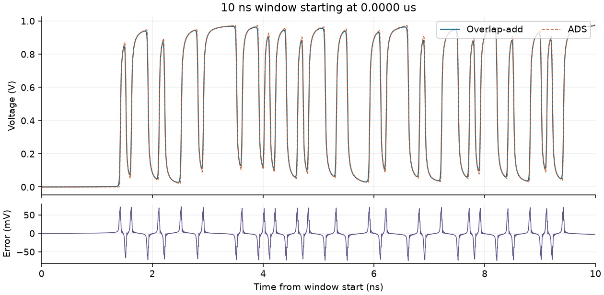
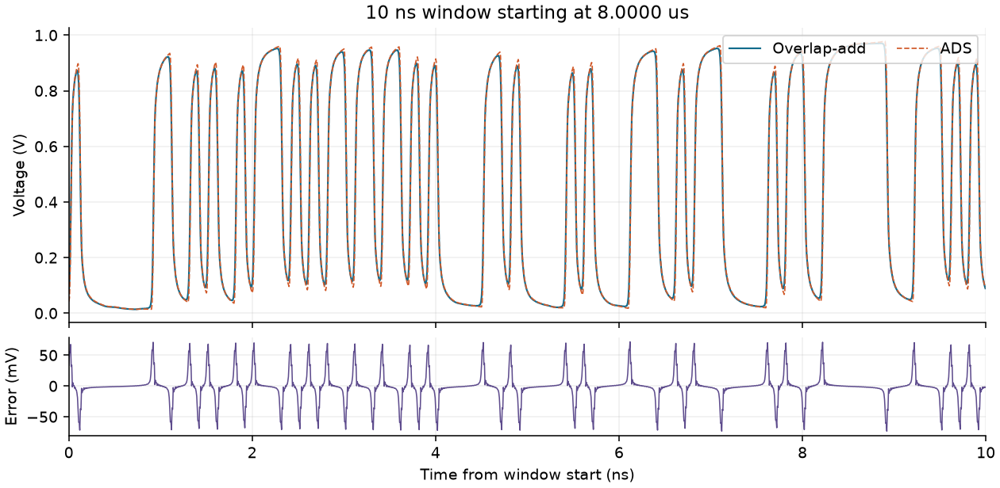
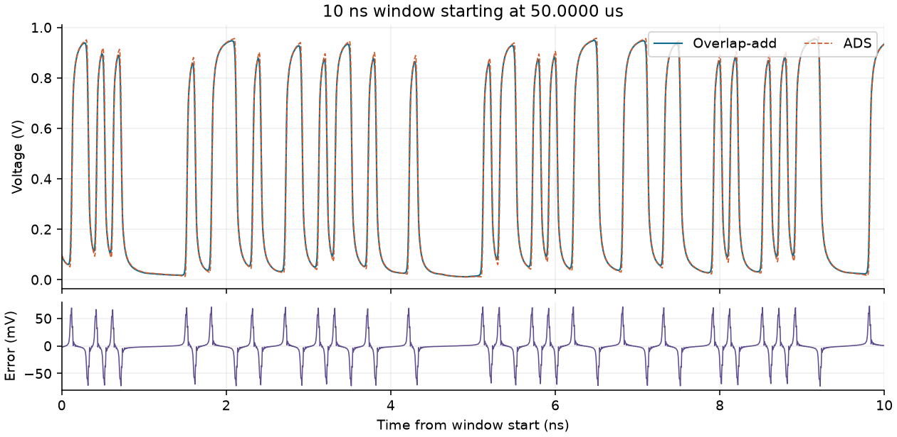
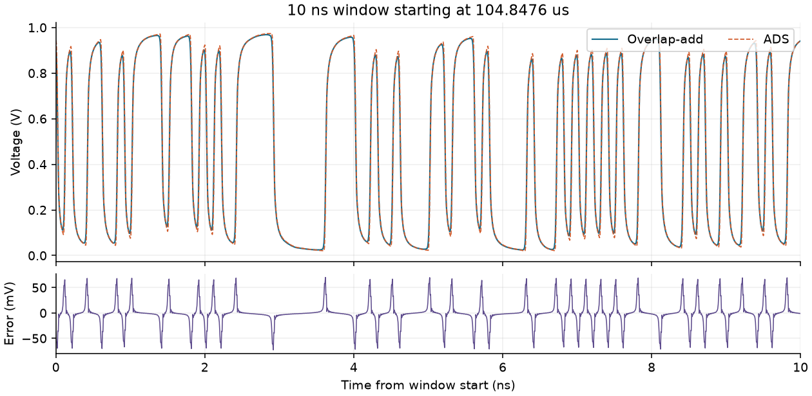

> National Central University | EE8091 | Signal Integrity and Electromagnetic Compatibility

# HW3: Sectional convolution

**Anonymous numerical report**

This study computes the receiver waveform of a 20 cm microstrip channel using its supplied S21 data and FFT overlap-add. All 1,048,576 bits are processed at 2 ps spacing. The known input duration is **104.857600 us**, rather than a rounded 105 us.

On the known input interval, comparison at 16,777,216 ADS timestamps gives an RMSE of **22.2689 mV** and a maximum absolute difference of **75.5376 mV**. The measured overlap-add loop takes **4.272 s** for the complete pattern. These are results from this run; no shift, gain or voltage-offset fit is used.

## 1. Problem and numerical settings

| Quantity | Value and interpretation |
| --- | --- |
| Course / task | NCU EE8091 / time-frequency transform (3): sectional convolution |
| Channel | 20 cm microstrip; S21 used with matched source and load |
| Source / load | 50 ohm / 50 ohm; S-parameter reference is 50 ohm |
| Bit rate / UI | 10 Gbps / 100 ps |
| Input levels | 0 to 1 V incident wave; source high level is 2 V before the matched divider |
| Rise and fall | 20 ps, 0-100% linear transition starting at each changed bit boundary |
| Input length | 2^20 = 1,048,576 bits; 524,977 ones and 523,599 zeros |
| Input duration | 104.857600 us |
| Sample interval / rate | 2 ps / 500 Gsample/s |
| Points per UI / ramp | 50 / 10; new level is reached after 10 sample intervals |
| Bits / sections | 512 bits per full section; 2,048 sections; final section contains 512 bits |
| Output storage | float32 disk-backed array, 52,448,800 samples (209.795 MB decimal) |

All physical signal settings come from the assignment. Sampling, section size, window strength and impulse cutoff are explicit implementation choices. Sections need not divide the bit count: the loop also handles a shorter final section.

<!-- pagebreak -->

## 2. Channel impulse response and cutoff

Because both terminations match the 50 ohm S-parameter reference, the incident-to-received voltage transfer function is S21. The real time-domain response is obtained by a Hermitian inverse real FFT. The transform supplies conjugate negative frequencies and counts DC once, equivalent to the lecture's twice-real one-sided construction with half-weight DC.

| Transform parameter | Value |
| --- | --- |
| Measured band / spacing | DC to 40 GHz / 10 MHz; 4,001 frequency samples |
| Period from spacing | 1/df = 100 ns; 50,000 time samples |
| Frequency interpolation | None within the supplied uniform grid; unmeasured frequencies above 40 GHz are zero-filled |
| Kaiser window | alpha = 0.5; beta = pi*alpha = 1.570796; W(0) = 1 |
| Retained FIR | 0 to 40 ns inclusive; 20,001 coefficients |
| Impulse peak | Delay 1.114 ns; continuous amplitude 3.063776e+10 1/s |

The window is W(f) = I0[pi*alpha*sqrt(1-(f/fmax)^2)] / I0(pi*alpha). The moderate taper follows the assignment's guidance that the finite input rise time already suppresses high-frequency content. The discrete coefficients are `h_d[n] = dt*h_cont[n]`; convolving voltage samples with `h_d` needs no additional `dt` multiplier.



The selected cutoff is T2 = 40 ns. On the explicitly checked positive-time interval 40.002-80 ns, the largest discarded magnitude is **-85.56 dB** relative to the impulse peak, below the -80 dB guideline. This interval check is not an infinite-time bound and does not cover the wrapped part near 100 ns.

The supplied DC gain is 0.993689864; the retained FIR sums to 0.991583978, a difference of -0.002105886. No DC renormalization hides this effect. Finite bandwidth, windowing and causal truncation remain approximations; a small individual tail coefficient does not guarantee a 0.1 mV bound on the accumulated waveform error.

<!-- pagebreak -->

## 3. Input waveform and overlap-add

At a bit change, the old level is retained at the boundary sample and then moves linearly to the new level over 20 ps. Equal adjacent bits retain a constant level. The previous bit of each section is taken from the full pattern; only the first section assumes a preceding zero. This preserves a physical ramp across a section boundary.



For an input section of L samples and an FIR of M samples, linear convolution has L+M-1 samples. The FFT is zero-padded to at least that length. With the default choices, L = 25,600, M = 20,001, L+M-1 = 45,600, and NFFT = 65,536. The FIR spectrum is computed once and reused.

```text
H = rfft(h_discrete, n=NFFT)
for start_bit in range(0, number_of_bits, block_bits):
    take all remaining bits up to block_bits
    construct x using the real preceding bit
    z = irfft(rfft(x, n=NFFT) * H, n=NFFT)
    keep len(x) + len(h_discrete) - 1 points
    add z at output offset start_bit * samples_per_ui
```

The section input intervals are adjacent. Their **output tails overlap and are added** at the original sample offsets. This addition is the step that makes sectional convolution equivalent to whole-waveform linear convolution for the chosen FIR. FFT arithmetic uses NumPy's float64 transform; the saved voltage array and each update are float32. No full input waveform or full time vector is allocated.

### Coverage and implementation corrections

- Every supplied bit is consumed. Floor-dividing the original 100-bit section size would process 1,048,500 bits and drop the last 76; the rewritten loop uses start indices through the entire pattern.
- FFT padding uses the input **sample** count plus the FIR count minus one, avoiding circular wraparound and confusion between bits and samples.
- A preceding bit is carried across sections, so the first transition in a section has the correct ramp.
- Time is derived from integer sample indices with float64 arithmetic when comparing short windows, avoiding a long float32 time vector.
- The Touchstone reader selects S21 in the standard two-port order and supports RI, MA and DB complex formats. File locations are relative to the program or provided explicitly.

<!-- pagebreak -->

## 4. ADS comparison: startup and early waveform

The ADS export has nonuniform timestamps, with steps ranging from 4.9 to 7.625 ps. The computed voltage is linearly interpolated at each original ADS timestamp. Error is `overlap_add - ADS`. No time shift, amplitude scale or constant offset is fitted. RMSE is sample-weighted on these timestamps, not a time-integrated error norm.





| Window (us) | ADS samples | RMSE (mV) | Max abs. (mV) |
| --- | --- | --- | --- |
| 1: 0.000000-0.010000 | 1,600 | 20.2817 | 73.7017 |
| 2: 8.000000-8.010000 | 1,600 | 22.6455 | 73.2837 |

<!-- pagebreak -->

## 5. ADS comparison: middle and final known bits





| Window (us) | ADS samples | RMSE (mV) | Max abs. (mV) |
| --- | --- | --- | --- |
| 3: 50.000000-50.010000 | 1,600 | 21.6401 | 72.9118 |
| 4: 104.847600-104.857600 | 1,600 | 22.8533 | 72.7002 |

Only timestamps before 104.857600 us enter the metrics. The later ADS continuation is outside the specified input; its 22,785 rows are excluded. Section 7 explains this boundary.

<!-- pagebreak -->

## 6. Verification, runtime and reproducibility

### Numerical checks and overall accuracy

| Check or metric | Recorded result |
| --- | --- |
| Input coverage | 1,048,576 of 1,048,576 bits processed; 2,048 sections |
| FFT padding | 65,536 >= 45,600; full linear output retained per section |
| Independent convolution check | 11 bits in 4-bit sections; final partial section 3 bits; FFT overlap-add compared with `numpy.convolve` of the whole input |
| Direct-check maximum error | 5.960464478e-08 V; passes tolerance 2.0e-07 V |
| ADS samples compared | 16,777,216; timestamp range 0.000000-104.857595 us |
| Overall RMSE / mean abs. error | 22.2689 / 11.7779 mV |
| Overall max. abs. / mean signed | 75.5376 / -1.0543 mV |

The independent test exercises overlap addition, state transfer and a final partial section. It checks the FFT algorithm against a separate direct convolution. **Algorithmic correctness and ADS agreement are separate findings:** the algorithm passes its numerical check while the ADS residual above remains unresolved.

### Measured computation time

| Item | Time or environment |
| --- | --- |
| Overlap-add loop | 4.272 s, including section construction and output flush |
| ADS file streaming / comparison | 6.732 s |
| Complete analysis run | 13.443 s, including figures and output processing measured before summary serialization |
| Software / platform | Python 3.12.14; NumPy 2.5.4; Windows AMD64 |

The overlap-add timer starts after output allocation and the FIR FFT. These times describe one execution on the available machine and storage system. ADS was not rerun here, so no measured speedup over ADS is claimed. The assignment's example PC timings are not substituted for a local benchmark.

<!-- pagebreak -->

## 7. Sensitivity, scope and reproduction

### Sampling, window and tail sensitivity

This study recomputes only the four 10 ns windows (6,400 ADS timestamps), preserving all preceding input history required by each finite FIR. It does not rerun the full pattern for each variant. The baseline on this subset is 21.8789 mV RMSE and 73.7017 mV maximum absolute error; subset values differ from the whole-interval metrics.

| Variant | ADS RMSE (mV) | ADS max. (mV) | Max change (mV) |
| --- | --- | --- | --- |
| 1 ps sampling | 21.9250 | 73.8534 | 0.2901 |
| alpha = 0 | 20.4795 | 66.4227 | 11.8329 |
| alpha = 0.1 | 20.5347 | 66.8115 | 11.2088 |
| T2 = 20 ns | 21.8840 | 73.7017 | 0.2050 |
| T2 = 60 ns | 21.8768 | 73.7017 | 0.0950 |

"Max change" compares the variant's voltage with the baseline at the same ADS timestamps. Halving the sample interval changes the waveform by at most 0.291 mV; extending T2 to 60 ns changes it by at most 0.096 mV. Removing the taper reduces the subset RMSE, but leaves a residual above 20 mV. These checks do not identify a unique cause of the ADS mismatch. The reported default remains alpha = 0.5, without fitted alignment or voltage corrections.

### Known input and reference boundary

ADS continues to 105.000000 us; the supplied pattern specifies only `0 <= t < 104.857600 us`. Exactly 22,785 later reference rows are excluded. The finite convolution's output tail assumes zero input after the pattern ends. The continued bit sequence used by ADS is unspecified, so that tail is not validated against the later ADS continuation.

### Limits and rerunning the work

The 40 GHz frequency limit, Kaiser weighting, 2 ps waveform sampling, finite causal FIR and float32 storage all contribute approximation error. The 40 ns tail test checks one finite interval; it is not an infinite-support proof. Comparison against the provided ADS waveform is the evidence for the reported configuration, rather than a claim that alternative samplings or cutoffs produce the same error.

From the repository root, run the following after installing `requirements.txt`; PDF generation additionally uses `homework/hw03/report/requirements.txt`. The numerical input hash verifier and automated solver tests are supplied beside the analysis.

```text
python homework/hw03/verify_inputs.py
python homework/hw03/analyze.py --verification-study
python homework/hw03/report/build_report.py --refresh
```

`analyze.py` writes the JSON summary, four compact waveform CSVs and all figures. The large disk-backed waveform is deleted by default; `--keep-waveform` retains it. `--refresh` updates this Markdown narrative from the new summary before rebuilding the PDF. The complete executable source is included in `analyze.py`; the short algorithm above describes its central loop.

**References.** NCU EE8091 HW3 assignment, including Appendix 2 (input timing) and Appendix 3 (Kaiser window), in `instructions/`; supplied bit pattern, channel S2P and ADS waveform, identified by the input manifest. Numerical values in this report are recorded in `results/summary.json`.
