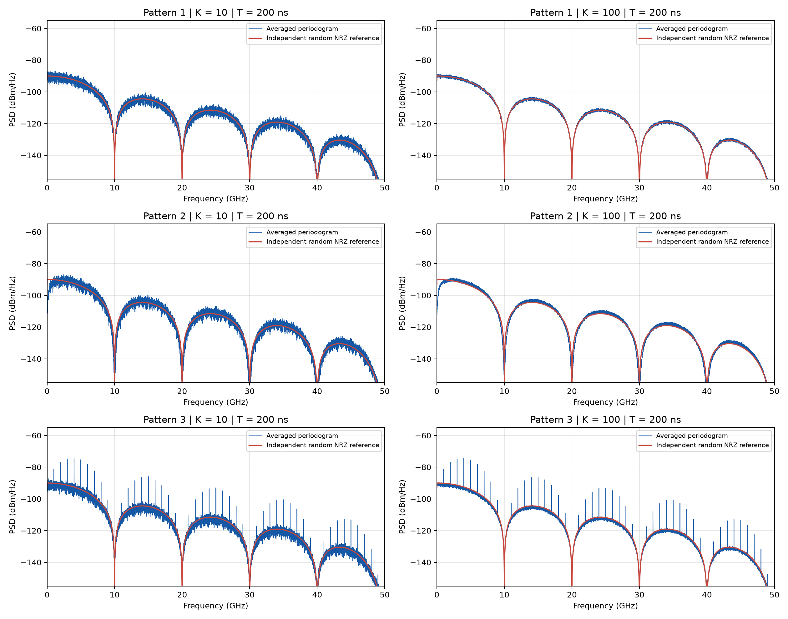

# HW4: Spectrum of digital signals

Estimate the single-sided power spectral density (PSD) of the three supplied
200,000-bit records at 10 Gbps, with a 20 ps linear transition, 1 V peak-to-peak
voltage, and a 50 ohm load. The six required figures compare K = 10 and K = 100
averages with the theoretical PSD of independent random NRZ.

## Run and verify

From the repository root, with Python 3.10 or newer:

```sh
python -m pip install -r homework/hw04/requirements.txt
python homework/hw04/src/hw4.py
python -m unittest discover -s homework/hw04/tests -p test_hw4.py -v
python homework/hw04/tests/verify_delivery.py
```

Use `python homework/hw04/src/hw4.py --help` for input and output options.
Paths default to the homework directory, independently of the current working
directory. The program runs without a graphical desktop. To rebuild the report:

```sh
python -m pip install -r homework/hw04/report/requirements.txt
python homework/hw04/report/build_report.py
```

To independently reconstruct all six saved spectra using convolution and
SciPy's separate periodogram implementation, run the following audit. It also
runs the unit tests and refreshes `results/verification.json` after success.

```sh
python homework/hw04/tests/verify_reference.py
```

Use `--results-dir PATH` to audit a separately regenerated results directory.

## Results



- [Anonymous report (PDF)](report/hw04_report.pdf)
- [Report text and explanations](report/report.md)
- [Parameters and numerical results](results/summary.json)
- [Independent verification](results/verification.json)
- [Independent bit-pattern audit](results/pattern_audit.json)
- [Source coverage and instruction checksums](source_manifest.json)

The individual plots are `results/pattern_1_K10.png` through
`results/pattern_3_K100.png`. `results/spectra.npz` stores the full one-sided
frequency axis and all six PSD arrays in W/Hz, including frequencies above the
50 GHz plotting limit, so total-power checks can be reproduced.

## Method

Each segment contains 2,000 bits: T = 200 ns, 100,000 samples at dt = 2 ps.
K = 10 uses the first 20,000 bits; K = 100 uses all 200,000 bits. Both estimates
use the same segment duration and initial segments, allowing averaging effects
to be compared at fixed spectral resolution.

The Kaiser window has alpha = 1 (beta = pi). Its power gain is mean(w**2).
The resolution scale 1/T is 5 MHz and the window equivalent noise bandwidth is
about 5.758 MHz. Zero padding to 524,288 FFT points produces a plotting interval
of about 0.954 MHz; it does not improve the physical resolution. Positive
frequency power is doubled, with DC and the Nyquist bin kept undoubled.
Power spectra are averaged in linear units before converting to dBm/Hz.
The actual preceding bit is retained at every segment boundary. No detrending
is applied, preserving the low-frequency content needed for classification.

Pattern 1 matches independent random NRZ. Pattern 3 consists of 20,000 aligned
ten-bit words whose last two bits are always `01`; the first eight positions
are random-like. This produces a random continuum and periodic components
spaced by 1 GHz, with missing lines at pulse-shape zeros.

Pattern 2 is the assignment's intended 8b/10b-coded example. Its low-frequency
suppression is consistent with a constrained code, but the supplied record
fails strict conventional 8b/10b invariants: there are 42 runs of six identical
bits and its cumulative digital sum drifts by 588. The report distinguishes the
intended classification from a standards-compliance claim.

## Files and provenance

`instructions/` contains all five supplied instruction files, unchanged,
including the incomplete starter example. Run the rewritten `src/hw4.py`;
the starter is retained as course reference material.

`src/`, `tests/`, and `results/` contain the rewritten implementation,
independent checks, and regenerated results. `report/` contains the rewritten
report and its builder. The original submission code and identity-bearing
reports are replaced by these rewritten files rather than published.
The originals are preserved in their source locations.

The rewritten report, filenames, generated metadata, and commit authorship
contain no student name, student number, or personal machine paths.
