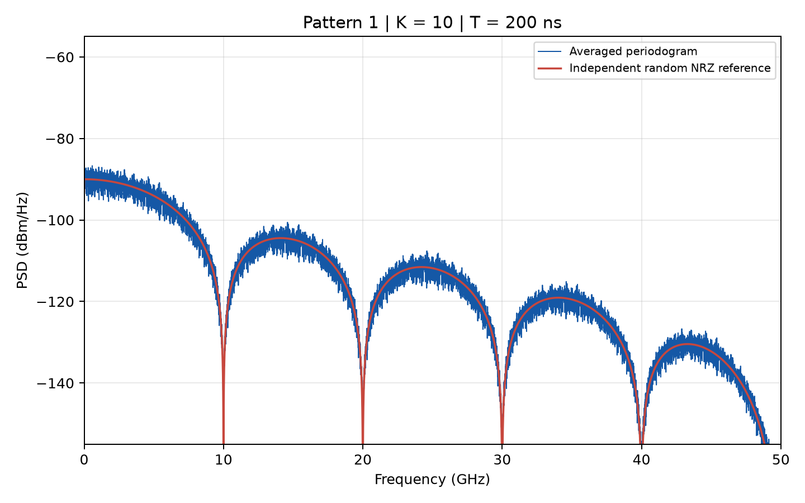
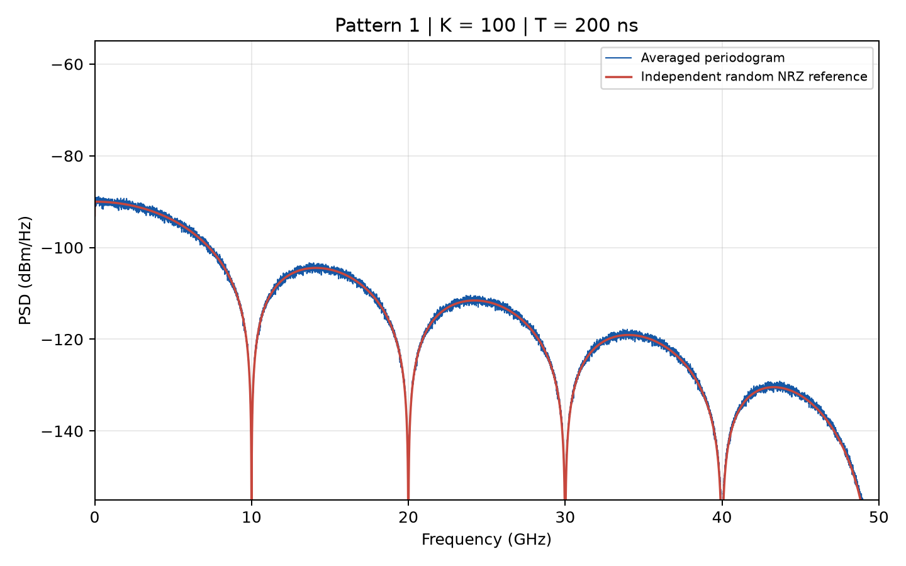
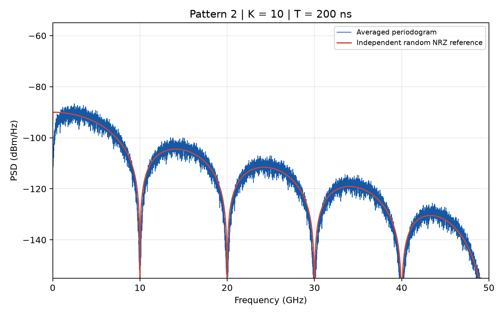
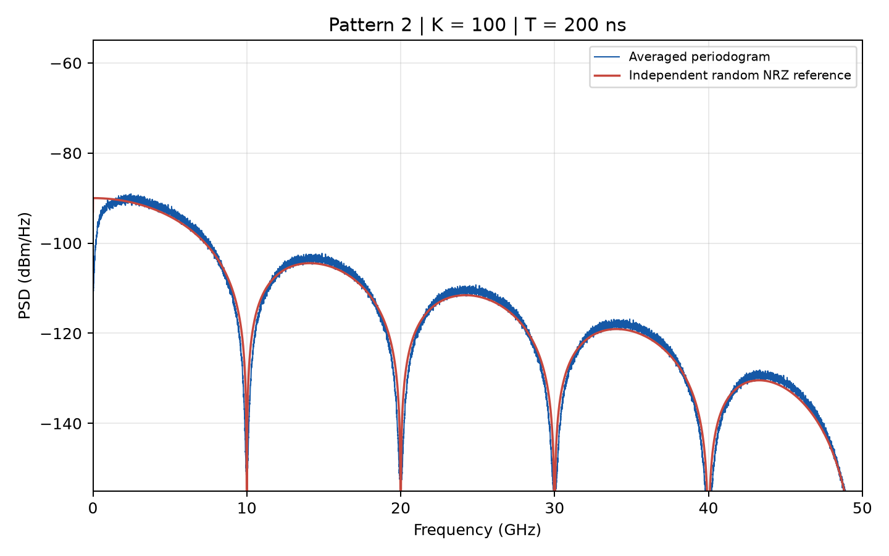
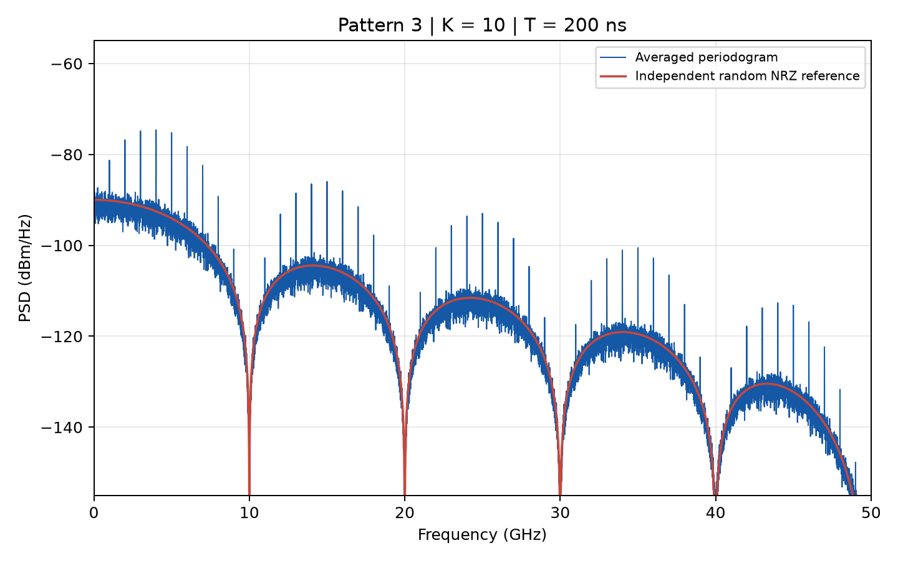
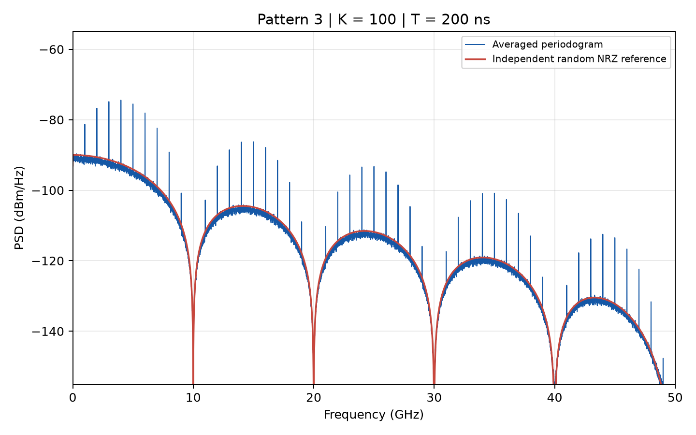
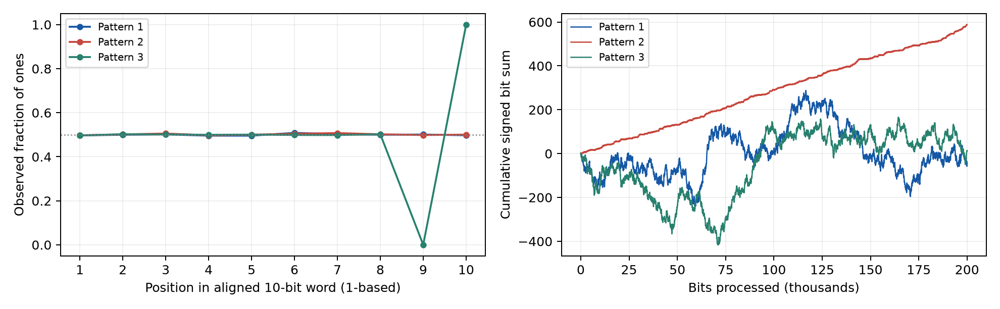
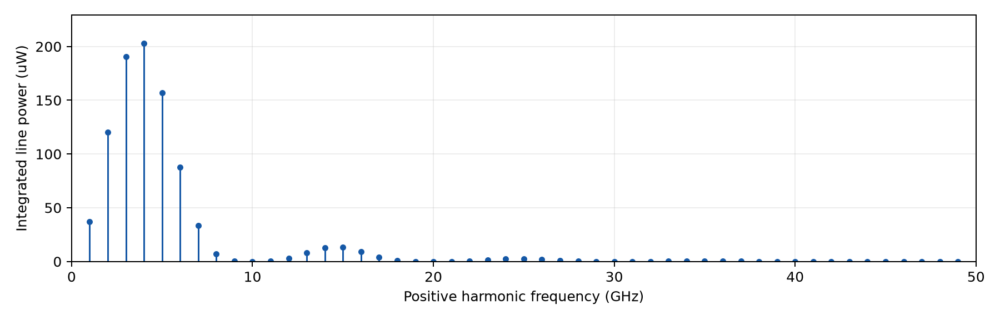

# HW4: Spectrum of digital signals

Anonymous technical report

## Scope and conclusions

Three supplied 200,000-bit records are converted to bipolar trapezoidal NRZ and analyzed with a correctly normalized, one-sided averaged periodogram. Six required PSD plots cover 0-50 GHz in dBm/Hz at K = 10 and K = 100. Pattern 1 is consistent with independent random NRZ. Pattern 2 is the assignment's intended 8b/10b-like data, with strong low-frequency suppression; its supplied bitstream nevertheless fails basic strict 8b/10b invariants. Pattern 3 has eight random-looking payload bits followed by an exact 01 suffix in every aligned 10-bit word, producing a continuous background plus a 1 GHz harmonic comb.

## Parameters and signal model

| Quantity | Value |
|---|---|
| Input length per file | 200,000 bits |
| Bit rate / UI | 10 Gbit/s / 100 ps |
| Full record duration | 20 us |
| Voltage / impedance | -0.5 V and +0.5 V / 50 ohm |
| Linear transition duration | 20 ps |
| Sample interval / Nyquist frequency | 2 ps / 250 GHz |
| Samples per bit / per transition | 50 / 10 |
| Segment length | 2,000 bits = 100,000 samples = 200 ns |
| Unwindowed resolution scale | 1/T = 5 MHz |
| Kaiser window | beta = pi, equivalently alpha = 1 when beta = pi alpha |
| Window equivalent noise bandwidth | 5.757828 MHz |
| FFT length | 524,288 = 2^19 samples |
| Display frequency grid | 0.953674316 MHz |
| Averages | 10 and 100 consecutive, nonoverlapping segments |

The full record contains 200,000 bits, not 2,000,000. At 10 Gbit/s it lasts 20 us. K = 10 uses the first 20,000 bits (2 us); K = 100 uses all 200,000 bits (20 us). The two estimates share their first 10 segments and are not independent experiments. Segment duration and window remain fixed so that changes in K primarily alter averaging variance, not spectral resolution.

Let A = Vpp/2 = 0.5 V. Bit 0 maps to -A and bit 1 to +A. At a transition the preceding level is retained at the boundary, followed by a linear ramp reaching the new level after 20 ps. Successive segments use the actual preceding bit rather than restarting the waveform. Only the start of the complete record assumes preceding bit 0. This is causal rectangular smoothing of ideal NRZ; its delay changes spectral phase but not the PSD. No mean subtraction or detrending is applied.

## Estimator and normalization

For N samples per segment, M FFT points and q_j = 2 at interior positive bins, q_j = 1 at DC and at the even-length FFT's Nyquist bin,

$$\widehat S_1(f_j)=q_j\frac{\Delta t}{Z_0\sum_n w_n^2}\frac1K\sum_{k=1}^K|\mathrm{FFT}_M\{w_nv_{k,n}\}_j|^2.$$

This is equivalent to dividing the squared continuous-time transform approximation |dt FFT|^2 by T Z0 U, where U = mean(w^2). Average squared magnitudes, never complex FFT coefficients. The stored spectra are W/Hz. Plot values are 10 log10(1000 S1) dBm/Hz. DC and Nyquist must not be doubled.

The window power gain is U = 0.51859976, coherent gain Gc = mean(w) = 0.67107616, and ENBW = U/Gc^2 times 1/T = 5.757828 MHz. U corrects broadband PSD power. Coherent gain instead corrects the amplitude of a bin-centered deterministic tone; substituting Gc^2 for U in a PSD changes the noise-floor normalization by the ENBW factor. Zero padding provides a smoother frequency grid but does not improve the 200 ns observation's physical resolving power. Both 1/T and ENBW are below 10 MHz; the plotted grid is below 1 MHz.

For independent, equiprobable bits, the assignment's one-sided continuous-time reference is

$$S_{NRZ,1}(f)=\frac{2A^2T_b}{Z_0}\operatorname{sinc}^2(fT_b)\operatorname{sinc}^2(fT_r),\quad f>0,$$

with normalized sinc(x) = sin(pi x)/(pi x). It is a reference for random NRZ, not a prediction that the other two inputs should follow. Pulse-shape nulls occur at multiples of 10 GHz and the first transition-filter null is 50 GHz. At the single DC grid point the code uses the undoubled two-sided reference value, consistent with the rFFT endpoint convention. The finite-sample waveform's exact reference includes sinc(f dt)^(-4) relative to the continuous formula away from removable zeros; this is only 0.2867 dB by 50 GHz in its limiting ratio. Both models are stored for verification.

## Verification and uncertainty

The complete positive sampled band, 0-250 GHz, satisfies the DFT Parseval check sum(S1) df = mean(sum(w^2 v^2)/sum(w^2))/Z0. Its largest relative error across all six estimates is 3.74e-16. Full-band integration must use the DFT bin sum, not trapezoidal endpoint half weights.

| Pattern | K | Weighted time-domain power (mW) | Full-band PSD power (mW) | Relative error |
|---|---:|---:|---:|---:|
| 1 | 10 | 4.670993 | 4.670993 | 1.86e-16 |
| 1 | 100 | 4.670322 | 4.670322 | 0.00e+00 |
| 2 | 10 | 4.597129 | 4.597129 | 1.89e-16 |
| 2 | 100 | 4.598096 | 4.598096 | 1.89e-16 |
| 3 | 10 | 4.633671 | 4.633671 | 0.00e+00 |
| 3 | 100 | 4.636757 | 4.636757 | 3.74e-16 |

For pattern 1 at K = 100, ordinary time-domain power is 4.670515 mW and window-weighted power is 4.670322 mW. The independent-bit sampled-model expectation is 4.670000 mW; the ideal instantaneous-transition value of 5 mW is reduced by finite ramps. In 0.1-9 GHz, the RMS pointwise log error against the sampled random reference decreases from 1.4170 dB at K = 10 to 0.4215 dB at K = 100. The corresponding mean linear ratios are 0.996806 and 0.998847. Neighboring zero-padded bins are correlated, so these are descriptive diagnostics, not independent sample counts or confidence tests.

For independent periodograms of a continuous Gaussian-like random spectrum, relative standard deviation is approximately 1/sqrt(K): 31.6% at K = 10 and 10.0% at K = 100 (about 1.37 and 0.43 dB under a small-error approximation). This heuristic is not a line-amplitude confidence interval and does not apply unmodified at spectral nulls, DC, deterministic lines, or correlated coded data. Finite windows broaden lines and fill apparent nulls through leakage; report a line's integrated power, not its plotted peak density alone.

## Pattern 1: independent random NRZ

Figures 1 and 2. Pattern 1 follows the random NRZ envelope, with noticeably reduced fluctuations at K = 100. The 10 GHz pulse null spacing and the 50 GHz rise-time null are consistent with Tb = 100 ps and Tr = 20 ps. Exact null depths depend on finite-window leakage and the plotted grid.

## Pattern 2: the intended 8b/10b-like record

Figures 3 and 4. Pattern 2 strongly suppresses low-frequency power relative to independent random NRZ. The ratio of average PSDs over 10-100 MHz at K = 100 is -17.67 dB relative to pattern 1. Transition and disparity constraints create correlations between bits; replacing these correlations by independent bits would lose the low-frequency spectral shaping. This identification is qualified by the supplied-file audit below.

## Pattern 3: random payload plus periodic suffix

Figures 5 and 6. A comb of lines at integer GHz is superposed on a random background. The aligned 10-bit block lasts 1 ns. The fixed 01 suffix creates a nonzero, periodic phase-conditioned mean even though its average over a block is zero. Missing lines at 10, 20, 30, 40 and 50 GHz agree with the suffix difference and pulse-shape zeros. The comb comes from the repeated mean structure; the entire 200,000-bit sequence is not periodic.

## Classification from the bit files

| Check | Pattern 1 | Pattern 2 | Pattern 3 |
|---|---:|---:|---:|
| Bits | 200,000 | 200,000 | 200,000 |
| Ones | 99,981 | 100,294 | 100,007 |
| Maximum equal-bit run | 17 | 6 | 9 |
| Final signed bit sum | -38 | 588 | 14 |
| Aligned distinct 10-bit words | 1,024 | 440 | 256 |

Pattern 1 uses all 1,024 10-bit words and has no strong position-dependent bias; its statistics and PSD are consistent with random NRZ. A finite record cannot prove stochastic independence. Pattern 3 has exactly 20,000 aligned words; position 9 is always 0 and position 10 is always 1. Its first eight positions are close to balanced and all 256 8-bit payload values occur. The exact suffix is proven by the file; an independent, equiprobable payload is the useful statistical model, not a proven generator specification.

Genuine 8b/10b does allow repeated bits. Its relevant properties are controlled DC balance, bounded running disparity and run-length limits, which permit AC coupling and aid clock recovery. The original IBM code gives a maximum run length of five and digital sum variation of six [3]; AMD describes the character-end running-disparity state as +1 or -1 [4]. Thus low DC content should be explained by controlled imbalance and correlation, not by an absence of consecutive zeros or ones.

The supplied pattern 2 contains 42 runs of six bits. Its cumulative signed bit sum ranges from -2 to 590 and ends at 588, inconsistent with the bounded imbalance of a strict 8b/10b stream. At the file's initial 10-bit alignment, 119 words have disparity +4. That alignment alone is not decisive: shifting the word start by six bits removes all absolute word disparities above two, but the long-term cumulative drift persists. The report therefore identifies pattern 2 as the intended coded example, with 8b/10b-like spectral shaping, and does not claim a standards-compliant encoding or a successful full decoder check. Input data are preserved unchanged.

## Exact hybrid model and spectral lines

Write the bipolar symbols as a random zero-mean part plus a periodic mean. Under the independent, equiprobable payload model, the ten phase-conditioned means are [0,0,0,0,0,0,0,0,-A,+A]. Only eight out of ten positions have variance A^2, so the time-averaged continuous spectrum is 0.8 times the independent random NRZ reference, or -0.9691 dB. A periodic variance alone is not a deterministic line source; the nonzero periodic mean supplies the lines here.

For fm = m/(10 Tb) = m GHz, the Fourier-series coefficient has magnitude given by

$$c_m=\frac{A}{10}\operatorname{sinc}(f_mT_b)\operatorname{sinc}(f_mT_r)e^{-j\phi_m}[e^{-j2\pi m9/10}-e^{-j2\pi m8/10}].$$

The phase phi_m collects the common NRZ-pulse and smoothing delays; it does not affect power. The total one-sided model is

$$S_{hybrid,1}(f)=0.8S_{NRZ,1}(f)+\sum_{m=1}^\infty\frac{2|c_m|^2}{Z_0}\delta(f-f_m).$$

Consequently each positive-frequency line has integrated power

$$P_m=\frac{8A^2}{100Z_0}\operatorname{sinc}^2(m/10)\operatorname{sinc}^2(m/50)\sin^2(\pi m/10).$$

The fundamental is 1 GHz. The suffix difference supplies sin(pi m/10), which vanishes at m = 10, 20, ... and at DC; the NRZ pulse also vanishes at these 10 GHz multiples, and the transition filter first vanishes at 50 GHz. These zeros explain why not every integer GHz line is present. A finite-length window convolves each ideal delta line with its spectral response. Plot peak heights thus depend on T and the window even when physical line power is fixed. The model describes the ideal ensemble; finite payload realizations fluctuate about the 0.8 background.

## Reproduction and limitations

From this homework directory, install the packages in requirements.txt and report/requirements.txt, run `python src/hw4.py`, run `python -m unittest discover -s tests -v`, run `python tests/verify_reference.py` for the independent SciPy audit, run `python report/build_report.py`, then run `python tests/verify_delivery.py` to check delivery integrity. The analysis reads only instructions/HW4_bit_pattern_1.txt through HW4_bit_pattern_3.txt. The report builder reads package-local results and those bit files, creates its own diagnostic assets, and emits this PDF and Markdown. Figures and numerical spectra retain no personal identifiers. Generated PDF metadata uses a generic title and an empty author field.

Independent verification passed all 20 tests with zero failures and zero errors. A separate construction convolves the complete bipolar stream with a causal boxcar, then splits the waveform and applies scipy.signal.periodogram with density normalization and no detrending. It does not call the rewritten estimator. Across all six saved spectra (262,145 bins each), the largest relative L2 error is 2.533e-15; the largest relative full-band power discrepancy is 3.773e-16. Full details are in results/verification.json.

`results/summary.json` records every signal and window parameter, per-file statistics, integrated powers and Parseval errors. `results/spectra.npz` retains the full one-sided frequency grid and all six linear PSD arrays, as well as both reference curves. `results/pattern_audit.json` supplies a separate file audit including SHA-256 checksums and every 10-bit starting alignment. The six requested plots use the continuous-time reference; the sampled reference quantifies discretization error. No claim of a strict 8b/10b implementation is made for pattern 2, and the random payload's source distribution cannot be recovered uniquely from a finite record.

## References

1. Course assignment, *Homework: Spectrum of digital signals*, pp. 1-2. [Included assignment](../instructions/HW4_spectrum_of_digital_signals.pdf).
2. Course lecture, *Spectrum of digital signals*, pp. 2-8, 15-16 and 40-43. PSD definitions, periodogram averaging, periodic/random spectra and window gains. Lecture material is a read-only teaching reference and is not reproduced in this report.
3. A. X. Widmer and P. A. Franaszek, *Transmission code for high-speed fibre-optic data networks*, 17 March 1983. [IBM Research](https://research.ibm.com/publications/transmission-code-for-high-speed-fibre-optic-data-networks).
4. AMD, *Versal Adaptive SoC GTY and GTYP Transceivers Architecture Manual (AM002): Running Disparity*. [Official documentation](https://docs.amd.com/r/en-US/am002-versal-gty-transceivers/Running-Disparity).
5. *8b/10b encoding*, Wikipedia. [Assignment-requested overview](https://en.wikipedia.org/wiki/8b/10b_encoding). Claims about run length and disparity are additionally checked against [3]-[4].
