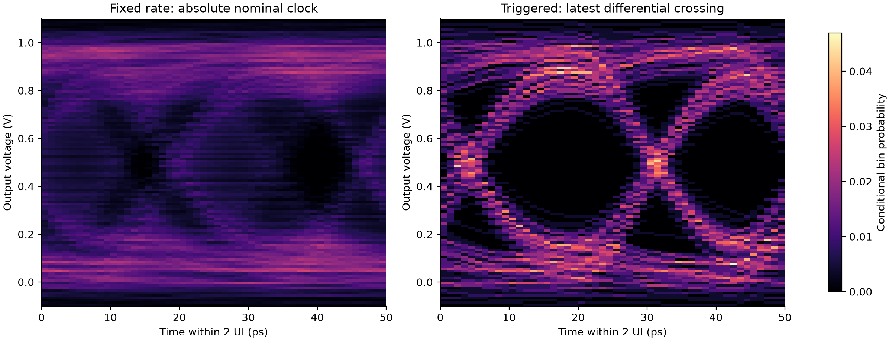

# HW5: Construction of statistical eye diagrams

Construct fixed-rate and differential-clock-triggered statistical eyes from the
supplied ADS receiver waveforms. The nominal bit rate is 40 Gbps, so one unit
interval (UI) is 25 ps and the displayed two-UI interval is 50 ps. The assignment
specifies spread-spectrum clock modulation; aligning each interval to a received
clock crossing produces a visibly larger eye opening than a fixed nominal clock.

## Run and verify

From the repository root, with Python 3.10 or newer:

```sh
python -m pip install -r homework/hw05/requirements.txt
python homework/hw05/src/hw5.py
python -m unittest discover -s homework/hw05/tests -p test_hw5.py -v
python homework/hw05/tests/verify_delivery.py
```

Input and output paths default to the homework directory, independently of the
current working directory. Run `python homework/hw05/src/hw5.py --help` for options.
The analysis runs without a graphical desktop. The supplied incomplete starter
in `instructions/` is reference material; run the rewritten `src/hw5.py`.

To rebuild the anonymous report:

```sh
python -m pip install -r homework/hw05/report/requirements.txt
python homework/hw05/report/build_report.py
```

## Results



- [Anonymous report](report/hw05_report.pdf)
- [Editable report text](report/report.md)
- [Numerical results and parameters](results/summary.json)
- [Independent full-data verification](results/verification.json)
- [Source coverage and original instruction checksums](source_manifest.json)

The run includes all 1,639,001 waveform samples in the fixed-rate histogram.
It finds 32,777 positive differential zero crossings and assigns 1,638,788 samples
to triggered intervals. The 170 samples before the first crossing and 43 samples
at least 50 ps after the latest crossing are excluded from the triggered eye.
The saved `results/histograms.npz` contains integer counts, column-normalized
probabilities, bin edges, column counts, and interpolated crossing times.

## Method

Both eyes use 50 time bins of 1 ps and 120 voltage bins of 10 mV, spanning
-0.1 to 1.1 V. The floor-based voltage index includes the minimum-voltage
offset. A sample at the exact upper voltage bound belongs to the final bin.
Time bins are half-open; small floating-point errors at exact bin boundaries
are repaired before flooring.

The fixed-rate phase uses absolute time relative to zero and folds it into 50 ps.
The triggered method forms `CLKp - CLKn`, locates negative-to-nonnegative zero
crossings, and interpolates the crossing time between adjacent clock samples.
Each measured voltage sample is assigned to the latest crossing and retained
only if its age is in `[0, 50 ps)`. This prevents overlapping intervals from
counting a sample twice. Voltage samples are not interpolated or resampled.

Each time column is normalized independently to give
`P(voltage bin | time bin)`. An empty column stays zero. These values are
probabilities per voltage bin; a continuous density approximation in inverse
volts would require a further division by the voltage-bin width. Both eye
figures share the same voltage, time, and probability scales.

Independent verification rebuilds the histograms using a separate binning
algorithm, checks every integer cell, and checks crossing times, count
conservation, and probability normalization. Synthetic tests also verify that
trigger alignment removes an imposed timing mismatch. Eye appearance depends
on the finite record and bin sizes; these plots alone do not establish a BER
or a Gaussian three-sigma eye margin. Re-running ADS is optional in the assignment
and is not part of the verification claimed here.

## Supplied files and anonymous replacements

`instructions/` contains all three supplied instruction files without changing
their bytes, including the 80 MB CSV. `source_manifest.json` records their SHA256
hashes and accounts for all three supplied submission files by role. The source
code is replaced by `src/hw5.py`; the report is rewritten as a regenerated PDF
and editable Markdown. Source folders and the original submission are preserved
at their original locations. Identity-bearing original submissions are not
published. Rewritten text, filenames, figure metadata, and this contribution's
commit author omit personal names and student numbers.

## Course attribution

Course materials, supplied simulation data, and the supplied `snpreader.py`
helper are credited to **Prof. Chiu-Chih Chou (周求致), Department of Electrical
Engineering, National Central University, Taiwan**. See the
[full attribution](../../ATTRIBUTION.md) and [input inventory](../../SIMULATION_INPUTS.md).
