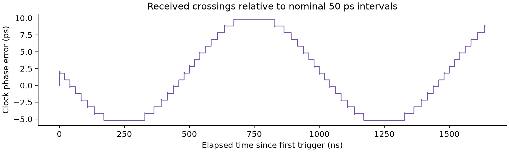

# Construction of statistical eyes

HW05 / Fixed-rate folding and differential-clock triggering

## Objective and setup

Reconstruct fixed-rate and triggered statistical eyes from the supplied ADS waveform record.
The same received waveform produces substantially different eyes when its time reference changes.
The triggered eye has a visibly larger opening because it follows the received clock rather than a constant nominal period.

The assignment specifies a nominal 40 Gbps bit rate: UI = 25 ps and a 2 UI window = 50 ps.
It describes a frequency deviation of approximately +/-2 MHz about 40 GHz with a 1 us modulation period. [1]
Spread spectrum clocking (SSC) causes a fixed time reference to drift relative to the data.

| Parameter | Value |
|---|---|
| Input columns | Time, Vo, CLKp, CLKn |
| Samples | 1,639,001 |
| Nominal sample spacing | 1 ps |
| Observed Vo range | -0.09617345 to 1.08581 V |
| Display window | 0 to 50 ps, identical for both eyes |
| Voltage range | -0.1 to 1.1 V |
| Grid | 120 voltage x 50 time bins |
| Bin sizes | 10 mV and 1 ps |
| Normalization | Per occupied time column |


**Figure 1.** Color denotes the probability of a voltage bin conditional on a time bin.
Both panels use the same axes and shared linear probability scale.
The received crossing phase spans 15.007 ps relative to nominal 50 ps intervals.
Fixed-rate folding spreads transitions across that changing phase; resetting time at positive differential-clock crossings reduces misalignment.
This supports the assignment's SSC alignment argument without establishing a bit error rate.

## Method and bin conventions

### 1. Preserve the waveform values

Require finite values and strictly increasing time; convert time from seconds to picoseconds.
Preserve all measured Vo samples. Interpolate only clock crossing times.

### 2. Fixed-rate folding and voltage assignment

With fixed origin t0 = 0 ps, dt = 1 ps, W = 50 ps and dV = 0.01 V:

```text
j_fixed = floor((t - t0) / dt) mod 50
k = floor((Vo - vmin) / dV)
```

The voltage offset is essential: negative voltage must map to low rows rather than wrap to high rows.
Bins are left-closed and right-open; the last voltage bin additionally includes exact vmax.
Only floating point roundoff close to integer bin boundaries is snapped before flooring.

### 3. Differential-clock triggers

Form c = CLKp - CLKn and find adjacent samples satisfying c[n-1] < 0 and c[n] >= 0.
Linearly interpolate their positive zero crossing:

```text
a = -c[n-1] / (c[n] - c[n-1])
t_cross = t[n-1] + a * (t[n] - t[n-1])
```

Choose the latest crossing at or before each data sample, set age = t - t_cross,
and retain the sample only for 0 <= age < 50 ps. Use j_triggered = floor(age / dt).
Triggered ages never wrap and each measured sample is counted at most once.
This avoids duplicate counts when adjacent 2 UI windows overlap.
Exclude samples before the first crossing and samples in gaps beyond 50 ps.

### 4. Count and normalize vertically

Count H[k,j] and normalize every occupied time column:

```text
P[k,j] = H[k,j] / sum_k H[k,j]
sum_k P[k,j] = 1
```

Empty columns remain zero. P is the discrete conditional probability P(voltage bin | time bin),
not a continuous voltage density; the latter would additionally divide by dV.
The plotted probabilities depend on the time and voltage bins.
The procedure follows the assignment starter and lecture vertical normalization. [2,3]

## Timing evidence and results



**Figure 2.** Positive crossing times relative to the first crossing plus n x 50 ps.
This is received-clock phase error relative to a nominal reference and includes the effects in the sampled waveform.

| Checked result | Fixed rate | Triggered |
|---|---:|---:|
| Samples counted | 1,639,001 | 1,638,788 |
| Count per occupied time column | 32,780 to 32,781 | 32,754 to 32,777 |
| Occupied / total time columns | 50 / 50 | 50 / 50 |
| Largest column-sum error | 2.22e-16 | 1.11e-16 |

There are 32,777 interpolated positive crossings.
Intervals range from 48.842 to 51.135 ps (mean 50.000269 ps).
Triggering excludes 170 samples before the first crossing and
43 samples with age at least 50 ps, accounting for the difference in totals.
Unequal column counts are expected.

## Verification and reproduction

Fourteen unit tests passed: bin boundaries, voltage offsets, crossing interpolation, trigger gaps and overlap,
normalization, invalid inputs, and synthetic rate drift.
A separate full-record histogram implementation matched all 6,000 fixed-rate bins and all 6,000 triggered bins exactly.
All probabilities are finite; occupied-column sums differ from one by at most 2.22e-16.

From the HW05 folder:

```sh
python -m pip install -r requirements.txt
python src/hw5.py
python -m unittest discover -s tests -v
python -m pip install -r report/requirements.txt
python report/build_report.py
python tests/verify_delivery.py
```

The analysis writes figures, summary.json and histograms.npz to results/.
The report builder reads the regenerated summary and figures and writes this Markdown report and hw05_report.pdf.

## Limits and conclusion

The triggered eye shows improved timing alignment for this finite ADS record.
Observed crossing intervals are received-waveform measurements, not estimates of the SSC source frequency extrema.
No noise model, BER extrapolation, threshold optimization or standardized eye-mask test was performed.
Any eye opening inferred from these bins remains sample- and bin-dependent.

## References

1. HW5_stat_eye_construction.pdf, pp. 1-3.
2. HW5_stateye_construction_sample.py.
3. 5 Eye diagram.pdf, pp. 4-5 and 14-17.

Data: HW5_ADS_waveforms.csv.
