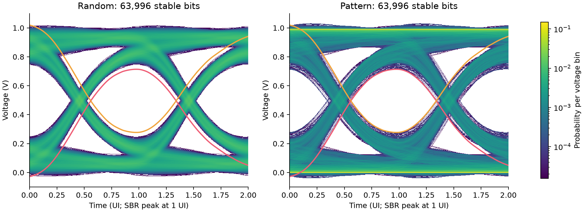

# HW6: Peak distortion analysis

Reconstruct the 40 Gbit/s channel's single-bit response (SBR), predict its
worst-case inner eye boundaries, and compare them with random NRZ and the
supplied adverse bit pattern. The model uses 0 to 2 V source levels, a 25 ps UI,
equal 5 ps linear rise/fall ramps, and the matched transfer `S21/2`.

## Reproduce

From the repository root, with Python 3.10 or newer:

```sh
python -m pip install -r homework/hw06/requirements.txt
python homework/hw06/src/hw6.py
python -m unittest discover -s homework/hw06/tests -v
python homework/hw06/tests/verify_results.py
```

The solver resolves default input/output paths relative to the homework folder
and runs without a graphical desktop. `--help` lists configuration options.
`--no-plots` runs the calculations with only NumPy. The incomplete supplied
starter in `instructions/` is reference material; run `src/hw6.py`.

To rebuild the anonymous report from the verified default results:

```sh
python -m pip install -r homework/hw06/report/requirements.txt
python homework/hw06/report/build_report.py --refresh
```

## Results



- [Six-page anonymous report](report/hw06_report.pdf)
- [Editable report text](report/report.md)
- [Rewritten analysis](src/hw6.py)
- [Numerical summary](results/summary.json)
- [Independent verification](results/verification.json)
- [Saved SBR, histograms, boundaries and extrema](results/arrays.npz)
- [Source inventory and SHA-256 hashes](source_manifest.json)

| Quantity | Recorded value |
| --- | --- |
| SBR peak | 0.763223150 V at 801.1 ps |
| Exact finite-model maximum gap | 0.436735919 V at 0.976 UI |
| Minimum one / maximum zero there | 0.713767426 / 0.277031508 V |
| Random record's observed gap at that phase | 0.501776840 V |
| Supplied pattern's observed gap at that phase | 0.436897687 V |
| Input coverage | All 64,802 bits per case, including the final 290-bit partial block |
| Stable eye windows | 63,996 per case; 403 guard reference bits per end |
| Exact-bound violations | None within numerical precision |

The supplied pattern approaches each boundary to within approximately 80.9
microvolts at the optimum phase. A finite random record need not contain the
bit combinations that attain the worst deterministic ISI.

## Method and corrections

The causal trapezoid spectrum is
`Vpp*Tb*sinc(f*Tb)*sinc(f*Tr)*exp(-j*pi*f*(Tb+Tr))`. A real, correctly scaled IDFT
uses all 8,001 measured frequencies from DC to 80 GHz, a Kaiser alpha of 1, and
0.1 ps sampling. The SBR is truncated inclusively at 10 ns.

The PDA selects negative and positive nonmain cursor contributions separately.
Every retained tap contributes to the solid plotted bounds. Separate dashed
curves apply the 0.2 mV per-tap tolerance. Those filtered bounds are relaxed:
many individually small taps can accumulate, with a maximum omitted absolute
sum of 6.314784 mV. They are not claimed as strict envelopes for the raw kernel.

FFT overlap-add convolves the binary impulse train with the already shaped
SBR, retaining each complete linear output tail and the final partial block.
This is equivalent to applying the linear channel to equal-ramp NRZ; it avoids
duplicating pulse shaping or the matched-source factor.

Time alignment follows `kmain = argmax(SBR)` and `kstart = kmain - samples_per_ui`.
Eyes are built over one UI and then duplicated. The single-color figures show
512 uniformly selected traces; all stable windows enter the histograms and
every numerical extremum. Each of the 250 histogram columns contains 63,996
samples and is normalized independently. Probabilities are per voltage bin,
not continuous voltage densities or BER estimates.

Nine synthetic tests check exhaustive PDA combinations, tolerance signs,
causal pulse phase and matched gain, direct versus sectional convolution,
final partial blocks, temporal alignment, histogram conservation, and readers.
The saved-result verifier imports no implementation functions. It rebuilds
the SBR with a full Hermitian IFFT and direct frequency sums, computes PDA
with a separate phase-total method, and reconstructs every full-record eye
sample using symbol-rate polyphase convolutions. All histogram cells agree;
the maximum recorded extrema discrepancy is below 1.1e-15 V.

## Inputs and anonymity

All four files in the supplied `Instruction` folder are included byte for byte:

- `instructions/HW6_PDA.pdf`
- `instructions/HW6_PDA_sample.py`
- `instructions/HW6_channel.s2p`
- `instructions/HW6_wcbitpattern.txt`

The separately supplied channel and bit file have identical hashes to these
copies, so they are stored once. The rewritten two-port Touchstone reader
supports MA, DB and RI data and does not require the legacy `snpreader.py`.
The original student report and identifying solution source are not uploaded.
Their replacements contain no personal name, student ID, email or workstation
path; the report's PDF author field is empty. Original local references are
unchanged. The GitHub repository owner remains visible.

## Scope

The solid PDA curves are exact only for the finite, windowed, bandwidth-limited
SBR used by the convolution. Extending truncation from 10 to 20 ns changes the
maximum gap by about 0.218 mV; it does not establish infinite-support accuracy.
The optional ADS simulation was not run. Noise, jitter, nonlinear I/O behavior,
and receiver error/threshold models are outside this calculation.

## Course attribution

Course materials, supplied simulation data, and the supplied `snpreader.py`
helper are credited to **Prof. Chiu-Chih Chou (周求致), Department of Electrical
Engineering, National Central University, Taiwan**. See the
[full attribution](../../ATTRIBUTION.md) and [input inventory](../../SIMULATION_INPUTS.md).
