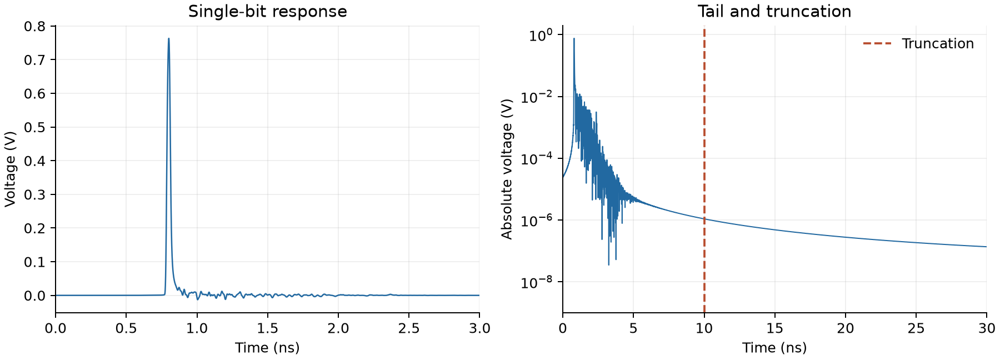
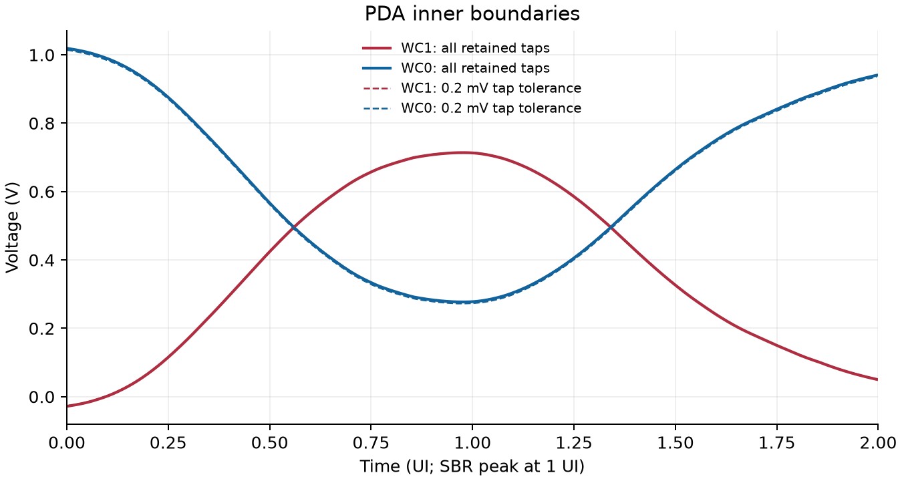
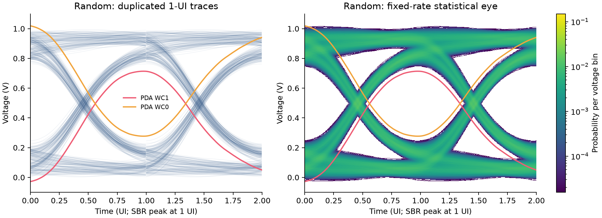
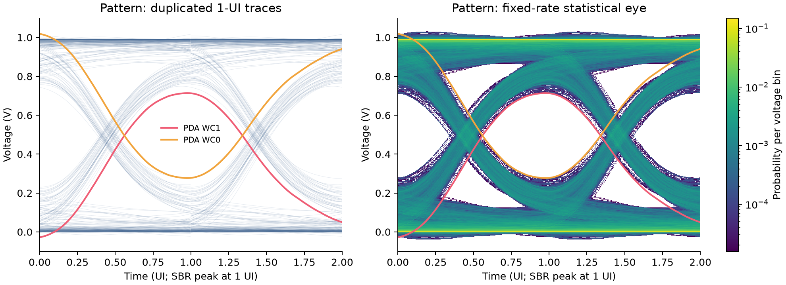

> NCU EE8091 / Signal Integrity and Electromagnetic Compatibility

# HW6: Peak distortion analysis

Anonymous technical report. Rewritten calculations, regenerated figures and independently checked numerical results.

## 1. Assignment and signal model

The supplied two-port network carries a 40 Gbit/s unipolar NRZ source. This work computes the worst-case inner eye boundaries, overlays them with random-data and supplied-pattern eyes, and explains the difference. All four supplied instruction files are retained unchanged in `instructions/`.

| Parameter | Value or convention |
| --- | --- |
| Input levels and UI | 0 to 2 V; Tb = 25 ps |
| Rise and fall time | Equal 5 ps linear ramps |
| Matched transfer | H(f) = S21(f) / 2; 50 ohm ports |
| Supplied S21 grid | 8,001 points; DC to 80 GHz; 10 MHz spacing |
| Time grid and IDFT | 0.1 ps; 250 samples/UI; 1,000,000 points |
| Kernel and blocks | 10 ns inclusive SBR; 100,001 taps; 1,024 bits per section |
| PDA tolerance | 0.2 mV per interfering tap; unfiltered bounds also retained |

The single-bit input is a causal trapezoid: it rises on [0, Tr], stays high on [Tr, Tb], and falls on [Tb, Tb + Tr]. With sinc(x) = sin(pi*x)/(pi*x), its physical Fourier transform is:

```text
Vin(f) = Vpp * Tb * sinc(f*Tb) * sinc(f*Tr)
         * exp(-j*pi*f*(Tb + Tr))
P(f)   = Vin(f) * S21(f)/2 * W(f)
```

Here W(f) = I0(pi*alpha*sqrt(1-(f/fmax)^2))/I0(pi*alpha), with alpha = 1 and fmax = 80 GHz. The causal phase uses the sum Tb + Tr. Frequencies beyond the supplied band are set to zero. The taper and finite band are part of the numerical channel model, rather than measured extensions of it.

The real IDFT uses Hermitian symmetry and the scale M*df. DC is counted once and positive/negative frequency pairs are counted once each. No additional factor of two or matched-source factor is applied during the later convolution.

**Recorded result.** The finite-model worst-case vertical opening is **0.436735919 V**. The supplied pattern approaches it much more closely than the equally long random record. These are deterministic ISI results; no BER, jitter or random-noise performance is inferred.

<!-- pagebreak -->

## 2. SBR and worst-case boundaries



The SBR peak is 0.763223150 V at 801.1 ps. Define kmain = 8011 and kstart = kmain - 250 = 7761. PDA evaluates the 500 points beginning at kstart; the SBR peak therefore lies at exactly 1 UI on the plotted axis.

At each time t, write the output as the reference bit's response plus all other symbol-spaced SBR contributions. The smallest possible one includes every negative interfering contribution; the largest possible zero includes every positive one:

```text
WC1(t) = p(t) + sum of all negative nonmain cursor values
WC0(t) =        sum of all positive nonmain cursor values
gap(t) = WC1(t) - WC0(t)
```



The exact maximum gap occurs at 0.976 UI, corresponding to SBR time 800.5 ps and nominal global phase 0.5 ps. WC1 = 0.713767426 V and WC0 = 0.277031508 V. "Exact" here refers to the finite, windowed, bandwidth-limited SBR used by the solver; it is not an infinite-support physical-channel guarantee.

<!-- pagebreak -->

## 3. Purely random NRZ

The random case uses NumPy's default_rng with seed 0 and the same 64,802-bit length as the supplied file. The equal-ramp input can be written as a sum of shifted single-bit trapezoids. Linearity therefore permits sectional convolution of the binary impulse train with the already shaped channel SBR.

Every FFT section is padded to at least its input length plus the SBR length minus one. Entire output tails are added at their original sample offsets. The final 290-bit partial section is retained. This produces the same finite-model output as direct linear convolution, without applying the pulse shaping twice.



The waveform is folded into one UI using the sample origin kstart, then that one-UI plot is duplicated. No arbitrary time offset is fitted. For steady-state eyes, 403 reference bits at each record end are excluded; 63,996 stable windows remain. The solver still convolves all 64,802 input bits and their complete finite-model tail.

The single-color view shows 512 uniformly selected stable traces for readability. The statistical eye and every reported extremum use all stable windows. With 512 voltage bins from -0.1 to 1.1 V, each time column contains 63,996 observations. Color is probability per voltage bin conditional on time, not a voltage density or BER. Zero-count bins are masked.

| Metric at the exact PDA optimum | Random record |
| --- | --- |
| Smallest observed one | 0.747733728 V |
| Largest observed zero | 0.245956888 V |
| Observed vertical gap | 0.501776840 V |
| Distance above WC1 / below WC0 | 33.966302 / 31.074620 mV |
| Maximum exact-bound violation | 0 V within numerical precision |

The random eye is wider than the worst-case prediction because this finite record need not contain the particular bit combinations that maximize every ISI contribution at a chosen phase.

<!-- pagebreak -->

## 4. Supplied pattern and comparison

The supplied bit file contains 64,802 bits, of which 32,401 are ones. It is processed with the identical SBR, block size, guard, time origin, voltage bins and plotting scales used for random NRZ.



| At 0.976 UI | PDA bound | Supplied pattern |
| --- | --- | --- |
| Minimum one (V) | 0.713767426 | 0.713848310 |
| Maximum zero (V) | 0.277031508 | 0.276950624 |
| Vertical gap (V) | 0.436735919 | 0.436897687 |


At this optimum, the supplied pattern is only 80.884 microvolts above WC1 and 80.884 microvolts below WC0. Its observed gap is 0.000161768 V larger than the bound, whereas the random gap exceeds it by 0.065040922 V. This supports the assignment's intended distinction: a deliberately adverse pattern reveals rare ISI combinations more efficiently than an equally long random record. It does not establish that every boundary point is reached by one common bit pattern.

<!-- pagebreak -->

## 5. Tolerance, truncation and verification

A tolerance removes small taps; it does not make them random or physically absent. The filtered maximum gap is 0.441864023 V at 0.968 UI. Ignoring many tiny contributions can cumulatively move an envelope by more than a single 0.2 mV threshold. The largest phasewise sum of omitted absolute contributions is 6.314784 mV. Solid overlays therefore retain every tap, and tolerance checks use the accumulated omitted positive/negative sums.

| SBR truncation (ns) | Unfiltered maximum gap (V) | Filtered maximum gap (V) |
| --- | --- | --- |
| 3 | 0.438385828 | 0.441864023 |
| 5 | 0.437196206 | 0.441864023 |
| 10 | 0.436735919 | 0.441864023 |
| 20 | 0.436517737 | 0.441864023 |

Extending the finite kernel from 10 to 20 ns changes the maximum gap by 0.218182 mV and either inner boundary by at most 0.218487 mV. The largest interior tail sample after 10 ns and before 90 ns is 1.093100 microvolts. The 100 ns periodic wraparound is excluded from this tail measurement. These sensitivity checks quantify finite-model dependence; they do not prove convergence to infinite support.

### Independent numerical checks

The saved-result verifier imports no functions from the analysis module. It rebuilds the full real SBR with a two-sided Hermitian IFFT and separately evaluates six time points by a direct frequency sum. It computes PDA using phase totals with the main contribution removed. To validate every eye sample without reusing overlap-add, it reconstructs each waveform phase as an independent symbol-rate FIR convolution.

| Check | Result |
| --- | --- |
| Synthetic unit tests | 9 passed; exhaustive bit combinations, tolerance signs, pulse gain and phase, direct convolution, temporal alignment, histogram and readers |
| Supplied-file integrity | All 4 instruction SHA-256 hashes match |
| PDA and truncation study | All 500 conditional phases and all four truncation lengths agree |
| Full-record conditional values | 31,998,000 evaluations per case across two UI |
| Independent extrema difference | At most 1.083e-15 V |
| Histogram counts | Every bin agrees; 15,999,000 one-UI samples per case |
| Column normalization | Maximum error below 1.4e-15 |

The two-UI conditional evaluations overlap in time and retain the same reference-bit label; they are not distinct histogram observations. The displayed statistical eye is instead the duplicated one-UI histogram, as requested by the assignment.

<!-- pagebreak -->

## 6. Reproduce and interpret the results

Run these commands from the repository root with Python 3.10 or newer:

```text
python -m pip install -r homework/hw06/requirements.txt
python homework/hw06/src/hw6.py
python -m unittest discover -s homework/hw06/tests -v
python homework/hw06/tests/verify_results.py
```

To regenerate this report after the verified default run:

```text
python -m pip install -r homework/hw06/report/requirements.txt
python homework/hw06/report/build_report.py --refresh
```

The solver is portable: its default paths are resolved relative to the homework directory. It runs without a graphical desktop. `results/summary.json` records configuration and measured quantities; `results/arrays.npz` stores the SBR, boundaries, both input records, exact histogram counts, probabilities, trace subset and observed extrema. `results/verification.json` records the independent checks. `source_manifest.json` identifies all supplied instruction files by checksum.

### Interpretation and scope

- PDA directly predicts the deterministic finite-model inner eye limits from one SBR. A long random simulation is not needed to obtain those limits.
- The supplied pattern approaches the limits closely; the finite random record leaves a larger observed eye opening. Probabilities inside the eye still require a statistical calculation.
- Truncation controls the available ISI memory and computational cost. A per-tap tolerance must be reported separately from accumulated envelope relaxation.
- The one-UI folding origin follows kmain and kstart. Duplicating one UI samples the same time-phase distribution on both displayed UIs; directly grouping disjoint two-UI blocks can change finite-record pattern coverage.
- Linearity and equal rise/fall shaping are assumed. Random noise, jitter, nonlinear driver/receiver behavior and an explicit receiver threshold/error model are absent.
- The optional ADS task was not run. The validation here is independent numerical reconstruction, not comparison with a newly executed ADS simulation.

### Provenance and anonymity

The report and implementation are rewritten from the assignment and reviewed reference work, with new figures and verified calculations. The four original instruction files are preserved byte for byte. The channel and bit file mentioned separately are identical to the instruction copies, so they are stored once. The rewritten two-port reader is self-contained; the legacy `snpreader.py` is not required.

No original student report or personally identifying source file is included. This report has no personal author field, student number, email address, signature, or workstation path. Source files in the local reference folders are unchanged. The GitHub hosting account remains visible independently of the report's anonymous content.

**Reference.** NCU EE8091, HW6: Peak distortion analysis, including the circuit, required comparisons and implementation notes in `instructions/HW6_PDA.pdf`. The incomplete supplied starter remains in `instructions/HW6_PDA_sample.py`; the executable replacement is `src/hw6.py`.
