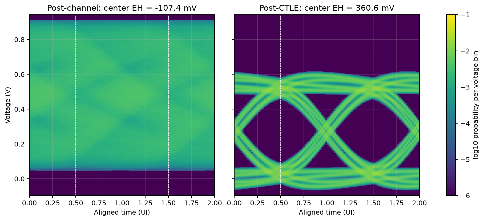

# HW7: CTLE design and simulation

A portable rewrite of the supplied CTLE exercise for a 50 cm stripline and a
40 Gbit/s NRZ source. The supplied assignment, incomplete starter template, and
complete channel data are retained in `instructions/`. The verified implementation
is `src/hw7.py`; the starter template is reference material and is intentionally
incomplete.

The [anonymous report](report/hw07_report.pdf) and its
[editable source](report/report.md) document the verified design and checks.

## Verified design

| Quantity | Verified value |
| --- | ---: |
| First pole | 20.6 GHz |
| Second pole | 22.8 GHz |
| DC gain parameter | -4.91 dB |
| Nominal AC gain parameter | 11.48 dB |
| Actual CTLE maximum | 5.979953 dB at 21.216523 GHz |
| Finite-pattern center eye height | 360.606 mV |
| Conservative PDA, 20 ns impulse | 319.309 mV |
| Conservative PDA, complete 100 ns FFT period | 317.824 mV |
| Conservative PDA, complete period at 0.25 ps | 317.717 mV |

Both the finite-pattern result and the conservative estimates exceed the
300 mV requirement. The nominal AC parameter exceeds 6 dB, but the actual
maximum of the complete two-pole response remains below 6 dB, as required.
This is a verified feasible design, not a claim of a global optimum.



The unequalized signed center separation is -107.404 mV: the conditional
one and zero levels overlap, so there is no positive eye opening. Each path
is aligned to its own best PDA sampling phase; the vertical markers identify
eye centers at 0.5 and 1.5 UI. See `results/metrics.json` for the exact numerical
conventions and `results/independent_verification.json` for independent checks.

## Reproduce

From the repository root, with Python 3.10 or newer:

```sh
python -m pip install -r homework/hw07/requirements.txt
python homework/hw07/src/hw7.py
python homework/hw07/tests/verify_reference.py
python homework/hw07/report/build_report.py
```

The solver runs without a graphical desktop. Its input and default output paths
are relative to the homework directory, independent of the current working
directory. See `python homework/hw07/src/hw7.py --help` for numerical settings.

## Model and acceptance criteria

- Source: 40 Gbit/s NRZ, 25 ps per bit, 5 ps transition ramp, 0 to 2 V.
- Matched voltage transfer: `S21_channel * S21_CTLE / 2`. The factor of one half
  is applied exactly once and is separate from one-sided Fourier reconstruction.
- CTLE: the assignment's USB-form transfer function, with two poles, one zero,
  DC gain, and nominal AC gain. Gains in dB are converted to linear amplitude.
- Each pole must be between 1 and 40 GHz; DC gain between -20 and +6 dB.
  The actual maximum of the complete CTLE response must not exceed 6 dB.
  The nominal AC gain parameter is not the actual peak gain.
- The target is a center eye height of at least 300 mV. Finite-pattern eye
  height and the conservative single-bit-response estimate are reported
  separately, with the sampling phase and propagation delay stated explicitly.

The frequency-domain Kaiser window uses the actual highest supplied frequency,
80 GHz. All 8,001 original frequency records are used, including DC, with their
uniform 10 MHz spacing. No frequency extrapolation or artificial voltage
normalization is applied. Equalized and unequalized results use identical bits.

## Deliverables

- `src/hw7.py`: channel reader, CTLE model, waveform simulation, eye analysis,
  parameter study, and plotting.
- `tests/verify_reference.py`: independent numerical checks.
- `results/`: measured results and the frequency, eye, and waveform figures.
- `report/hw07_report.pdf`: anonymous report.
- `report/report.md` and `report/build_report.py`: editable and reproducible report.
- `source_manifest.json`: supplied-file coverage and checksums.

The three waveform comparisons each span exactly 1 ns, starting at 100, 200,
and 300 ns. Statistical-eye plots use voltage increasing upward and center the
selected receiver sampling phase. A positive simulated eye opening is evidence
for this noise-free linear model and finite channel data, rather than a measured
hardware BER. The optional ADS ChannelSim exercise is not claimed as completed.

## Provenance and anonymity

The supplied instruction files are preserved byte for byte. The submitted
solver, channel reader, tuning notes, and report have been reviewed; the solver
and reader are replaced by the verified implementation, and the report is
regenerated from its numerical results. The duplicate channel file is stored
once under `instructions/`. The original report and identity-bearing source
filenames are not published. Names, student numbers, personal contact details,
and machine-specific paths are absent from the rewritten code and report.
Source folders outside this repository are not modified.

The course materials retain their existing provenance; no ownership or blanket
license is asserted over supplied files. The public repository's owner and
GitHub activity remain visible separately from the anonymous report content.

## Course attribution

Course materials, supplied simulation data, and the supplied `snpreader.py`
helper are credited to **Prof. Chiu-Chih Chou (周求致), Department of Electrical
Engineering, National Central University, Taiwan**. See the
[full attribution](../../ATTRIBUTION.md) and [input inventory](../../SIMULATION_INPUTS.md).
