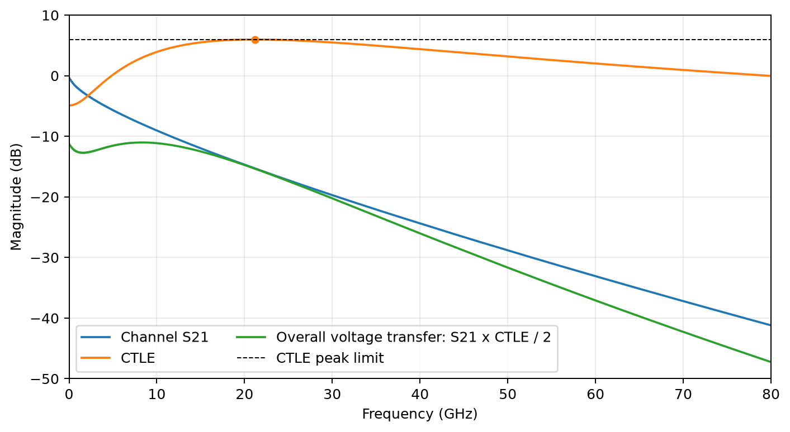
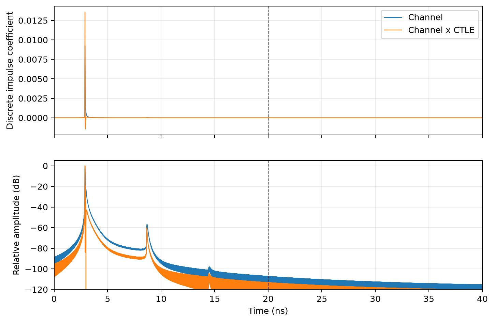
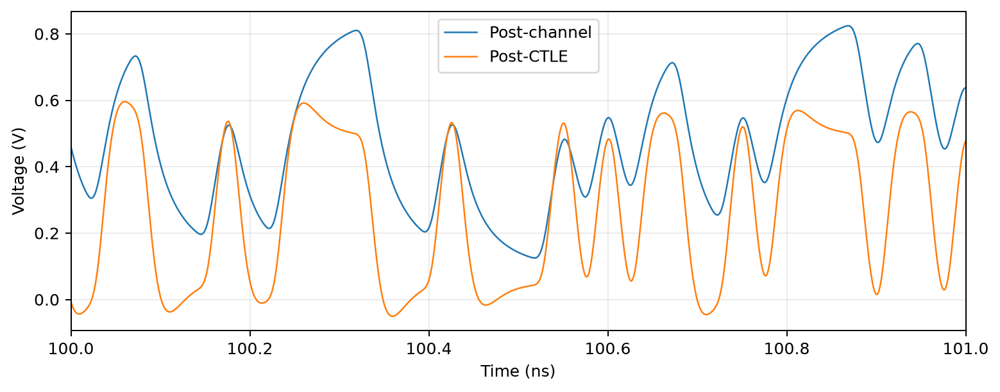
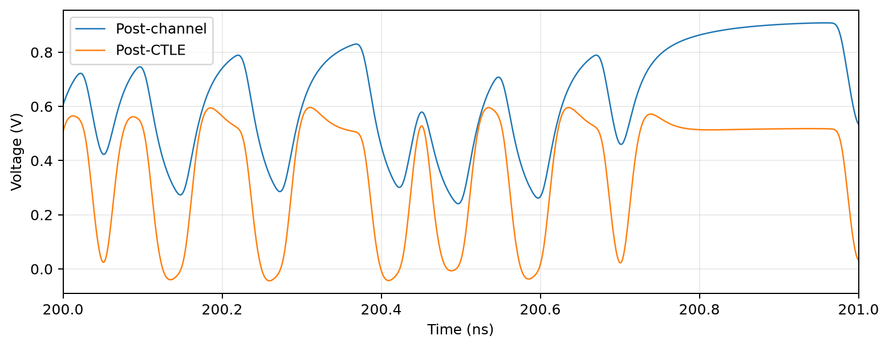
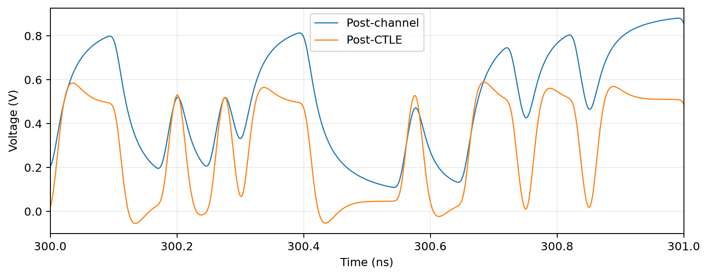

# HW7 | CTLE simulation and design

Anonymous numerical report.

A two-pole, one-zero CTLE was tuned for the supplied 50 cm stripline at 40 Gbps. The center eye height increases from -107.40 mV to 360.61 mV, with a PDA margin of 319.31 mV. All assignment constraints are checked explicitly.

## Selected design

| Parameter | Selected value | Meaning |
| --- | --- | --- |
| f_p1 | 20.600000 GHz | First pole frequency |
| f_p2 | 22.800000 GHz | Second pole frequency |
| A_DC | -4.910000 dB | DC amplitude gain |
| A_AC | 11.480000 dB | Midband gain parameter |
| f_z | 3.121528 GHz | Derived zero frequency |

The USB-style two-pole, one-zero transfer function is

$$H_{eq}(s)=a_{AC}\omega_{p2}\frac{s+(a_{DC}/a_{AC})\omega_{p1}}{(s+\omega_{p1})(s+\omega_{p2})}.$$

Here $a_{DC}=10^{A_{DC}/20}$, $a_{AC}=10^{A_{AC}/20}$, $\omega_p=2\pi f_p$, and $f_z=(a_{DC}/a_{AC})f_{p1}$. A_AC is a midband asymptote parameter, not the actual peak. [1, 2]

| Constraint | Computed result | Status |
| --- | --- | --- |
| 1 <= fp1, fp2 <= 40 GHz | 20.600, 22.800 GHz | PASS |
| Maximum CTLE gain <= 6 dB | 5.9800 dB | PASS |
| -20 <= A_DC <= +6 dB | -4.910 dB | PASS |
| Center eye height >= 300 mV | 360.61 mV | PASS |

The exact continuous-frequency maximum occurs at 21.216523 GHz. The gain limit is checked at the analytic maximum, not only on the plotted samples.

## Model and input

The supplied 50 cm stripline has 8,001 complex samples, frequency spacing 10 MHz, maximum frequency 80 GHz and 50 ohm reference impedance. The complete complex S21 is retained, including phase.

The positive-frequency spectrum is Kaiser-tapered at the actual 80 GHz data cutoff (alpha = 1), then zero-padded to the simulation Nyquist frequency and transformed by real inverse FFT. The retained impulse response is 20 ns long. No independent hardcoded data cutoff is used.

The same 65,536 seeded random bits (seed 0) drive both paths at 40 Gbps. UI = 25 ps, source swing = 2 Vpp, rise time = 5 ps and 50 samples/UI (dt = 0.5 ps). The source is unipolar NRZ with full 0-to-100% linear transitions, following the supplied sample-code convention (the modeled 10-90% transition is 4 ps). The first 800 bits are discarded to remove the finite-record startup transient.

The matched transfer functions are $H_{ch}=S21_{ch}/2$ and $H_{total}=S21_{ch}H_{eq}/2$. The divider is applied exactly once. Sectional convolution uses overlap-add and retains the output tail. The inverse FFT produces a discrete impulse response, so there is no extra dt multiplication. Its full-period sample sum equals the DC transfer; truncation slightly changes the sum and is not renormalized.

## Statistical eyes and center eye height

| Center metric | Post-channel | Post-CTLE |
| --- | --- | --- |
| Random-pattern eye height (mV) | -107.40 | 360.61 |
| PDA eye height (mV) | -198.33 | 319.31 |
| Minimum conditional one level (mV) | 426.35 | 454.72 |
| Maximum conditional zero level (mV) | 533.76 | 94.12 |
| Selected SBR sample time (ns) | 2.9020 | 2.9005 |
| Sample index within the UI | 4 | 1 |
| Analyzed bits | 64,736 | 64,736 |

Each path uses its own fixed sampling phase, chosen by maximizing the single-bit-response PDA margin around its main cursor. The plotting centers are aligned to 0.5 and 1.5 UI. At that fixed phase the random-pattern center eye height is

$$EH_{random}=\min(v\mid b=1)-\max(v\mid b=0),$$

over every retained bit. There is no density or probability threshold that removes rare excursions. A negative value is a signed separation indicating a closed eye. PDA sums worst-case sampled precursor and postcursor contributions from the isolated bit response, including the same 5 ps source ramps. PDA covers more bit combinations than the finite random sequence and is reported separately.

## Three 1 ns snapshots

These three overlays use the same complete simulated record and the same voltage scale for both received paths.

The CTLE reduces the long channel tail and separates received logic levels. Overshoot and negative undershoot can remain; their contributions at the sampling phase enter the eye-height calculation.

## Independent verification

- **Independent reader and gain checks.** All 12 unit/format combinations reproduce a defined two-port matrix. A dense 12-decade frequency sweep and a separately derived peak calculation confirm the global CTLE gain limit.
- **Impulse and physical normalization.** The real IFFT matches a full Hermitian IFFT and preserves the DC kernel sum. An identity transfer maps the 2 V source high level to 1 V with exactly one matched-source division by two.
- **Direct versus sectional convolution.** Overlap-add matches direct linear convolution for a 137-bit pattern, including its partial final block and final falling ramp; transition endpoints independently match time-knot interpolation.
- **Eye alignment and sensitivity.** Bit-conditioned random EH and all-tap PDA use y[k*samples_per_ui+cursor] against bit k and remain distinct measures. An independent continuous-pulse spectrum, 0.25 ps grid and full 100 ns impulse period retain more than 300 mV worst-case margin.

Extending the retained impulse response from 20 to the full 100 ns gives PDA EH = 317.824228 mV. Halving dt to 0.25 ps gives a full-period PDA EH of 317.717038 mV (change -0.107191 mV). The target remains satisfied without impulse-response renormalization.

## Interpretation and limits

This is a linear, frequency-domain, noise-free calculation for the supplied channel. It retains channel phase and delay, but does not introduce receiver noise, clock jitter, nonlinearity or saturation. CTLE can increase high-frequency noise and does not generally remove reflection notches. Finite-pattern eye height and finite-tail PDA are not BER predictions. No independently validated analog circuit is claimed.

The optional ADS ChannelSim exercise was not performed. Every figure and numerical claim comes from the accompanying Python calculation and independent checks.

## References

[1] *Homework: CTLE simulation and design*, [assignment brief](../instructions/HW7_CTLE.pdf), pp. 1-3. The supplied channel and sample program are stored alongside the brief.

[2] Course lecture, *Continuous Time Linear Equalizer (CTLE)*, pp. 6-9 and 11-14. Transfer-function conventions, circuit interpretation and over-equalization.

Channel SHA-256: `564560062e750405e89cadbb8be73cc7a40ad3188d19383ebbfe1e22723f5efc`
