# Transmitter FFE design and simulation

> HW8 - Introduction to Signal Integrity and Electromagnetic Compatibility

This report designs and evaluates a transmitter feedforward equalizer (FFE) for
the supplied 50 cm stripline channel. All five required configurations are
recomputed from the same random bit sequence. The post-FFE transmitter waveform
is constructed explicitly and propagated through the channel by sectional
convolution. The equivalent FFE frequency response is shown only for reference.

## Model and parameters

| Quantity | Setting |
| --- | --- |
| Channel | Supplied HW7_stripline_50cm.s2p, 50 ohm reference |
| Bit rate / modulation | 40 Gb/s, binary NRZ |
| Unit interval | 25 ps |
| Source bit levels | 0 V and 2 V before FFE |
| Source-to-load transfer | H(f) = S21(f) / 2, applied once |
| Rise and fall duration | 5 ps, 0 to 100%, for every transition size |
| Time sample spacing | 0.5 ps, 50 samples/UI |
| FFE tap spacing | 1 UI |
| Kaiser parameter | alpha = 0.5; beta = pi times alpha |
| Retained causal channel FIR | 20 ns |
| Random sequence | 65,536 measured bits; seed 0; guard bits excluded |

### Calculation sequence

Read the Touchstone frequency grid and complex S21. Apply the matching factor and
Kaiser window, construct a Hermitian spectrum, and obtain a real sampled channel
impulse response. Compute the single-bit response (SBR), sample its cursors one
UI apart, solve the finite zero-forcing system, and normalize the taps.

Convolve the binary voltage levels with the taps. At each bit boundary, interpolate
from the previous level to the new level over exactly 5 ps. Convolve this actual
time waveform with the channel FIR in zero-padded sections, adding overlapping
tails. Reuse the same bit pattern for every configuration.

<!-- pagebreak -->

## Tap design and numerical results

Index channel cursors relative to the unequalized SBR maximum. For taps indexed
from -Npre through Npost, use the following finite design system:

```text
A[i,j] = a[r_i - n_j]         (unselected cursors set to zero)
A c_raw = e_main
c = c_raw / sum(abs(c_raw))
```

The main tap is at vector position Npre. A causal implementation stores the
leftmost tap first and adds Npre UI of latency. A precursor does not require
access to an unavailable future bit.

| Case (pre / post) | Coefficients, left to right | Design residual (V) |
| --- | --- | --- |
| 1 (0 / 0) | +1.000000 | 0 |
| 2 (1 / 0) | -0.099584, +0.900416 | 5.55e-17 |
| 3 (0 / 1) | +0.687143, -0.312857 | 5.4e-18 |
| 4 (1 / 1) | -0.070629, +0.638611, -0.290760 | 2.78e-17 |
| 5 (1 / 2) | -0.071021, +0.642151, -0.276095, -0.010733 | 1.39e-17 |

The design residual measures A c minus the normalized target at the **retained
design cursors**. It is not the residual of the full physical channel. Omitted
channel cursors can contribute at these same times, and normalization reduces
the main-cursor voltage from the unnormalized unit target.

For example, case 4 retains a maximum selected off-main contribution of
5.871 mV at the original design phase.
The absolute sum of all other UI-spaced analytic cursors at its chosen sampling
phase is 69.380 mV. These physical-response
quantities remain much larger than the finite matrix residual.

| Case | SBR main (mV) | Empirical gap (mV) | Tx swing (V) |
| --- | --- | --- | --- |
| 1 | 391.198 | -93.407 | 2.000000 |
| 2 | 334.503 | -38.655 | 2.000000 |
| 3 | 258.214 | 186.829 | 2.000000 |
| 4 | 226.692 | 180.814 | 2.000000 |
| 5 | 228.390 | 175.597 | 2.000000 |

The empirical gap is the minimum sampled high voltage minus the maximum sampled
low voltage in this finite, noiseless random run, at the phase selected by each
equalized SBR. A negative value means the two observed distributions overlap.
It is neither a BER estimate nor a 3-sigma eye-height measurement or a guarantee
for every possible bit sequence. No gain or vertical offset is fitted between
cases. Source swing is bounded by the absolute-sum tap constraint.

For this recorded run, case 3 has the largest empirical gap,
186.829 mV. Cases 1 and 2 have
overlapping sampled distributions. The finite ZF system targets cancellation,
not direct maximization of this gap; increasing the tap count does not make the
gap improve monotonically.

<!-- pagebreak -->

## Channel response in the time domain

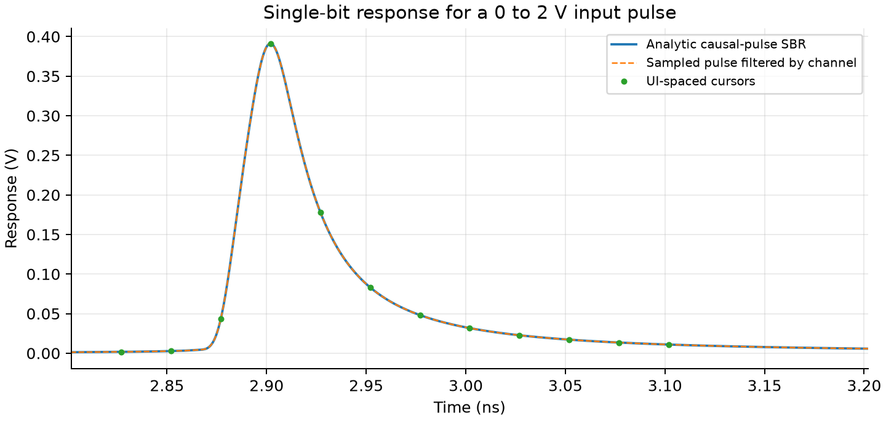

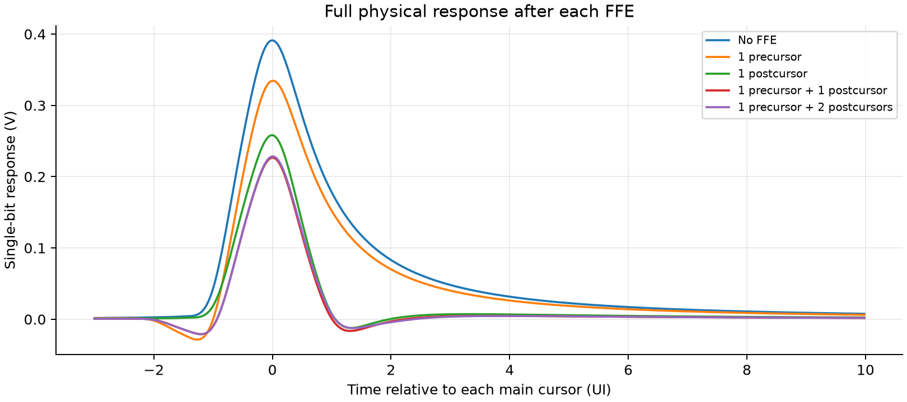

<!-- pagebreak -->

## Eye diagrams: cases 1 and 2

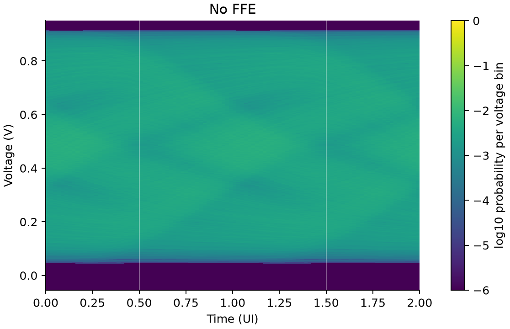

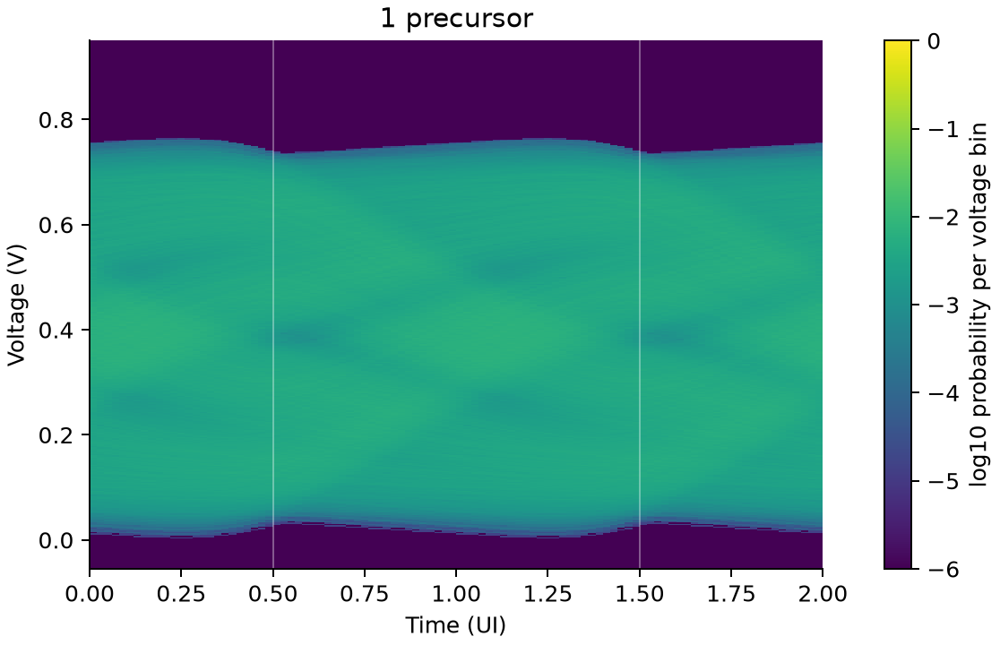

<!-- pagebreak -->

## Eye diagrams: cases 3 and 4

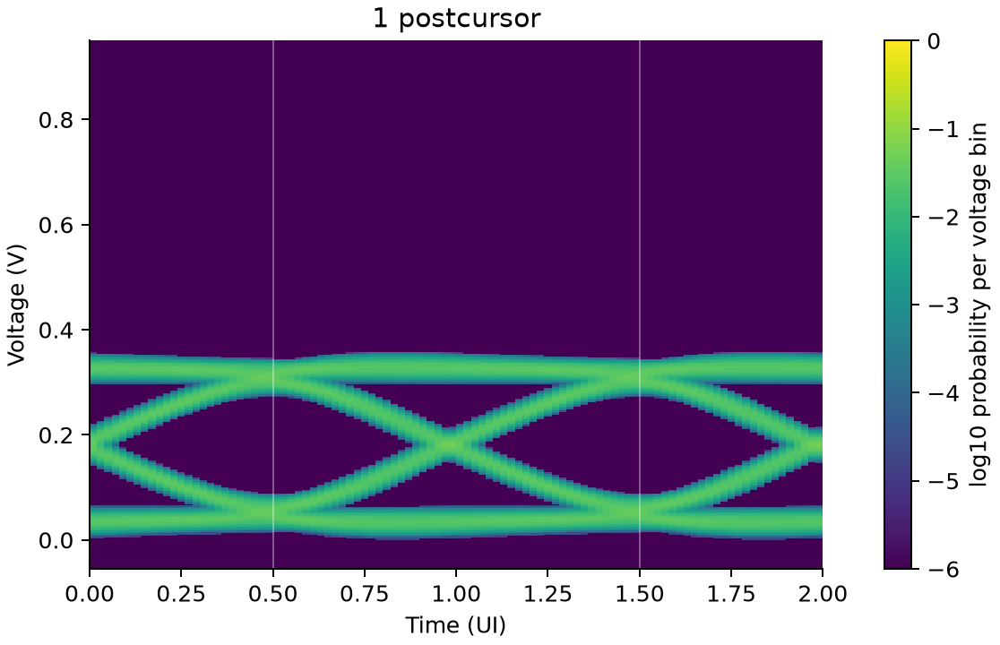


<!-- pagebreak -->

## Eye diagram: case 5 and frequency reference

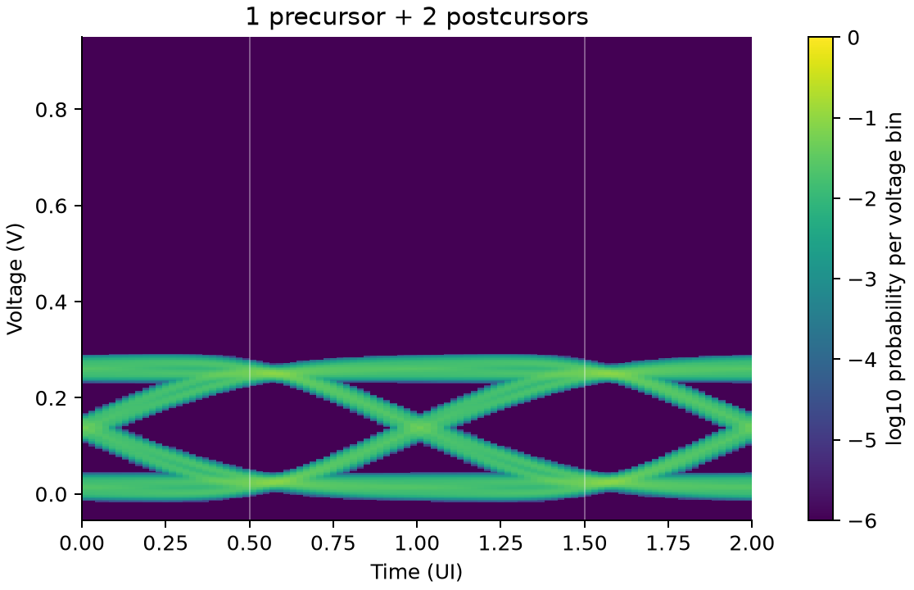

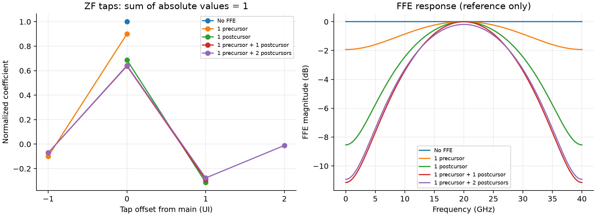

<!-- pagebreak -->

## Case 4: transmitter waveforms

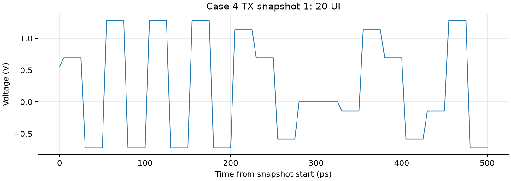

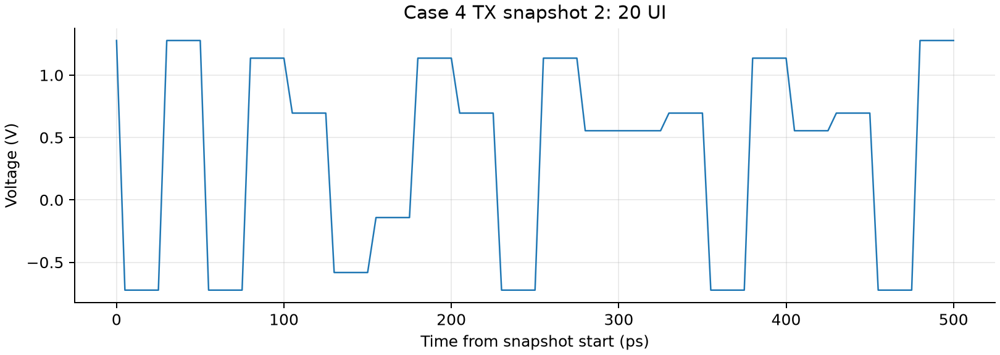

<!-- pagebreak -->

## Case 4: receiver waveforms

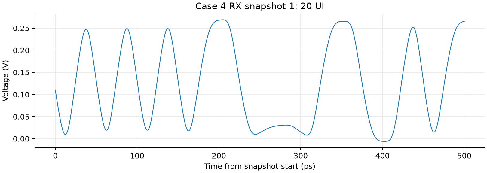

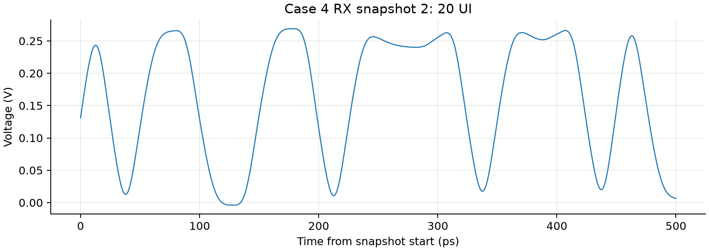

Tx and Rx axes each start at their own local zero. Each paired Rx slice starts
2.913000 ns after its Tx slice, using the SBR-derived sampling
latency minus half a UI. Their absolute start samples, start times and source
payload indices are recorded in summary.json; the four CSV files preserve the
plotted samples. The local zeros do not denote simultaneous physical times.

<!-- pagebreak -->

## Verification and interpretation

| Numerical check / recorded quantity | Value |
| --- | --- |
| Sectional vs direct convolution, max error (V) | 2.32934e-21 |
| Analytic vs sampled pulse, max error (V) | 4.7629e-05 |
| Analytic vs sampled pulse, RMS error (V) | 5.89063e-07 |
| Analytic vs sampled pulse, error / peak | 0.000121752 |
| Sampled DFT vs folded linear convolution, max error (V) | 1.66533e-16 |
| Periodic vs unfurled pulse, max error before 20 ns (V) | 1.22307e-05 |
| Main-window sampled pulse error at 0.5 ps (V) | 4.7629e-05 |
| Main-window sampled pulse error at 0.25 ps (V) | 1.1903e-05 |
| Refined time spacing (s) | 2.5e-13 |

The independent regression run recorded **46 passing tests**
(34 for HW8 and 12 existing regression tests),
with 0 failures and 0 errors.
It covers transfer-function scaling, waveform construction, tap indexing,
section boundaries, eye normalization and existing repository analyses. The
recorded evidence is in results/test_results.json.

The analytic SBR and the sampled finite-ramp convolution use different
continuous-time versus discrete-time approximations. Their measured discrepancy
is retained in the verification results. Zero filling above the measured
bandwidth, Kaiser tapering, and finite causal impulse truncation also limit
accuracy. A histogram with no added noise or jitter cannot establish link BER.

The finite 20 ns FIR has DC gain 0.483434557, compared
with the source-to-load DC value 0.484733287; the relative DC deficit
is 0.2679%. It is recorded rather
than removed by an amplitude renormalization. The refined pulse check reduces
the sampling discrepancy; it does not independently verify the random-data eye.

The optional ADS ChannelSim exercise is not run here. No numerical measured or ADS
waveform reference is supplied for this HW8 data set, so the checks establish numerical consistency
of the stated model, rather than an independent hardware or circuit-simulator
match. Tx FFE emphasizes transitions by sacrificing steady-state amplitude under
the swing constraint; an open eye need not have a larger absolute signal level.

### Reproduce

```sh
python -m pip install -r requirements.txt
python homework/hw08/verify_inputs.py
python homework/hw08/analyze.py
python -m unittest discover -s tests -v
python -m pip install -r homework/hw08/report/requirements.txt
python homework/hw08/report/build_report.py
```

The supplied assignment and incomplete template are retained under instructions/.
The channel and legacy Touchstone helper are supplied references; analyze.py is
the rewritten executable solution. The original student report and source are
not published. The report, PDF author field, figures and generated numerical data
contain no student name, student number, email address or local machine path.
Source-byte hashes are recorded in instructions/manifest.json.

Recorded runtime packages: python 3.14.4, numpy 2.5.0, scipy 1.18.1, matplotlib 3.11.2.
