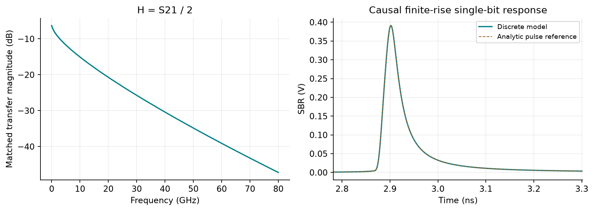
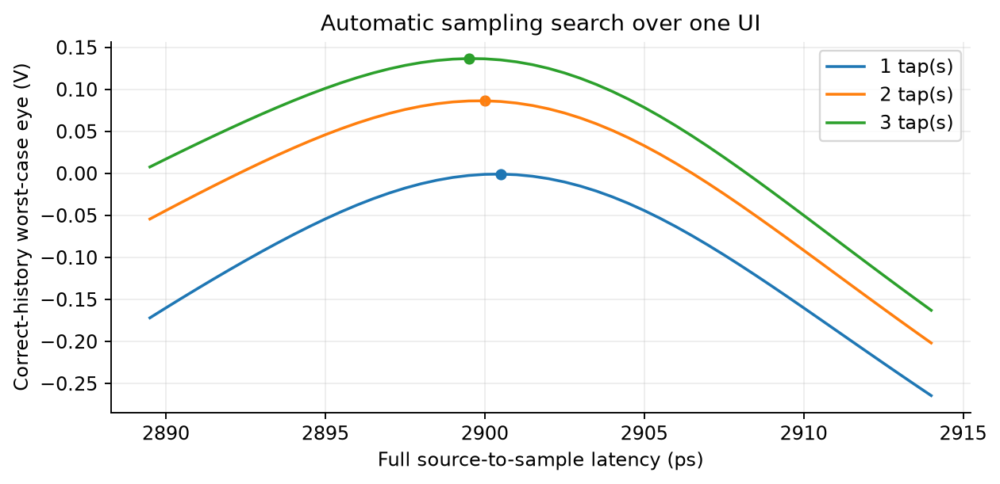
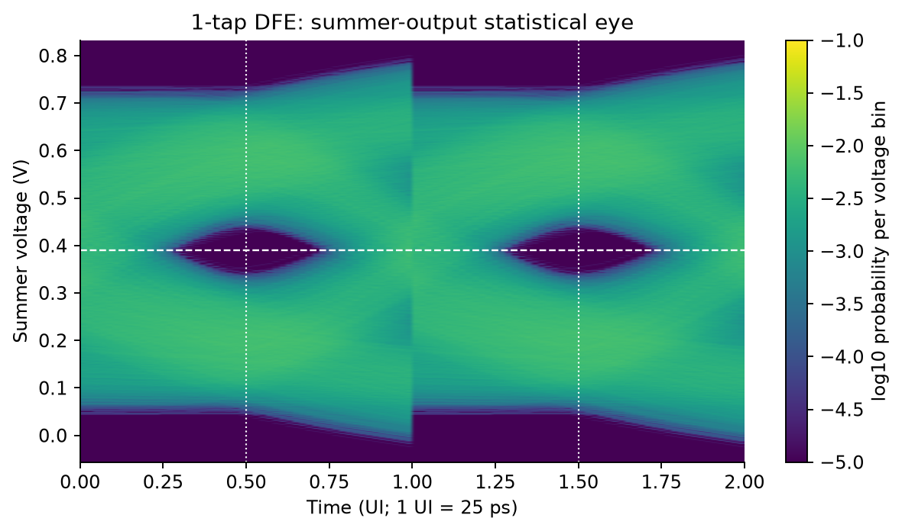
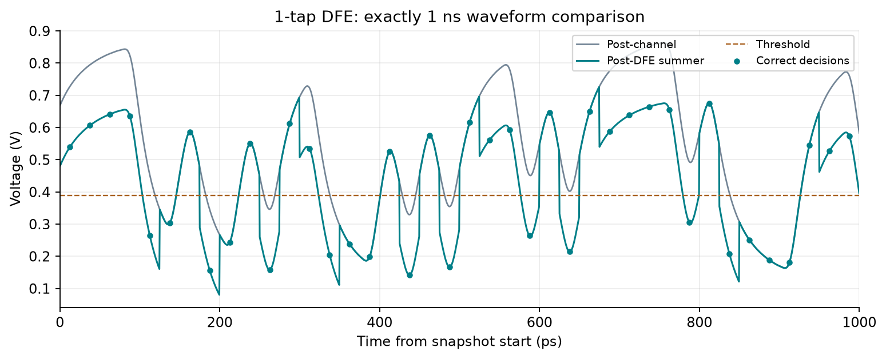
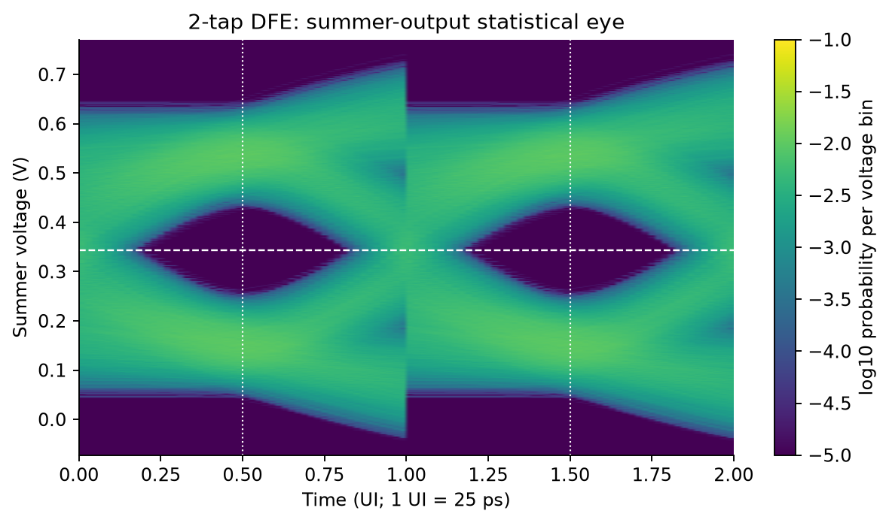
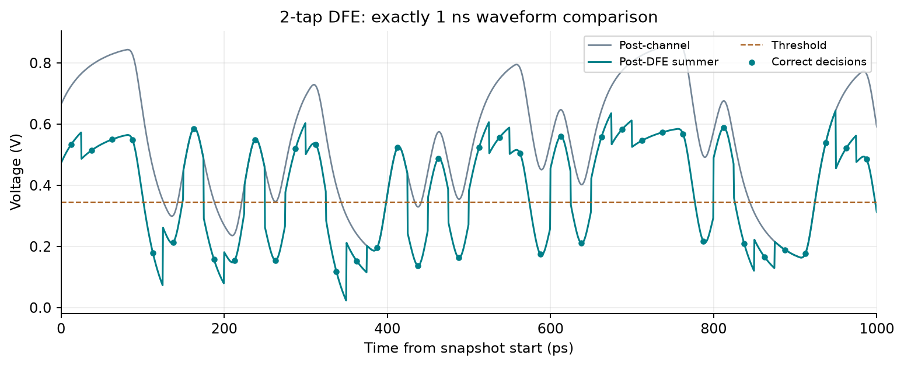
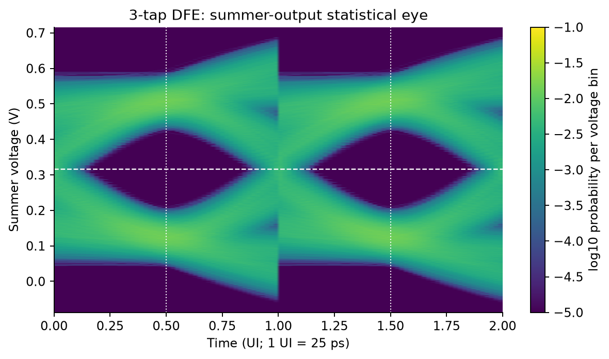
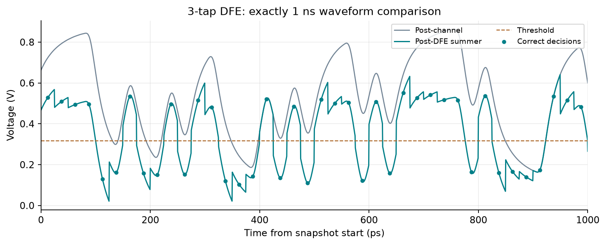
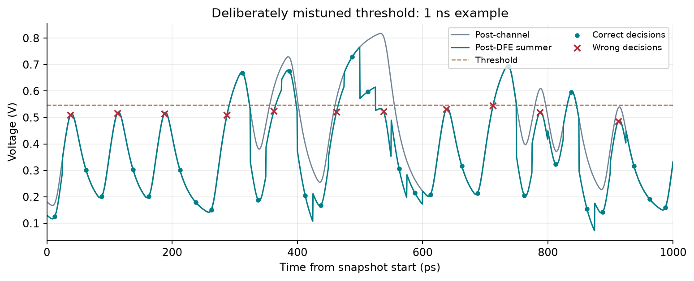

# Decision feedback equalizer simulation and design

> HW9 - Introduction to Signal Integrity and Electromagnetic Compatibility

This report designs one-, two-, and three-tap receiver decision feedback
equalizers (DFEs) for the supplied 50 cm stripline channel. Automatic design
uses the channel's sampled single-bit response and residual ISI bounds.
A separate recursive time-domain simulation evaluates actual slicer decisions.
Each required configuration includes a post-DFE eye and a 1 ns comparison
against the same post-channel waveform.

## Model and parameters

| Quantity | Setting |
| --- | --- |
| Channel | Supplied HW7_stripline_50cm.s2p, 50 ohm reference |
| Bit rate / modulation | 40 Gb/s, binary NRZ; 25 ps/UI |
| Source voltage levels | 0 and 2 V |
| Matched source-to-load transfer | H(f) = S21(f) / 2, applied once |
| Transition duration | 5 ps, linear, 0 to 100 percent |
| Time spacing | 0.5 ps; 50 samples/UI |
| Kaiser window | alpha = 0.5; beta = pi times alpha |
| Retained causal channel FIR | 20 ns |
| Evaluated random payload | 65,536 bits; seed 20261025 |
| Guard data | 810 bits at each end, excluded from scoring |
| Equalization | Receiver DFE only; no Tx FFE or Rx CTLE |
| Noise / jitter | None added |

### Waveform construction and symbol association

Construct the actual NRZ voltage waveform using the finite linear ramps, then
apply the channel by zero-padded sectional convolution. The DFE receives this
waveform; it does not receive the transmitted bits as feedback. The source truth
is used only for evaluation. All three configurations reuse the same waveform.

A single source bit starts at sample kP, where P = 50. Let p be that bit's
sampled trapezoid and g = p * h its response through the same finite channel FIR.
For an absolute sampling latency L, define a[j] = g[L + jP]. The corresponding
source bit is b[k] at received sample kP + L. Positive j denotes a past bit
(postcursor), and negative j a future bit (precursor). L modulo P gives only
the clock phase; the complete L is retained for association with source truth.

<!-- pagebreak -->

## Automatic threshold and sampling-point design

### Question 1: select a good threshold without manual tuning

The single-ended slicer outputs 0 or 1. The summer adds signed feedback
coefficients in volts; a positive postcursor therefore requires a negative tap.
For N taps, cancel the first N postcursors at the candidate sampling phase:

```text
y[kP + L] = sum_j a[j] b[k-j]
c[j] = -a[j],                         j = 1,...,N
d[k] = y[kP + L] + sum_j c[j] bhat[k-j]
bhat[k] = 1 if d[k] >= Vt else 0
```

Assuming previous decisions are correct, combine each selected postcursor with
its feedback coefficient. Call the remaining off-main cursors r[j]. Include
all nonzero precursor and postcursor samples within the finite response,
including uncancelled tails and either sign of cursor. Bounds for arbitrary
binary neighboring symbols are then:

```text
low_max  = sum_(j != 0) max(r[j], 0)
high_min = a[0] + sum_(j != 0) min(r[j], 0)
Vt       = (low_max + high_min) / 2
         = (a[0] + sum_(j != 0) r[j]) / 2
gap      = high_min - low_max
         = a[0] - sum_(j != 0) abs(r[j])
```

The midpoint maximizes the smaller vertical margin to these two bounds. A
positive gap provides a separating threshold for this finite model with correct
past decisions. A nonpositive gap means this bound cannot establish a safe
threshold. The signed sum matters: using half the main cursor alone would
ignore the residual ISI offset. No tap normalization or additional matched
source factor is applied to the feedback voltages.

### Question 2: select a good sampling point without manual tuning

Search one complete UI of discrete phases near the main SBR peak. At each
candidate L, recompute its cursors, feedback taps, threshold, and bound gap.
Choose the phase maximizing a[0] minus the absolute sum of residual ISI.
This objective optimizes the predicted worst-case opening rather than the SBR
peak alone. The phase search uses the discrete response of the same finite
ramps and FIR as the random-data simulation, preserving amplitude and timing.

The bound uses correct past decisions. Actual decisions are evaluated afterward
by the recursive slicer loop, so the design calculation cannot hide error
propagation by substituting transmitted bits into the feedback path.

<!-- pagebreak -->

## Channel response and automatic phase search





The continuous-pulse frequency-domain response is a separate sampling-convergence
reference. It is not substituted for the sampled finite-FIR response when
selecting taps or checking random-data decisions.

<!-- pagebreak -->

## Selected designs and numerical results

| Taps | Signed feedback coefficients (V) | Threshold (V) |
| --- | --- | --- |
| 1 | -0.188091 | 0.389389 |
| 2 | -0.191587, -0.087502 | 0.343890 |
| 3 | -0.195169, -0.088655, -0.050470 | 0.316287 |

| Taps | Phase within UI (ps) | Latency (ns) | Bound gap (mV) | Observed gap (mV) |
| --- | --- | --- | --- | --- |
| 1 | 0.500 | 2.900500 | -0.824 | 73.724 |
| 2 | 0.000 | 2.900000 | 86.383 | 160.946 |
| 3 | 24.500 | 2.899500 | 136.674 | 206.683 |

Clock phase is shown relative to a 25 ps UI. Latency is the complete source-bit
to received-sample offset. The post-DFE eye is the analog summer output, not the
slicer's ideal 0/1 waveform. The eye plots use individually selected voltage
ranges and therefore different voltage-bin widths. Shared probability-per-bin
color limits do not imply the same probability density. Compare the recorded
voltage gaps rather than apparent eye size or color alone. Each new decision updates the first feedback
interval starting half a UI later; subsequent taps follow one UI apart.

The bound gap assumes correct feedback and every binary neighboring-symbol
combination within the finite model. The observed gap is the minimum sampled
high voltage minus the maximum sampled low voltage in this finite payload,
classified by transmitted truth. They need not be equal because a finite random
record need not realize the worst pattern. Neither quantity is a measured BER,
a noise-inclusive eye height, or a guarantee for an unmodeled physical link.

For the 1-tap configuration, the worst-case bound does not give a positive separating gap. Its selected midpoint is therefore a heuristic operating threshold, not a safe threshold for every binary pattern. Zero observed errors in the finite random record do not contradict the conservative bound.

| Taps | Payload errors / bits | Observed error fraction |
| --- | --- | --- |
| 1 | 0 / 65,536 | 0 |
| 2 | 0 / 65,536 | 0 |
| 3 | 0 / 65,536 | 0 |

The reported counts exclude both guard regions and compare each decision with
its latency-aligned source bit. The decisions come from compensated summer
samples. No gain or vertical offset is fitted between configurations.

<!-- pagebreak -->

## 1-tap DFE: eye and waveform





The snapshot begins at simulation time 35.688000 ns.
It has 2,001 waveform samples at 0.5 ps spacing, including both
endpoints from 0 to 1,000 ps. Its local time origin does not remove channel
latency. The full recorded run,
rather than this 40-bit view alone, supplies the decision-error count.
<!-- pagebreak -->

## 2-tap DFE: eye and waveform





The snapshot begins at simulation time 35.687500 ns.
It has 2,001 waveform samples at 0.5 ps spacing, including both
endpoints from 0 to 1,000 ps. Its local time origin does not remove channel
latency. The full recorded run,
rather than this 40-bit view alone, supplies the decision-error count.
<!-- pagebreak -->

## 3-tap DFE: eye and waveform





The snapshot begins at simulation time 35.687000 ns.
It has 2,001 waveform samples at 0.5 ps spacing, including both
endpoints from 0 to 1,000 ps. Its local time origin does not remove channel
latency. The full recorded run,
rather than this 40-bit view alone, supplies the decision-error count.


<!-- pagebreak -->

## Question 3: are decisions always correct?

Across 65,536 scored payload bits per baseline configuration, the observed wrong-decision counts are 1 tap(s): 0, 2 tap(s): 0, 3 tap(s): 0. These counts compare recursive slicer decisions with the source truth. They characterize this finite noiseless run, rather than every possible channel, noise realization or bit sequence.

### Separately labeled threshold-mistuning example

Keep the three-tap coefficients and sampling phase, but raise the threshold by 0.6 times the main cursor. This deliberately changes the operating point and is not a baseline design result. The mistuned threshold is 0.547062 V; the run produces 14,439 errors in 65,536 evaluated bits.

| First observed stress error | Recorded value |
| --- | --- |
| Payload bit index (zero based) | 1 |
| Transmitted bit / slicer decision | 1 / 0 |
| Post-channel sample (V) | 0.508835 |
| Post-DFE summer sample (V) | 0.508835 |
| Mistuned threshold (V) | 0.547062 |
| Source context / first context index | 0100100 / 0 |



### Controlled error-propagation diagnostic

A second diagnostic forces only payload decision 512 from 0 to 1, using the baseline threshold. The next three summer-sample changes are -195.169, -88.655, -50.470 mV. The remaining payload has 0 additional decision changes relative to baseline. This is an artificial single-error injection, not a naturally occurring baseline error. Its voltage changes show how an incorrect past decision enters later feedback; a voltage perturbation need not cause another wrong decision. The sample-by-sample comparison is preserved in results/injected_error.csv.

<!-- pagebreak -->

## Independent verification and numerical consistency

The independent verifier imports no production solver or channel module. It rebuilds the channel with NumPy's inverse FFT, convolves the sampled pulse directly, and reconstructs source-bit responses and scalar decision history including pre-payload clocks. It checks every persisted payload decision and all 2,001 samples of each required waveform CSV. Maximum differences are shown below.

| Taps | Decisions checked | Phases checked | Sample error (V) | Snapshot error (V) |
| --- | --- | --- | --- | --- |
| 1 | 65,536 | 50 | 8.88e-16 | 7.77e-16 |
| 2 | 65,536 | 50 | 9.99e-16 | 7.77e-16 |
| 3 | 65,536 | 50 | 9.99e-16 | 6.66e-16 |

The verifier also reproduces all 14,439 mistuning errors, its complete 1 ns snapshot, and all 12 persisted injected-error rows. Eye-file existence and complete sample counts are checked; image pixels and every histogram bin are not independently regenerated. Evidence is retained in results/verification.json.

The recorded repository regression run passed 66 tests, including 20 HW9 tests, with 0 failures and 0 errors. Outcomes are retained in results/test_results.json.

### Additional solver consistency checks

| Recorded numerical check | Value |
| --- | --- |
| 193-bit sectional versus single-FFT convolution, max error (V) | 5.55112e-16 |
| Waveform versus scalar DFE samples, max error over cases (V) | 1.11022e-16 |
| Waveform versus scalar decision mismatches, all cases | 0 |
| Source-bit cursor reconstruction, max error over cases (V) | 1.11022e-15 |
| Eye probability-column sum error, max over cases | 0 |
| Analytic versus discrete SBR, max recorded error (V) | 4.7629e-05 |
| 20 ns FIR DC gain | 0.483434549 |
| Frequency-domain source-to-load DC gain | 0.484733287 |
| Finite-FIR minus frequency-domain DC gain | -0.00129874 |

The scalar DFE uses past-decision dot products rather than held waveform blocks. Source-bit reconstruction separately checks full latency and waveform association. The analytic and discrete SBRs use continuous-time versus sampled-ramp approximations; their measured difference is recorded rather than forced to zero.

<!-- pagebreak -->

## Model sensitivity, limits, and provenance

### Sensitivity to extending the retained FIR

| Taps | Threshold change (mV) | Bound-gap change (mV) | Max tap change (mV) |
| --- | --- | --- | --- |
| 1 | +0.249896 | -0.499716 | 0.000000 |
| 2 | +0.249896 | -0.499706 | 0.000000 |
| 3 | +0.249896 | -0.499701 | 0.000000 |

This independently checked diagnostic extends the FIR from 20 ns to 40 ns at each selected latency. It recomputes thresholds, taps and correct-history bounds; it does not repeat the random-data simulation or re-optimize phase. Baseline eyes and errors remain the 20 ns model. Values shown as zero are rounded, not asserted to vanish exactly.

### Model limits

The reported run is finite and noiseless. Sampling resolution, measured channel
bandwidth, Kaiser tapering, and causal FIR truncation limit accuracy. The
residual-ISI bound covers all cursors of the retained discrete response, not an
infinite physical channel. A finite run without observed errors does not prove
zero physical-link BER. A DFE also cannot cancel precursor ISI using past
symbols, and an incorrect decision can perturb later summer samples.

No measured waveform or independent circuit-simulator reference is supplied for
this case. These checks establish numerical consistency of the stated model.
The optional ADS ChannelSim exercise is not performed.

### Source provenance

The supplied assignment, instructions/HW9_DFE.pdf, requires the three tap counts,
post-DFE eyes, 1 ns waveform comparisons, and the three questions answered here.
The incomplete sample specifies a 0/1 slicer and fixed-rate decision timing.
The supplied channel is the same 50 cm stripline used in the preceding homework.
Input byte hashes are recorded by the reference manifest.

Course lecture "Decision Feedback Equalizer", PDF pages 4-6, supports the summer
node, 0/1 slicer, and postcursor cancellation convention; page 8 discusses DC
level changes; pages 9-10 discuss incorrect decisions and error propagation.
The lecture's page 7 numerical example uses 20 Gb/s and is not copied as this
40 Gb/s design. The residual-bound threshold and phase search above are derived
for this report. Lecture material is consulted as a reference, not redistributed
as an original report or attributed to an individual student.

### Reproduce from the repository root

```sh
python -m pip install -r requirements.txt
python homework/hw09/verify_inputs.py
python homework/hw09/analyze.py --bits 65536 --seed 20261025
python homework/hw09/verify_results.py
python -m unittest discover -s tests -v
python -m pip install -r homework/hw09/report/requirements.txt
python homework/hw09/report/build_report.py --refresh
```

The report is generated from the recorded numerical results and contains no
student identity or machine-specific location. Its PDF author field is empty.
