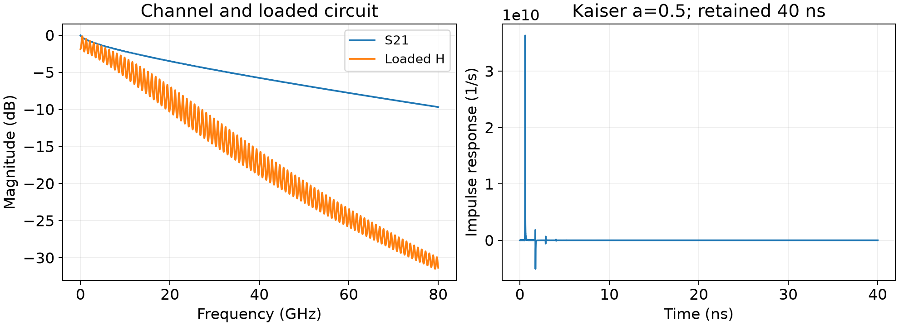
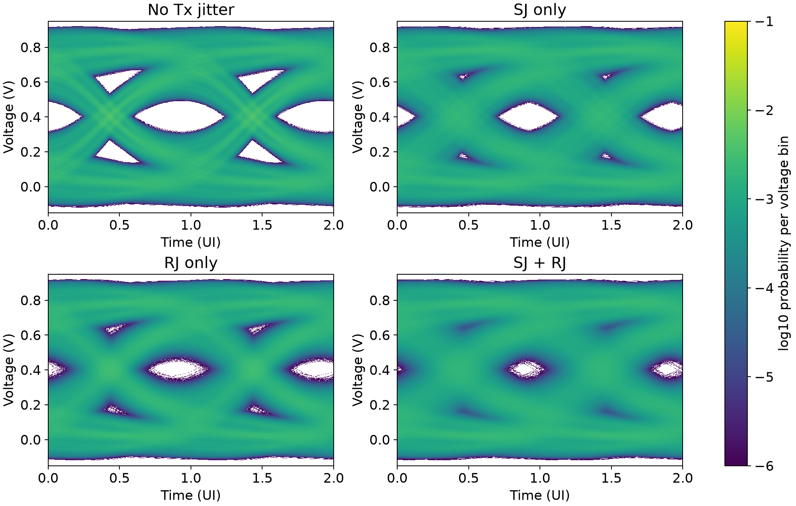
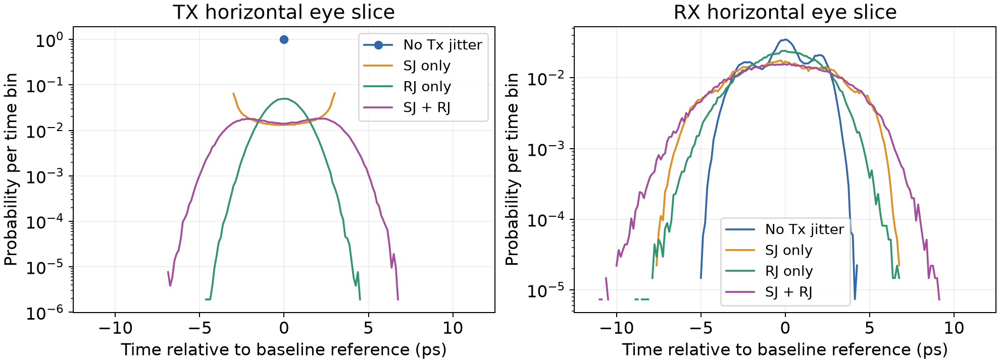
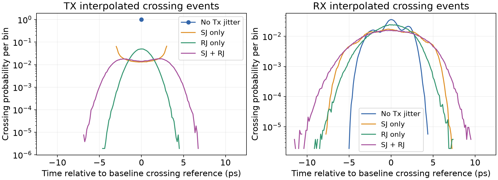

# Jitter simulation and basic analysis

> HW12 - Introduction to Signal Integrity and Electromagnetic Compatibility

This report recomputes all four required 40 Gb/s NRZ experiments using the supplied
two-port channel. The transmitter contains no jitter, sinusoidal jitter (SJ),
random jitter (RJ), or both. Receiver eye diagrams, one-UI transmitter and receiver
jitter distributions, and their variances are obtained from the same channel and
common random data. Every numerical value below comes from the saved run.

## Physical and numerical model

| Quantity | Setting |
| --- | --- |
| Bit rate / unit interval | 40 Gb/s NRZ / 25 ps |
| Source voltage levels | 0 and 1 V |
| Source resistance / capacitance | 20 ohm / 0.3 pF |
| Load resistance / capacitance | 85 ohm / 0.3 pF |
| Rise and fall duration | 5 ps |
| SJ | 3 ps peak amplitude, 1 MHz |
| RJ | Zero-mean Gaussian, 1 ps standard deviation |
| Evaluated data | 1,048,576 bits per case; seed 0 |
| Excluded startup | 1,602 warmup bits per case |
| Time samples | 200 per UI; 0.125 ps spacing |
| Eye voltage bin | 1 mV |
| Kaiser window / retained impulse | alpha = 0.5 / 40 ns |

The SJ period is 1 microsecond, or 40,000 UI. The measured record spans
26.2144 SJ cycles. The source resistance, load resistance and shunt
capacitances are included in the source-to-load transfer H(f); H is not simply
the channel's S21. There is no receiver additive noise or clock recovery model.

<!-- pagebreak -->

## Channel and waveform calculation

The Touchstone data use a 50 ohm reference impedance. At each frequency, modified
nodal analysis solves the external circuit together with the two-port relation
`(I-S)V = Z0(I+S)Iport`. The channel is oriented with S21 transferring excitation
from port 1 to port 2. The Kaiser-weighted positive-frequency data are completed
by conjugate symmetry to obtain a real impulse response on the simulation grid.
The causal 40 ns interval is retained as a finite impulse response (FIR).



| Channel diagnostic | Recorded value |
| --- | --- |
| frequency samples | 8001 |
| df hz | 1e+07 |
| maximum frequency hz | 8e+10 |
| reference impedance ohms | 50 |
| dc gain | 0.806386 |
| fir taps | 320000 |
| fir dc gain | 0.804706 |
| fir dc relative error | -0.00208306 |
| fir last 1ns l1 fraction | 9.60993e-05 |
| s parameter orientation | S[receiving_port,incident_port]; no transpose |

The retained FIR has DC gain 0.804706093, compared with
0.806385842 for the frequency-domain circuit. The signed relative
difference is -0.2083%. The FIR is not rescaled to hide this
windowing/causal-truncation difference. The receiver threshold remains the
assignment's frequency-domain DC definition.

<!-- pagebreak -->

## Four receiver statistical eyes



Case 1 already has receiver timing spread because channel memory produces
data-dependent jitter (DDJ). The ideal transmitter does not remove channel ISI.
Case 2 adds the slowly varying SJ displacement, case 3 adds independent random
transition displacement, and case 4 combines both source impairments.

The simulation processes bounded blocks and carries the FIR state between them.
Guard samples are excluded before accumulating exactly the requested number of
payload bits. Every time column of each eye is normalized using its actual count.
No artificial probability is added to the analysis arrays; zero-count bins remain
zero. The two displayed UI repeat the same one-UI statistical eye.

Source edge displacements are rounded to the nearest time sample before waveform
construction. The maximum timing-rounding error is 0.0625 ps. This matches
the assignment's sampled-edge model and avoids the original truncation-toward-zero
bias. It also prevents a narrow transmitter voltage slice from sparsely sampling
continuous sub-grid edge positions. The rounding is a numerical approximation,
not a physical bound on Gaussian RJ.

<!-- pagebreak -->

## One-UI jitter distributions




The transmitter threshold is 0.5 V. The receiver threshold is half the loaded
DC output, `real(H(0))/2`. A single one-UI interval is selected by circularly
centering the baseline transition region; the reference is reused across cases
at each observation side. This prevents losing bins when the transition straddles
the phase origin. A PDF value has inverse-time units; a PMF bin is dimensionless.

The four receiver slices contain 134,840, 134,742, 135,727, 136,081 occupied voltage-bin samples,
respectively. These counts, rather than the total transmitted bit count alone,
set the smallest nonzero increments in the normalized slice PMFs.

<!-- pagebreak -->

## Numerical statistics and transmitter theory

These are the assignment's **normalized eye-slice statistics**. The separate
crossing-event diagnostic uses a different estimator and is identified explicitly.

| Case | Tx variance (ps^2) | Rx variance (ps^2) | Tx RMS (ps) | Rx RMS (ps) |
| --- | --- | --- | --- | --- |
| 1 | 0 | 3.0074 | 0 | 1.73419 |
| 2 | 4.51963 | 7.53176 | 2.12594 | 2.7444 |
| 3 | 0.998228 | 4.28005 | 0.999114 | 2.06883 |
| 4 | 5.50517 | 8.77041 | 2.34631 | 2.96149 |

For samples at bin times t_i and a normalized PMF p_i, the statistics are

```text
mean = sum(t_i * p_i)
variance = sum((t_i - mean)^2 * p_i)
centered RMS = sqrt(variance)
PDF_i = p_i / dt
```

The reported RMS is the standard deviation after removing the mean timing
offset. Raw RMS would also include the square of a fixed delay or phase offset.
Every time bin is spaced by the same dt used by the waveform simulator.

| Tx case | Theoretical variance (ps^2) | Theoretical RMS (ps) |
| --- | --- | --- |
| 1: no jitter | 0 | 0 |
| 2: SJ | 4.5 | 2.12132 |
| 3: RJ | 1 | 1 |
| 4: SJ + RJ | 5.5 | 2.34521 |

For uniformly sampled sinusoidal phase, SJ has zero mean and variance A^2/2.
Its density is `1/(pi*sqrt(A^2-j^2))` for `abs(j)<A`, with more probability near
the turning points. Independent zero-mean Gaussian RJ has variance sigma_RJ^2.
Thus the combined transmitter variance is `3^2/2 + 1^2 = 5.5 ps^2`, and its
centered RMS is 2.345208 ps. Finite phase coverage, random sampling and time/voltage
binning account for small measured differences from these limiting values.

<!-- pagebreak -->

## Answers to the four assignment questions

| Comparison | LHS (ps^2) | RHS (ps^2) | RHS - LHS (ps^2) | Residual / LHS (%) |
| --- | --- | --- | --- | --- |
| Q1: Tx SJ + RJ | 5.51786 | 5.50517 | -0.012685 | -0.22989 |
| Q2: DDJ + Tx SJ | 7.52703 | 7.53176 | +0.00472376 | +0.06276 |
| Q3: DDJ + Tx RJ | 4.00563 | 4.28005 | +0.274415 | +6.85074 |
| Q4: intended Rx4 | 8.51258 | 8.77041 | +0.257835 | +3.02887 |

### 1. Does Tx case 2 variance plus Tx case 3 variance equal Tx case 4 variance?

**Yes in the independent-source population model.** For any two random timing
errors, `Var(X+Y)=Var(X)+Var(Y)+2*Cov(X,Y)`. Here SJ phase and the Gaussian random
source are independent, so their covariance is zero in the ensemble. The recorded
comparison is 5.51786 versus 5.50517 ps^2, with a residual of
-0.012685 ps^2. Finite-record and histogram differences need not be zero.
Nearest-grid rounding also matters: rounding `SJ+RJ` does not always equal the
sum of separately rounded SJ and RJ. Thus the sampled four-case experiment is
not an exact algebraic sum even before finite-sample covariance is considered.

### 2. Does Rx case 1 variance plus Tx case 2 variance equal Rx case 2 variance?

**Approximately, when SJ acts as a common slow time shift through the channel.**
A constant displacement of a waveform passes through an LTI channel as the same
displacement. A 1 MHz SJ changes slowly relative to the 25 ps UI and the dominant
channel memory, so its effect is close to that common-delay model. If this shift
is independent of the data-dependent receiver timing, their variances add.
The recorded comparison is 7.52703 versus 7.53176 ps^2, residual
+0.00472376 ps^2. The full channel plus threshold operation and histogram
estimator do not make exact equality a universal identity.

### 3. Does Rx case 1 variance plus Tx case 3 variance equal Rx case 3 variance?

**There is no general equality.** Independent edge-to-edge RJ changes the widths
and relative positions of neighboring pulses. Their overlapping channel responses
alter both the crossing voltage slope and the crossing time. Receiver timing
therefore cannot generally be represented as the baseline DDJ plus an unchanged
copy of the transmitter RJ. The recorded comparison is 4.00563 versus
4.28005 ps^2, residual +0.274415 ps^2. This is not a failure of the
variance-of-a-sum theorem; the proposed decomposition is the issue.

<!-- pagebreak -->

## Combined jitter and measurement interpretation

### 4. Printed equation and the intended receiver comparison

The supplied question prints `Var(Rx1)+Var(Tx4)=Var(Tx4)`. Taken literally, the
right-hand side cancels the second term and the equation requires zero baseline
DDJ. The measured `Var(Rx1)=3.0074 ps^2` is nonzero, so the literal
equation is false. This report preserves that reading explicitly.

The likely intended right-hand side is `Var(Rx4)`, continuing questions 2 and 3.
For that interpretation, the prediction is 8.51258 ps^2 and the measured
receiver case 4 value is 8.77041 ps^2, residual +0.257835 ps^2.
There is no general equality for the same reason as question 3: the fast RJ is
transformed together with the data pattern by the channel and the threshold
crossing operation. Approximate addition of slow SJ does not make the entire
combined transmitter distribution pass through unchanged.



The threshold-slice method follows the assignment and lecture. A narrow voltage
bin weights a transition approximately in proportion to the inverse of its
local slope. Receiver edge slopes depend on the data pattern, so its normalized
eye slice need not exactly match the histogram of individual threshold-crossing
events. The additional event-based diagnostic exposes this estimator difference;
it is not substituted silently for the requested eye-slice result.


Gaussian RJ is theoretically unbounded. The observed maximum and minimum in a
finite run are not intrinsic peak-to-peak RJ. With about one million bits, the
available low-probability evidence is around the finite-count scale; no BER
extrapolation to 1e-12 or smaller is claimed. The optional ADS ChannelSim exercise
has not been performed, and the assignment's example results are not presented
as fresh ADS verification of this run.

<!-- pagebreak -->

## Verification, corrections, and reproduction

The recorded independent suite completed **20 tests**, with
0 failures and 0 errors.
It checks the circuit against an independent formulation, waveform boundary
handling, block convolution against a full calculation, histogram normalization,
circular phase selection and statistical calculations. Detailed results are kept
in `results/test_results.json` and the verification source under `tests/`.

| Recorded numerical check | Value |
| --- | --- |
| exact evaluated bits | True |
| finite outputs | True |
| pmfs sum to one | True |
| pdfs integrate to one | True |
| zero probabilities preserved | True |

The saved-artifact verifier independently checked 16 distributions,
including the time grid, all PMF/PDF normalizations and moments, exact evaluated
bit counts and regenerated requested/applied jitter. The largest relative
transmitter-variance difference from ideal theory is 0.4362%
in this recorded run.

A separate end-to-end check evaluated 4,096 bits using block sizes 1024 and 997. All four cases produced exactly equal integer Tx/Rx eye and crossing-count arrays; only floating-point moment sums use roundoff tolerances. This checks boundary handling independently of the full-run block choice. Evidence: `results/block_size_check.json`.

The rewritten solution removes hard-coded machine paths and an unavailable
legacy helper, avoids retaining all full-length waveforms, excludes startup and
padded samples, and uses one consistent time spacing. It preserves zero analysis
probabilities, computes real-valued thresholds, and treats PMF and PDF units
separately. Every eye uses its own defined voltage grid. The source, figures,
tables, and this report contain no student identity.

The calculation is a finite-bandwidth, windowed and truncated channel model.
The FIR and numerical bin choices are recorded so their effects can be assessed.
Independent numerical agreement validates the stated implementation; it is not
an independent hardware measurement or a new circuit-simulator result.

### Reproduce from the repository root

```sh
python -m pip install -r homework/hw12/requirements.txt
python homework/hw12/src/hw12.py
python -m unittest discover -s homework/hw12/tests -v
python homework/hw12/tests/verify_results.py --output homework/hw12/results/verification.json
python -m pip install -r homework/hw12/report/requirements.txt
python homework/hw12/report/build_report.py --refresh
```

### Sources and provenance

[1] Supplied HW12 assignment, `instructions/HW12_jitter_simulation.pdf`, including
the circuit, four experiments, questions and example answer. [2] Supplied
`instructions/HW12_channel.s2p`. [3] Course handout 12, Jitter Basics, pages 2-12,
for timing error, SJ/RJ distributions and independent-source variance addition.
[4] Course handout 13, Jitter Basics (2), page 2, for the statistical-eye slice
method. The instruction template is retained as a reference, not the executable
solution. The independently regenerated report replaces personally identifying
student reports; it does not claim that their original results were reverified.
