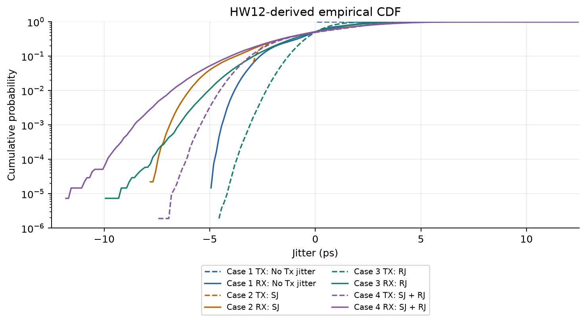
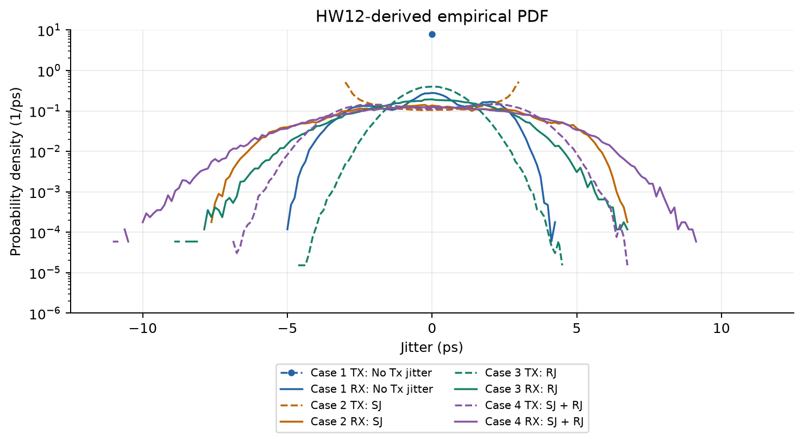
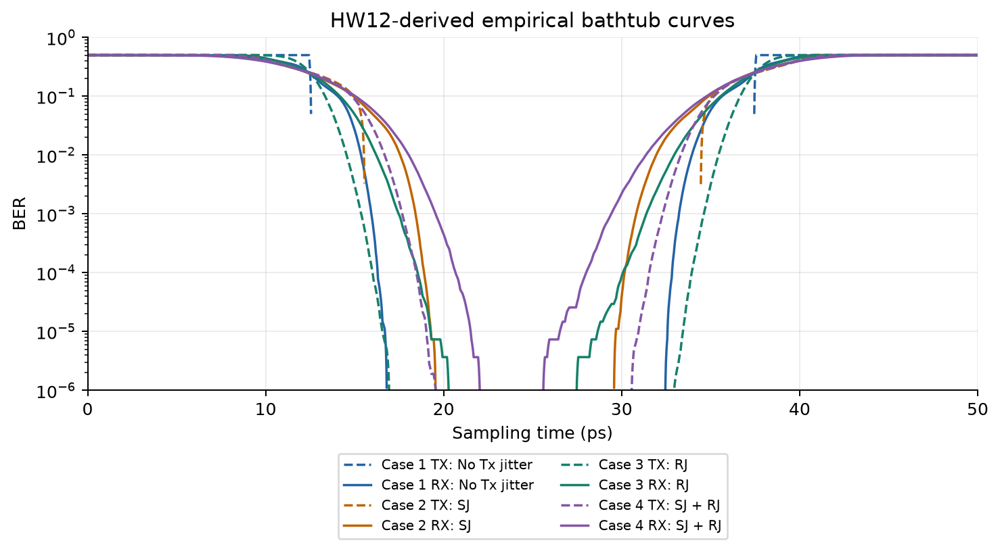
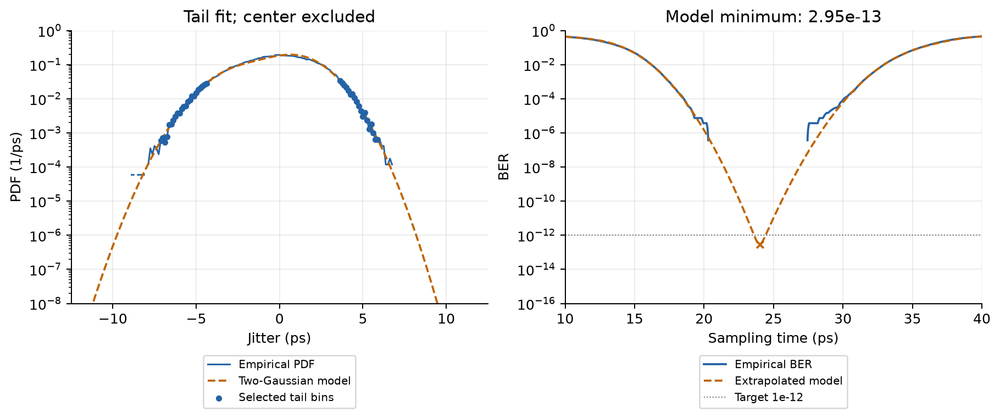
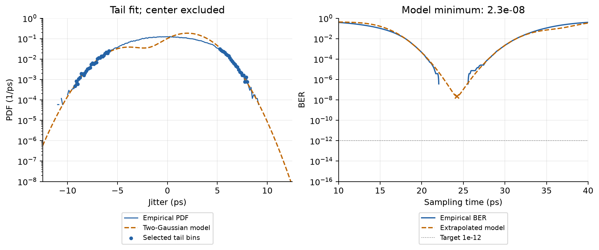
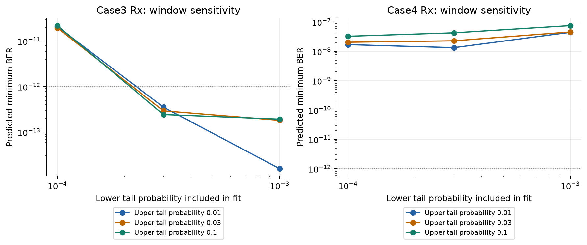

# Jitter fitting and BER extrapolation

> HW13 - Signal integrity numerical analysis

The verified full-length HW12 data give a two-Gaussian tail-model minimum BER of
**2.94553e-13 for Case 3 Rx** and
**2.30408e-08 for Case 4 Rx**. At BER = 1e-12, the nominal
Case 3 eye width is **0.830023 ps (0.0332009 UI)**;
Case 4 has no opening. These are extrapolated model predictions, not measured
error rates. The sensitivity analysis on the final page shows why the narrow
Case 3 opening must be interpreted cautiously.

## Scope and provenance

All eight sampled CDFs and bathtubs are calculated for four cases at Tx and Rx.
The two-Gaussian extrapolation then focuses on Case 3 and Case 4 Rx, as requested
in the assignment [1]. The primary input is the saved, independently verified
HW12 horizontal eye-slice distribution from **1,048,576 evaluated bits per case**.
That full channel simulation was reused; **HW12 was not rerun for this analysis**.

| Physical / numerical quantity | Setting |
| --- | --- |
| Signaling / UI | 40 Gb/s NRZ / 25 ps |
| Cases 1-4 | No Tx jitter; SJ; RJ; SJ + RJ |
| SJ / RJ | 3 ps peak at 1 MHz / zero-mean Gaussian, sigma = 1 ps |
| Source / load | 20 ohm / 85 ohm, each with 0.3 pF shunt capacitance |
| Rise and fall duration | 5 ps |
| Statistical time grid | 200 bins per UI; dt = 0.125 ps |
| Transition density | rhoT = 0.5 |
| Adjacent ideal boundaries | t_i = 12.5 ps; t_(i+1) = 37.5 ps |

### Probability definitions and timing convention

For normalized bin probability p[k], the PMF is dimensionless and sums to one.
The density f[k] = p[k]/dt has units 1/ps and integrates to one. The empirical
CDF at a bin center uses half that cell's mass; interpolation assumes uniform
density inside each centered 0.125 ps cell. This fixes the time origin and keeps
the CDF and density consistent, rather than treating endpoint-inclusive samples
as a different physical grid.

```text
F(u) = P(jitter <= u);  S(u) = P(jitter > u)
BER(t) = rhoT * [ S(t - 12.5 ps) + F(t - 37.5 ps) ]
f2G(u) = tau1 * phi((u-mu1)/sigma1)/sigma1
       + tau2 * phi((u-mu2)/sigma2)/sigma2
F2G(u) = tau1 * Phi((u-mu1)/sigma1)
       + tau2 * Phi((u-mu2)/sigma2);  tau2 = 1 - tau1
```

Here phi and Phi denote the standard-normal PDF and CDF. The timing-error
coordinate u is centered at an ideal transition; absolute sampling time t lies
between the two boundaries. Gaussian SF and CDF tails are evaluated directly
with stable log-domain normal-CDF/SF functions and log-sum addition, including the SF instead
of subtracting a nearly unit CDF from one [2].

### Reproduce from the repository root

```sh
python homework/hw13/verify_inputs.py
python homework/hw13/src/hw13.py
python -m unittest discover -s homework/hw13/tests -v
python homework/hw13/tests/verify_results.py
python -m pip install -r homework/hw13/report/requirements.txt
python homework/hw13/report/build_report.py --refresh
```

<!-- pagebreak -->

## 1. Sampled distributions: all eight cases





The CDF is an accumulated PMF, not an accumulated PDF without a dt factor.
Case 1 Rx spreads despite its ideal Tx because channel ISI causes DDJ. Adding
SJ widens the distributions; RJ creates sampled tails. The central multimodal
Rx structure need not have a Gaussian shape and is excluded from the tail fit.
The eye slice also weights voltage occupancy and edge slope; it is not an
equal-weight histogram of independently detected crossing events [2, pp. 2-4].

<!-- pagebreak -->

## 2. Sampled bathtub curves and finite evidence



The late left transition contributes S(t - t_i); the early right transition
contributes F(t - t_(i+1)). Moving the sampler toward either boundary increases its
corresponding tail. This is the two-transition construction in the lecture [2,
pp. 10-13]. The left PDF tail governs the right side of the bathtub, and the
right PDF tail governs its left side [1, p. 2].

| Distribution | Slice observations | Zero bins | Smallest nonzero PMF |
| --- | --- | --- | --- |
| Case 1 TX | 524,108 | 199 | 1 |
| Case 1 RX | 134,840 | 125 | 7.4162e-06 |
| Case 2 TX | 524,108 | 151 | 0.0130469 |
| Case 2 RX | 134,742 | 82 | 1.48432e-05 |
| Case 3 TX | 524,108 | 126 | 1.908e-06 |
| Case 3 RX | 135,727 | 72 | 7.36773e-06 |
| Case 4 TX | 524,108 | 87 | 1.908e-06 |
| Case 4 RX | 136,081 | 39 | 7.34856e-06 |

All eight PMFs sum to one and all eight PDFs integrate to one on the recorded
grid. The receiver slice counts differ from the bit count: Case 3 and Case 4
contain 135,727 and
136,081 threshold-voltage
occupancies. Their smallest nonzero PMF increments are approximately 7.4e-6.
Thus a zero empirical bathtub value is absence of observed slice support,
**not evidence of zero physical BER or direct observation of BER = 1e-12**.
The zeros remain exact in numerical arrays and are omitted only when plotting
on logarithmic axes.

<!-- pagebreak -->

## 3. Tail model and Case 3 Rx result

The two-Gaussian model has separate means, standard deviations and a single
independent mixing weight. Only tail locations with one-sided empirical
CDF or SF in **[3e-4, 3e-2]** are selected. Joint nonlinear least squares minimizes
unweighted residuals in log10(CDF) and log10(SF); it does not fit the central DJ
peak. Six starting guesses converge, and neither reported solution reaches a
parameter bound. This is a tail-fit procedure, **not maximum likelihood**.

The fit evaluates a selected bin's CDF at its upper edge, u[k] + dt/2, and its
SF at the lower edge, u[k] - dt/2, so each includes the full selected cell mass.
This half-bin correction is distinct from the center-interpolated plotted CDF.
The bounds are mu1 in [-8, 0] ps, mu2 in [0, 8] ps, both sigmas in [0.2, 5] ps,
and tau1 in [0.01, 0.99].

| Tail-model parameter | Case 3 Rx | Case 4 Rx |
| --- | --- | --- |
| mu1 (ps) | -1.94537 | -3.97865 |
| sigma1 (ps) | 1.6379 | 1.8081 |
| mu2 (ps) | 0.939036 | 2.00569 |
| sigma2 (ps) | 1.47729 | 1.78834 |
| tau1 | 0.35408 | 0.171466 |
| tau2 = 1 - tau1 | 0.64592 | 0.828534 |



| Fit diagnostic | Case 3 Rx | Case 4 Rx |
| --- | --- | --- |
| Selected tail locations | 42 | 51 |
| CDF/SF log10 RMSE | 0.0170397 | 0.011733 |
| PDF-tail log10 RMSE | 0.0703944 | 0.0605754 |
| Converged starts | 6 / 6 | 6 / 6 |

Case 3 fits left-center coordinates from -7.125 to
-4.375 ps and right-center coordinates from
3.625 to 5.875 ps.
The selected probability threshold corresponds to approximately
40.7 cumulative slice observations at its low end.
The nominal minimum is **2.94553e-13** at
**24.0038 ps**. At 1e-12, the crossing times are
23.6012 and 24.4312 ps, giving
**0.830023 ps** of opening. The lower-than-empirical values follow the
Gaussian tail assumption, not new simulated errors.

<!-- pagebreak -->

## 4. Case 4 Rx and low-BER eye widths



Case 4 fits left-center coordinates from -9.25 to
-5.875 ps and right-center coordinates from
5.25 to 8 ps.
The nominal minimum is **2.30408e-08** at
**24.231 ps**. An eye width exists only when the
target BER is at least the curve minimum; it is the distance between the two
target-BER crossings inside this eye.

| Target BER | Case 3 EW (ps) | Case 3 EW (UI) | Case 4 EW (ps) |
| --- | --- | --- | --- |
| 1e-06 | 8.24695 | 0.329878 | 3.19011 |
| 1e-09 | 4.17788 | 0.167115 | No opening |
| 1e-12 | 0.830023 | 0.0332009 | No opening |
| 1e-15 | No opening | No opening | No opening |

### Corrections and comparison with supplied code

The executable analysis preserves zero probabilities, keeps dt in ps throughout,
uses the physical 0.125 ps grid, and computes extreme Gaussian SF/CDF tails
directly. It resolves data files relative to the project, uses valid positive
logarithmic display limits, and calculates numerical minima and crossing roots.
The incomplete starter is retained as instructions. Both supplied legacy
variants contain an inherited 1e-15 display offset and inconsistent endpoint
coordinates; those artifacts are not accepted as fresh tail observations.

| Comparison / Case 3 | Minimum BER | EW at 1e-12 (ps) |
| --- | --- | --- |
| Verified HW12 input, tail fit | 2.94553e-13 | 0.830023 |
| Corrected legacy CSV, tail fit | 3.49805e-13 | 0.762122 |
| Archive variant, supplied parameters | 2.06705e-12 | No opening |
| Adjacent variant, supplied parameters | 6.26121e-14 | 1.56811 |

The legacy comparison subtracts the known display offset and restores the
physical grid before refitting. Its original observation counts and exact
generating run are unavailable. The two supplied parameter sets also predict
different Case 3 conclusions. They are references, not a unique numerical answer
and not the primary input used above.

<!-- pagebreak -->

## 5. Sensitivity and limitations



| Tail min | Tail max | Case 3 min BER | Case 3 EW (ps) | Case 4 min BER |
| --- | --- | --- | --- | --- |
| 0.0001 | 0.01 | 2.09283e-11 | No opening | 1.7093e-08 |
| 0.0001 | 0.03 | 1.9581e-11 | No opening | 2.06607e-08 |
| 0.0001 | 0.1 | 2.20289e-11 | No opening | 3.29366e-08 |
| 0.0003 | 0.01 | 3.54793e-13 | 0.749623 | 1.34737e-08 |
| 0.0003 | 0.03 | 2.94553e-13 | 0.830023 | 2.30408e-08 |
| 0.0003 | 0.1 | 2.44072e-13 | 0.908142 | 4.32417e-08 |
| 0.001 | 0.01 | 1.57253e-14 | 1.86983 | 4.50274e-08 |
| 0.001 | 0.03 | 1.81909e-13 | 1.0277 | 4.6204e-08 |
| 0.001 | 0.1 | 1.93038e-13 | 1.00421 | 7.62604e-08 |

Across all nine windows, Case 3 minimum BER ranges from
1.57253e-14 to 2.20289e-11, and its 1e-12 eye width
ranges from no opening to 1.86983 ps. Including
probabilities down to 1e-4 leaves only about 14 cumulative slice observations
and can remove the opening; the narrow high-tail window can predict a larger
opening. **These are fit-window sensitivity results, not confidence intervals.**
The cumulative points are correlated and their RMSE is descriptive. Case 4 has
no 1e-12 opening in all nine tested windows.

The Gaussian-tail and two-component assumptions, finite time/voltage bins,
one-UI folding of extreme jitter, and slope-weighted eye slices limit physical
accuracy. This report contains no low-BER measurement, hardware validation or
new ADS ChannelSim result. Saved-artifact and numerical checks validate the
stated calculation, not the model assumptions. All **15 tests passed**.
An independent verifier, without importing the production module, checked
3,200 empirical bins, 26 model sets and
40,010 bathtub ordinates using direct math.erfc tails, cell-mass
integration and separate minimum/root solvers. Maximum relative model-curve
disagreement was 1.74943e-14.

### References

[1] Homework: Jitter fitting and BER extrapolation, supplied assignment,
pp. 1-2 (required tasks, finite-pattern note, zero-floor rule and tail mapping).
[2] Jitter Basics (2), course handout 13, pp. 2-4 (eye slice and CDF),
pp. 10-13 (two-boundary BER and eye width), pp. 15-17 (tail extrapolation and
two-Gaussian mixture). The optional ADS example is not presented as a new result.
