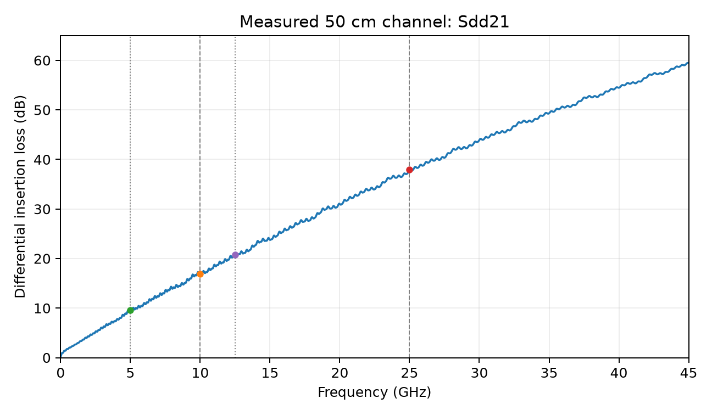
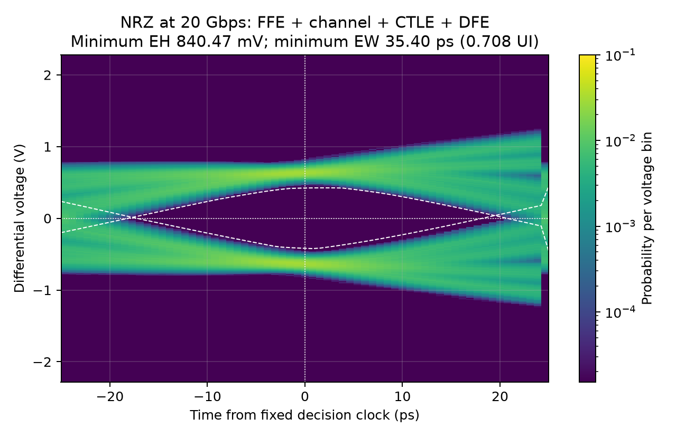
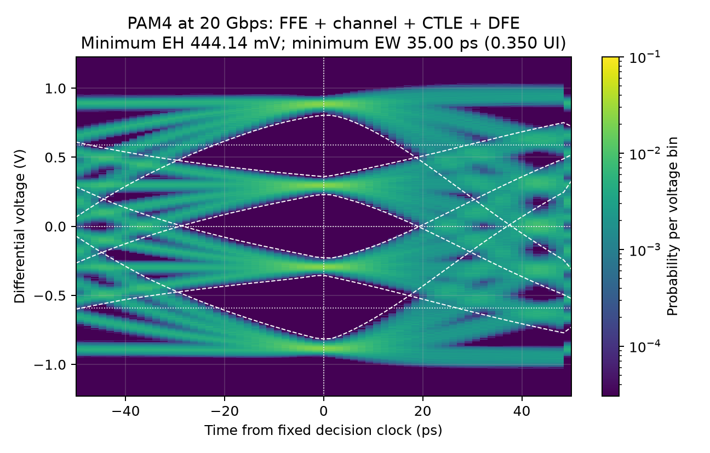
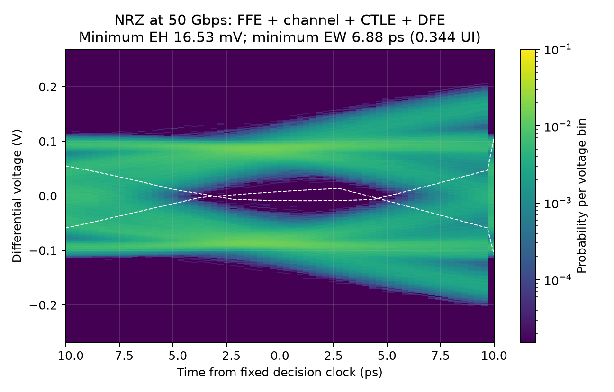
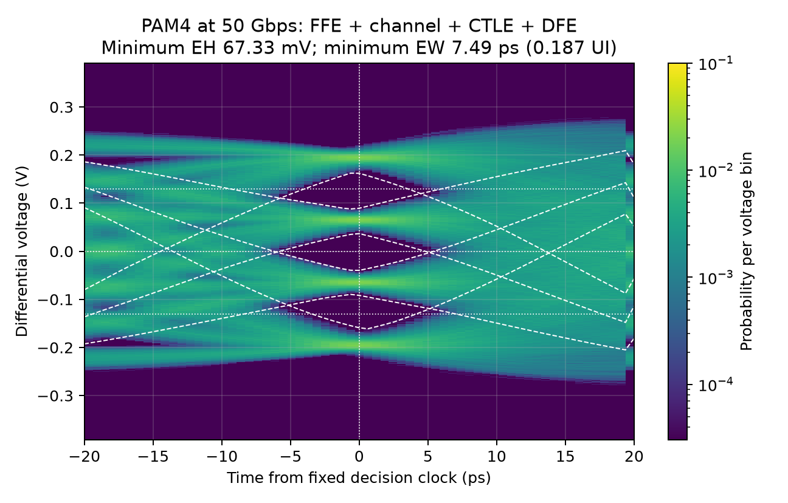

> NUMERICAL EXPERIMENT / ANONYMOUS REPORT

# NRZ versus PAM4

## Same information rate, different channel demands

This experiment compares two-level NRZ and four-level PAM4 over the supplied
50 cm differential channel. The route contains 40 cm of differential stripline,
10 cm of differential microstrip, and distributed parasitic elements.
The four required final eye diagrams use FFE, the measured channel, CTLE, and
decision-feedback equalization at two information rates.

| Bit rate | NRZ EH (mV) | PAM4 EH (mV) | NRZ EW (ps) | PAM4 EW (ps) |
| --- | --- | --- | --- | --- |
| 20 Gbps | 840.467 | 444.136 | 35.401 | 35.001 |
| 50 Gbps | 16.532 | 67.334 | 6.883 | 7.490 |

At 20 Gbps, NRZ has the larger worst eye height, and NRZ has the larger worst eye width in ps. At 50 Gbps, PAM4 has the larger worst eye height, and PAM4 has the larger worst eye width in ps. These statements describe the finite recorded experiment
under the settings below. Each PAM4 entry is the minimum of its three openings.
Eye width is compared in absolute ps; normalized UI values are also reported.

At 20 Gbps the eye-width ordering changes with the independent seed (NRZ 35.335 ps; PAM4 35.459 ps). The small baseline width advantage is therefore seed-sensitive; it is not a robust format advantage.

| Shared condition | Value / convention |
| --- | --- |
| Differential source | 1 Vpp open-circuit; levels centered on 0 V |
| Reference impedances | 50 ohm at each single-ended source/load port |
| Channel voltage transfer | Sdd21 / 2 (matched Thevenin source convention) |
| Transition duration | 10 ps, linear 0%-100% ramp for every level change |
| Sinusoidal jitter | 1.5 ps peak; 10 MHz; evaluated in absolute time |
| Random jitter | Gaussian, standard deviation 1 ps |
| Equalizer resources | 3 FFE taps; 5 DFE taps; CTLE with 1 zero and 2 poles |
| CTLE gain limit | 18 dB maximum absolute frequency-response magnitude |
| Transmitter FFE limit | Sum of absolute tap coefficients is 1 |
| Design clock stress | Nominal sampling phase and +/-3 ps; fixed DFE taps |
| Payload / random seed | 65,536 common information bits / seed 2025 |

PAM4 carries two bits per symbol, so at a fixed bit rate its symbol interval is
twice the NRZ interval. With the same source Vpp, the adjacent PAM4 voltage
spacing is one third of the NRZ spacing. The experiment tests whether lower
channel loss at PAM4's reduced symbol rate compensates for that vertical penalty.

<!-- pagebreak -->

## Channel and voltage conventions

Input ports are 1 and 3; output ports are 2 and 4. S-parameters use the convention
Sij = wave leaving port i / wave incident on port j. The forward differential
term is `Sdd21 = (S21 - S23 - S41 + S43) / 2`.

The waveform generator describes the open-circuit differential source voltage.
Matched 50 ohm source and load ports therefore give the voltage transfer
`Hchannel = Sdd21 / 2`. An ideal matched through connection consequently produces
half the open-circuit source voltage at the load. Keeping this factor explicit
prevents an unnoticed factor-of-two error in eye height.



| Bit rate | NRZ Nyquist loss | PAM4 Nyquist loss | Difference |
| --- | --- | --- | --- |
| 20 Gbps | 16.897 dB @ 10 GHz | 9.601 dB @ 5 GHz | 7.295 dB |
| 50 Gbps | 37.905 dB @ 25 GHz | 20.804 dB @ 12.5 GHz | 17.101 dB |

The source file spans 0 through 80 GHz on a 10 MHz grid. Its 100 ns inverse-transform
period limits the available unaliased delay record. A real Hermitian IDFT uses
the measured response directly and sets frequencies above 80 GHz to zero.
The causal kernel retains 40 ns, without DC renormalization.
Baseline waveforms use 64 samples per symbol UI;
the numerical sensitivity to both choices is checked separately. No hardware
measurement or new circuit-simulator result is claimed.

The retained loaded-channel kernel sums to 0.488032094,
compared with the full-record DC value 0.489063016.
This small truncation difference is retained rather than hidden by rescaling.

For rate Rb, NRZ uses Rs = Rb and PAM4 uses Rs = Rb/2. The symbol Nyquist
frequency is Rs/2; this is distinct from the first rectangular-pulse spectral
null at Rs. The lecture's approximate 9.54 dB differential-loss crossover is a
screening heuristic, not a substitute for the final eye comparison.

<!-- pagebreak -->

## Equalization and clock model

Equalizer coefficients may differ among the four cases, but all cases use the
same tap counts, CTLE pole/zero count, transmitter swing constraint and CTLE
absolute gain cap. Twenty CTLE candidates are combined with a conservative
worst-pattern linear program at the nominal sampling phase and +/-3 ps offsets.
DFE coefficients and midpoint thresholds stay fixed across these design offsets.
This is a finite robustness objective; it is not a bound on Gaussian jitter.
The design uses the noiseless channel response before the independent payload
is evaluated. The result is a reproducible finite design search, not a claim
of globally optimal transceiver performance.

| Parameter | NRZ 20G | PAM4 20G | NRZ 50G | PAM4 50G |
| --- | --- | --- | --- | --- |
| Symbol rate (Gbaud) | 20 | 10 | 50 | 25 |
| Symbol UI (ps) | 50 | 100 | 20 | 40 |
| Time step (ps) | 0.78125 | 1.5625 | 0.3125 | 0.625 |
| CTLE zero (GHz) | 8 | 8 | 2 | 1 |
| CTLE poles (GHz) | 10, 40 | 10, 40 | 20, 40 | 20, 40 |
| CTLE peak gain (dB) | 18 | 18 | 18 | 18 |
| CTLE DC gain (dB) | 17.1218 | 17.1218 | 1.50004 | -4.50421 |
| FFE taps | -0.042551, 0.95745, -0 | -0.014806, 0.8202, -0.16499 | -0.082428, 0.76242, -0.15515 | -0.03083, 0.96917, -0 |
| FFE L1 norm | 1 | 1 | 1 | 1 |
| DFE taps (mV) | 380.52, 166.63, 84.975, 49.443, 32.328 | 55.058, 27.174, 21.72, 9.8079, 14.161 | 56.983, 2.7637, -7.3645, -4.8636, -2.5657 | -6.6164, -37.401, -17.416, -7.6752, -3.2899 |
| DFE thresholds (mV) | 0 | -589.45, 0, 589.45 | 0 | -129.93, 0, 129.93 |
| Main cursor (mV) | 635.861 | 884.178 | 83.6435 | 194.898 |

The transmitter first applies its symbol-spaced FFE to the data levels. All
resulting level transitions are then placed on the jittered transmitter clock.
The same absolute SJ amplitude and RJ standard deviation are used for both
formats. Using a common percentage of UI instead would give PAM4 twice the
absolute timing error and would violate the assignment.

The differential PAM4 Gray levels, from low to high, represent 00, 01, 11 and 10.
DFE feeds back previously recovered decisions and uses three voltage thresholds
for PAM4 or one for NRZ. It does not replace recovered decisions with the known
transmitted payload. The receiver clock and thresholds are fixed from the design.
The feedback value for symbol n is held from half a UI before its clock through
half a UI after it; the right endpoint belongs to the next hold. This remains
causal because every feedback term uses a decision from at least one symbol earlier.

<!-- pagebreak -->

## Final NRZ eye at 20 Gbps

### 20 Gbaud; symbol UI 50 ps



| Measured opening | Eye height (mV) | Eye width (ps) | Eye width (UI) |
| --- | --- | --- | --- |
| 1 | 840.467 | 35.401 | 0.7080 |

All 65,536 retained symbols contribute to the measured boundaries. The receiver recovered 65,536 information bits with 0 observed bit errors and 0 symbol errors. The displayed eye is a histogram of the continuous held-feedback waveform; its measured boundaries use the full retained record.
<!-- pagebreak -->

## Final PAM4 eye at 20 Gbps

### 10 Gbaud; symbol UI 100 ps



| Measured opening | Eye height (mV) | Eye width (ps) | Eye width (UI) |
| --- | --- | --- | --- |
| 1 | 459.866 | 35.001 | 0.3500 |
| 2 | 457.298 | 47.339 | 0.4734 |
| 3 | 444.136 | 36.750 | 0.3675 |

All 32,768 retained symbols contribute to the measured boundaries. The receiver recovered 65,536 information bits with 0 observed bit errors and 0 symbol errors. The displayed eye is a histogram of the continuous held-feedback waveform; its measured boundaries use the full retained record.

Openings 1 through 3 run from the lowest to the highest threshold. Every opening must remain usable; selecting only the best eye would overstate the link margin.
<!-- pagebreak -->

## Final NRZ eye at 50 Gbps

### 50 Gbaud; symbol UI 20 ps



| Measured opening | Eye height (mV) | Eye width (ps) | Eye width (UI) |
| --- | --- | --- | --- |
| 1 | 16.532 | 6.883 | 0.3441 |

All 65,536 retained symbols contribute to the measured boundaries. The receiver recovered 65,536 information bits with 0 observed bit errors and 0 symbol errors. The displayed eye is a histogram of the continuous held-feedback waveform; its measured boundaries use the full retained record.
<!-- pagebreak -->

## Final PAM4 eye at 50 Gbps

### 25 Gbaud; symbol UI 40 ps



| Measured opening | Eye height (mV) | Eye width (ps) | Eye width (UI) |
| --- | --- | --- | --- |
| 1 | 67.334 | 7.664 | 0.1916 |
| 2 | 76.466 | 10.585 | 0.2646 |
| 3 | 72.659 | 7.490 | 0.1872 |

All 32,768 retained symbols contribute to the measured boundaries. The receiver recovered 65,536 information bits with 0 observed bit errors and 0 symbol errors. The displayed eye is a histogram of the continuous held-feedback waveform; its measured boundaries use the full retained record.

Openings 1 through 3 run from the lowest to the highest threshold. Every opening must remain usable; selecting only the best eye would overstate the link margin.

<!-- pagebreak -->

## Measurement definitions and finite-record evidence

Eye height is the finite-record separation between adjacent conditional voltage
envelopes at the receiver's design sampling phase. The upper extreme of the lower
symbol class is subtracted from the lower extreme of the next class. Negative
values indicate overlapping voltage distributions. No percentile trimming or
3-sigma opening is substituted for these extrema.

Eye width is the contiguous time interval around the sampling phase over which
the corresponding fixed decision threshold lies between those class envelopes.
Both ps and symbol UI are retained. PAM4's three eyes are checked separately;
the minimum opening is used for the format comparison.

| Case | Evaluated bits | Evaluated symbols | Bit errors | Symbol errors |
| --- | --- | --- | --- | --- |
| NRZ / 20G | 65,536 | 65,536 | 0 | 0 |
| PAM4 / 20G | 65,536 | 32,768 | 0 | 0 |
| NRZ / 50G | 65,536 | 65,536 | 0 | 0 |
| PAM4 / 50G | 65,536 | 32,768 | 0 | 0 |

The error counts come from recovered decisions matched to the transmitted
payload, including Gray decoding for PAM4. A zero count means no error was seen
in that record. It does not establish zero BER or demonstrate a 1e-12 BER target.
Gaussian timing jitter is unbounded, and finite-record extrema depend on record
length and seed. No receiver voltage noise, clock recovery, nonlinear device
effects or FEC is added to this model. The CTLE is an ideal linear gain stage;
receiver voltage rails and saturation are not modeled.

<!-- pagebreak -->

## Independent verification and sensitivity

The saved-artifact independent verification completed successfully. The independent unit-test suite passed 25 tests.

| Verification record | Outcome |
| --- | --- |
| unit test count | 25 |
| check count | 236 |

The independent baseline reconstruction generated 15,728,640 transmitter samples from analytic ramps, used a full complex IDFT and overlap-add convolution, and checked all 245,760 receiver decision inputs, including guards. Maximum decision-voltage disagreement was 2.01e-12 V. Conditional boundaries at every saved phase agreed within 2.29e-12 V, and all 156,000 histogram cells matched exactly. Separate checks cover odd-mode port excitation, source scaling, FFE shifts, recovered-decision feedback, Gray decoding and eye measurements.

| Case / perturbation | EH change (mV) | EW change (ps) | Bit errors |
| --- | --- | --- | --- |
| NRZ 20G / Seed 2026 | +30.0671 | -0.0652 | 0 |
| NRZ 20G / 128 samples/UI | +0.0115 | +0.0066 | 0 |
| NRZ 20G / 80 ns impulse | -0.1218 | +0.0038 | 0 |
| PAM4 20G / Seed 2026 | +9.9268 | +0.4580 | 0 |
| PAM4 20G / 128 samples/UI | -0.0506 | -0.0136 | 0 |
| PAM4 20G / 80 ns impulse | -0.1040 | -0.0024 | 0 |
| NRZ 50G / Seed 2026 | +4.6075 | -1.4530 | 0 |
| NRZ 50G / 128 samples/UI | +0.0050 | +0.0011 | 0 |
| NRZ 50G / 80 ns impulse | +0.0088 | +0.0056 | 0 |
| PAM4 50G / Seed 2026 | -2.1765 | -0.8308 | 0 |
| PAM4 50G / 128 samples/UI | +0.0075 | +0.0040 | 0 |
| PAM4 50G / 80 ns impulse | -0.0033 | +0.0001 | 0 |

All sensitivity runs freeze the equalizer coefficients and design clock; the time-grid study changes the numerical grid, and the impulse study changes the retained channel duration. The independent-seed study changes the random payload and jitter realization. Changes are reported relative to each baseline case. Seed sensitivity describes finite-record variability, not a deterministic discretization error. The sensitivity runs retain metrics rather than complete raw waveforms; the separate verifier checks their consistency, while the baseline has the saved numerical archives.

<!-- pagebreak -->

## Interpretation and reproduction

At 20 Gbps, NRZ has the larger worst eye height, and NRZ has the larger worst eye width in ps. At 50 Gbps, PAM4 has the larger worst eye height, and PAM4 has the larger worst eye width in ps. The physical tradeoff is between reduced bandwidth demand
and reduced separation of adjacent voltage levels. Channel loss and equalizer
constraints determine which effect dominates at a particular bit rate.
The measured results, rather than the 9.54 dB heuristic alone, support the
conclusion for this specific channel and model.

At 20 Gbps the eye-width ordering changes with the independent seed (NRZ 35.335 ps; PAM4 35.459 ps). The small baseline width advantage is therefore seed-sensitive; it is not a robust format advantage.

At 50 Gbps, PAM4 has the larger width in ps, while NRZ has the larger width in symbol UI. The distinction arises because PAM4's symbol interval is twice as long.

CTLE magnitude is bounded by the same absolute cap across cases. The source FFE
normalization keeps the emitted symbol range within the shared Vpp budget.
PAM4 is assessed by its weakest of three openings. These controls prevent an
unfair comparison through larger transmitted swing, extra equalizer complexity,
selective choice of the best PAM4 eye, or per-figure amplitude normalization.

### Reproduce from the repository root

```sh
python -m pip install -r homework/hw14/requirements.txt
python homework/hw14/verify_inputs.py
python homework/hw14/src/hw14.py --validation
python -m unittest discover -s homework/hw14/tests -v
python homework/hw14/tests/verify_results.py
python -m pip install -r homework/hw14/report/requirements.txt
python homework/hw14/report/build_report.py
```

The simulator resolves its input paths relative to its own homework directory
and runs without an interactive plotting window. The result archive retains
the settings and numerical arrays required by the independent verifier.
This report is regenerated from the recorded JSON and figures rather than
manually entered measurement tables.

### Sources and provenance

[1] Supplied HW14 assignment, `instructions/HW14_NRZ_vs_PAM4.pdf`, pages 1-4.
[2] Supplied `instructions/HW14_diff_channel_50cm.s4p`.
[3] Course handout 15, PAM4, pages 2-5 and 8-11, for symbol rates, Gray encoding,
three eye openings, spectral comparison, the empirical loss rule and PAM4 DFE.
[4] N. Dikhaminjia et al., "High-speed serial link challenges using multi-level
signaling," IEEE EPEPS, 2015, as cited by the assignment.

The supplied assignment is preserved. Personally identifying export comments
were removed from the channel copy; its numerical data were preserved exactly
and checksums are recorded in `instructions/input_manifest.json`. This report,
its figures and its metadata do not identify a student or contributor.
